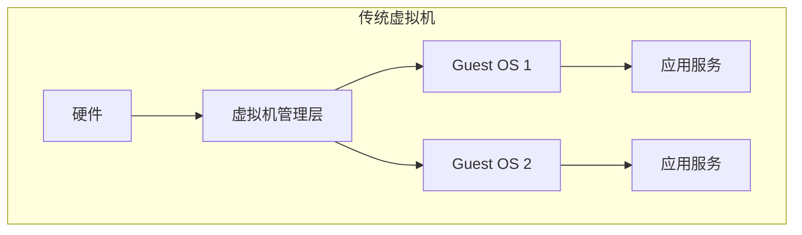
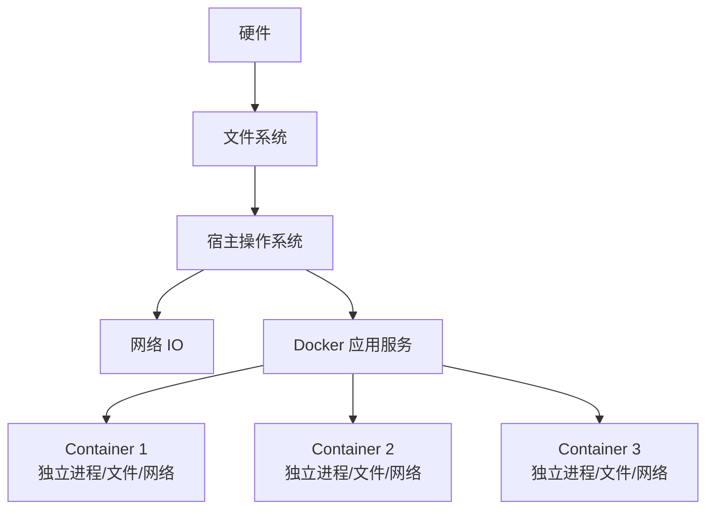
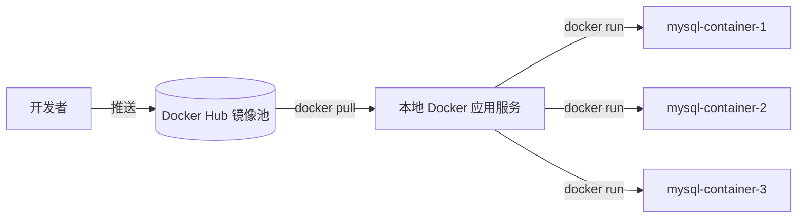
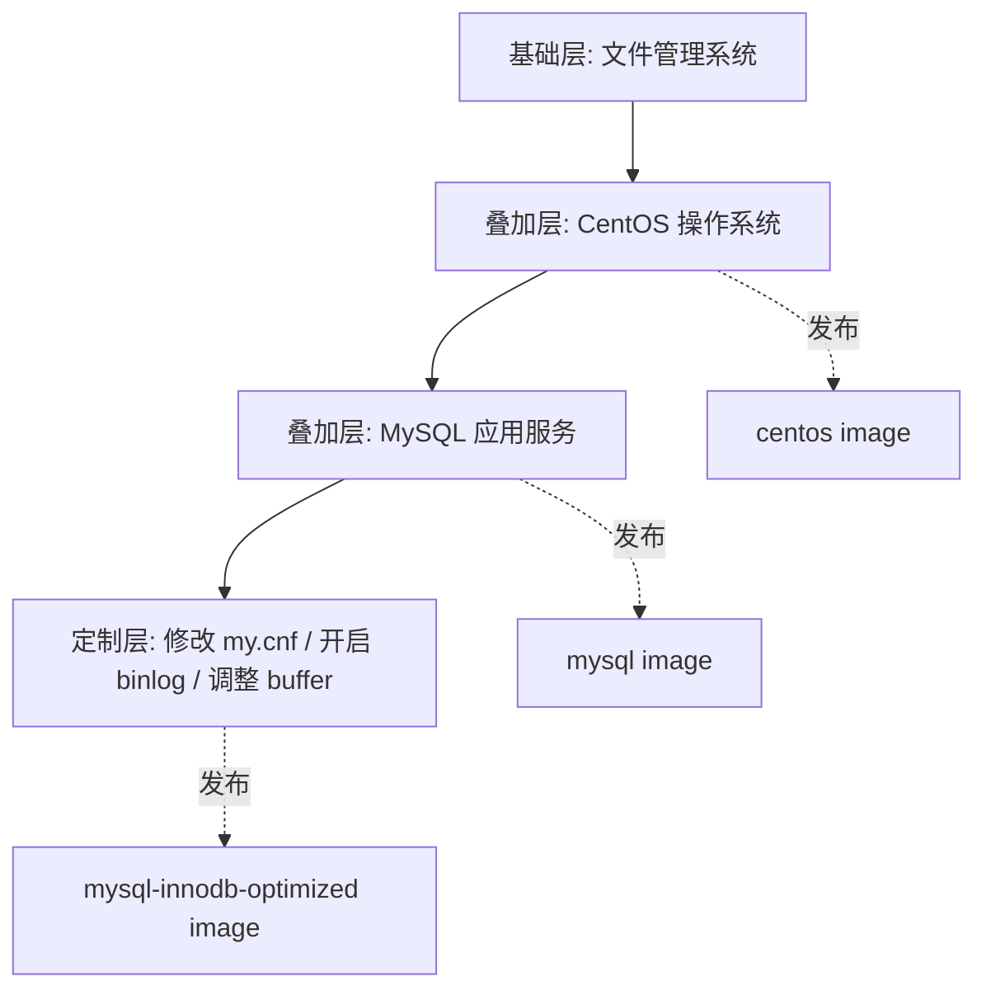

## 纲要

- 为什么全篇课程都用 Docker 部署存储中间件
- Docker 的本质：一个能做到进程、文件、网络资源隔离的应用程序
- 与传统虚拟机的对比：虚拟化层级不同
- Image 与 Container：镜像池、拉取、启动
- 镜像分层叠加：为什么 Docker 可扩展、可定制
- Docker 带来的运维收益：环境干净、可重建、节省资源

## 📎 代码说明

本讲为**原理 / 架构**篇，正文以推演与图示为主，无配套代码片段；本章课件源码中亦无对应类文件。

## 为什么用 Docker 部署存储

课程中要接触关系型与非关系型的各种数据库版本。相比手动在机器上逐个部署，Docker 有天然的运维优势：

- **资源与环境隔离**：可以快速部署存储服务。
- **屏蔽操作系统差异**：同一份镜像在 Windows、Linux、macOS 上表现一致。
- **运维成本最低**：把不同数据库存储服务带来的运维负担降到最低。

一句话：**用 Docker 部署存储，成本最低、环境最干净、可随时重建**。

## Docker 的本质

Docker 本质上是一个**应用层的程序**，但它可以在不同的 Docker 应用内部做到**进程、文件、网络资源的隔离**。

进程、文件、网络资源是任何应用程序赖以运行的生命周期中不可或缺的一部分。假设在应用层程序中能把这三件事完全隔离，就等于**完全虚拟化掉了整个运维环境**。

### 与传统虚拟机的对比

传统 VM 的做法是：直接在硬件之上部署另一套操作系统，替代掉原有的操作系统、文件系统与网络管理层，应用服务直接跑在虚拟机之上。

这种方式代价很高：虚拟主机完全替代了原本操作系统对文件系统的访问、对网络的存取等系统级权限，每一台虚拟机都要背负一整套操作系统。

Docker 走了另一条路：

关键差异在于：**Docker 运行环境本身就是一个应用服务程序**，它跑在宿主操作系统之上；基于这个 Docker 应用服务，再构建出 Container 的概念。

Container 的定义是：**Docker 基于某一个镜像启动的、Docker 内部的运行程序**。不同 Container 之间，完全类似于使用隔离进程 + 隔离文件系统 + 隔离网络的环境对外提供服务能力——每个 Container 都拥有自己的文件系统、网络与进程运行时环境。

因此在本机只装一个 Docker 应用服务，就可以起任意多个 Container，每个 Container 可以有自己的操作系统文件系统与网络 IO 管理权限，且进程资源互相隔离。比如：

- 一个 Container 跑基于 Linux 的 Nginx；
- 一个 Container 跑基于 Windows 的 SQL Server；
- 一个 Container 跑基于 CentOS 的 MySQL。

## Docker 带来的运维收益

| 收益 | 说明 |
| --- | --- |
| 环境干净 | 容器被搞坏或残留垃圾文件，删掉重建即可，不影响其他容器 |
| 不污染宿主机 | 删除容器不会影响原本主机的操作系统 |
| 可重建 | 开发环境的残留配置文件、历史问题，删掉重建就能彻底消除 |
| 节省资源 | 一台硬件服务器 + 一种操作系统，即可同时承载 Nginx、Tomcat、MySQL 等多种服务 |

对运维同学来说最有价值的一点是：**搭建开发环境时，别人机器上残存的配置文件到底在哪、之前出过什么问题，这些都可以不去追究——删掉重建即可**。

## Image 与 Container

Container 是基于什么启动起来的？答案是 **Image（镜像）**。

类比 Maven 的中央仓库，Docker 也有一个中央服务器管理系统——**Docker Hub**，相当于一个镜像池：

1. 全世界的开发者都可以把自己构建的镜像发布到 Docker Hub。
2. 使用者只需要指定镜像名，就可以把镜像拉取到本地的 Docker 应用服务内。
3. 拉取下来的 `mysql` image 内部已经包含了运行 MySQL 所需的操作系统、安装了 MySQL 应用的文件系统，以及配置好的网络 IO 端口。
4. 通过 `docker run` 命令，把一个 image 启动成 Container；**同一个 image 可以启动多个 Container**，它们各自是三个完全独立的 MySQL 进程，拥有独立的操作系统文件系统权限与网络 IO。

于是 MySQL 的部署变得非常清爽、干净、便捷：想再起一个，一条命令即可。

## 镜像的分层叠加

Image 之所以便于开发者利用和扩展，归功于 **Docker 镜像的文件叠加机制**。

理解起来很简单：

- 最早的镜像可能只有很薄的一层——一个普通的文件管理系统。
- 开发者在这之上叠加 CentOS 操作系统的功能，这个 image 就可以作为 `centos` 镜像发布到 Docker Hub；使用者拉下来启动 Container，就得到一个装了 CentOS 的运行环境。
- 另一位开发者基于 CentOS 叠加 MySQL 应用服务——所谓"叠加"，其实就是把 MySQL 的应用程序装载到 CentOS 对应的文件系统内，然后将两块整体打包成一个大的文件系统镜像发布。
- 于是这个 image 就变成了 `mysql` image。

**Docker image 支持以文件系统维度叠加文件的应用能力**，这就打开了定制化的空间。

### 自己也成为开发者

假设拿到 `mysql` image 后仍不满足需求：要配置基于 binlog 的访问，或者修改 MySQL 配置属性，把 InnoDB buffer 默认参数从 300 改成 500。

做法是：在这个 image 之上修改 `my.cnf` 之类的配置文件（因为文件系统层次内部是可以叠加的），打包定义出自己的 `mysql-image-innodb-optimized`。此时你自己也成为了一名开发者，通过 Docker Hub 的开发者认证后即可推送上去。其他使用方只要拉取这个优化过的版本，就能启动成自己的 Container。

正是这种机制，让 Docker 应用服务真正做到**开发者可定制化**。

## Docker 基本能力总结

- **资源隔离**：Docker 服务本身是一个应用程序，但在它内部的不同 Container 之间，可以真正做到模拟不同的进程、不同的文件以及不同的网络操作系统资源的隔离。
- **镜像与容器**：开发者可以从 Docker Hub 镜像池拉取镜像文件，镜像在本地 Docker 应用中启动后变成 Container——Container 才是真正对外提供服务能力的东西。
- **可扩展定制**：Docker 的 image 可以基于 FS 文件操作系统做叠加与改造，因此可以非常方便地把 Docker 做成可扩展式的应用。

## 小结

Docker 解决的是"部署存储服务的运维成本"问题：用进程 / 文件 / 网络三层隔离替代重量级的虚拟机，用镜像池解决分发，用分层文件系统解决定制。理解这三点，后续用它部署 MySQL、Redis、Elasticsearch、HBase 等各种存储时，就只需要关心镜像名与端口映射两件事。
