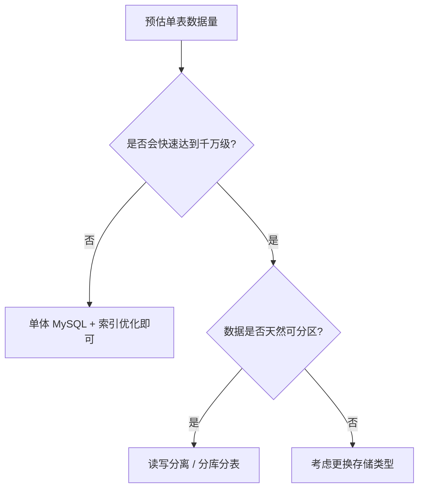

## 纲要

- 选型视角
## 📎 代码说明

本讲为**原理 / 架构**篇，正文以推演与图示为主，无配套代码片段；本章课件源码中亦无对应类文件。

## 正文

### 为什么 MySQL 能成为互联网的默认选择

存储选型最容易被误解成"性能参数对比"。实际上，一个数据库能否被广泛采用，取决于三点：**能力是不是够通用、有没有兜得住关键场景的杀手锏、出问题后有没有人帮你兜底。** MySQL 恰好把这三点都占齐了。

#### 完整的 SQL 标准实现

MySQL 与所有关系型数据库一样，用 SQL 标准语句完成关系型数据的存取。别小看这一点——它意味着：

- 可以用多表 `JOIN` 表达实体间关系，而不是在应用层拼装；
- 可以用 `GROUP BY`、`HAVING` 等关键字完成复杂的分析类查询，而不是把所有数据拉到内存里算；
- 迁移成本极低，任何支持 SQL 的关系库之间，语义基本对等。

就当前的互联网工程实践而言，**只有 SQL 语句性能满足不了的场景，几乎没有 SQL 语义表达不了的需求**。这就是 MySQL 最大的优势，也是关系型数据库至今无法被彻底替代的原因。

#### InnoDB 的事务 ACID 能力

MySQL 在 InnoDB 存储引擎上提供了完整的事务支持，保证了 ACID 特性。凡是涉及核心数据不能出错的场景——尤其是"跟钱相关的"交易、下单、支付链路——都会被要求使用具备事务 ACID 保障的存储。

可以用一个判断标准来划界：

| 数据特征 | 是否必须事务保障 | 典型案例 |
| --- | --- | --- |
| 与资金/库存余额直接相关 | 必须 | 下单扣库存、支付状态变更 |
| 丢失或错乱会导致业务不可解释 | 必须 | 订单状态机、优惠券核销 |
| 可重放、可幂等、允许短暂不一致 | 非必须 | 浏览记录、埋点日志 |

#### 开源社区带来的完备解决方案

需要澄清一件事：**MySQL 的社区方案完备，并不代表 MySQL 数据库本身在性能上能压过 Oracle。** 商业数据库在单机稳定性、优化器成熟度上依然有优势。真正的差别在于开源带来的可扩展性。

阿里的演进路径很有代表性：

1. 早期使用 Oracle 承载电商核心；
2. 随着流量增长，每年投入的数据库运维与硬件成本远超预期；
3. 转投 MySQL，通过钻研源码摸清内部实现并进行定制化改造；
4. 反向贡献社区，沉淀出读写分离、分库分表等成熟方案；
5. 最终用分布式 MySQL 方案扛住双十一、双十二的高并发流量。

这条路径证明了：**MySQL 可以在廉价的硬件环境上获得接近 Oracle 的性能与稳定性**，前提是你要掌握它的内部原理并做定制。这也是众多开发者偏爱 MySQL 的根本原因——它给了你"掀开盖子改"的权利。

### MySQL 绕不开的三个短板

优势说得再好，做选型时真正决定架构走向的往往是劣势。

#### 行级读写的性能瓶颈

如果不针对硬件和配置做专项优化，MySQL 单表数据量达到**千万级别**后，读写性能会出现明显的退化。这个数量级是行级数据操作的硬约束。

因此业务选型时必须做一个前置判断：

如果可以预见到单表存取会非常快速地达到千万级，就必须提前规划分布式方案；如果数据本身不适合分片，那更诚实的做法是考虑换存储，而不是硬扛。

#### 固定表结构导致的灵活性缺失

关系型数据库天然需要固定的表结构，就像操作 Excel 一样，每一列都要先定义清楚。这带来两个问题：

- **DDL 成本高**：对线上已有大量数据的表执行 `ALTER TABLE`，往往会产生锁表操作，运维复杂度和风险都很高；
- **语义负担重**：应用必须为每一个字段明确定义语义，字段一旦落到表里就很难调整含义。

互联网研发中常见的折中手段是预留扩展字段，例如加一个 `extra` 大字段，用序列化后的内容应对各种扩展性需求，从而避免频繁修改表结构。这本质上是用"可读性下降"换取"变更速度提升"，也正是 MySQL 与 MongoDB 这类不需要提前定义表结构的文档型数据库之间最大的差别。

#### 分布式方案自身的矛盾

MySQL 的分布式方案不可谓不完备，但每一套方案都有对应的代价：

| 方案 | 解决什么 | 引入什么问题 |
| --- | --- | --- |
| 读写分离 | 读压力横向扩展 | 主从延迟，读不到最新写入 |
| 分库分表 | 单表容量与写压力 | 跨库读写无法用事务保证一致性，需应用层兜底 |

所以"分布式方案完备"其实是一个矛盾的说法——**它提供的是在一致性与规模之间做取舍的工具集，而不是免费的午餐。** 存储选型的本质，就是选择愿意为哪一类问题买单。

### 优劣势对照总表

| 维度 | 优势 | 劣势 |
| --- | --- | --- |
| 语言能力 | 完整支持 SQL 标准，多表 JOIN、复杂分析查询 | — |
| 数据可靠性 | InnoDB 提供事务 ACID | — |
| 生态 | 开源社区活跃，读写分离/分库分表方案成熟 | 需源码级定制才能发挥极限 |
| 性能 | 廉价硬件上可媲美商业库 | 单表千万级后出现明显瓶颈 |
| 模型 | 结构清晰、语义明确 | 固定表结构，`ALTER TABLE` 成本高 |
| 扩展性 | 有成熟分布式方案 | 主从延迟、跨库事务需应用层兜底 |

## 小结
