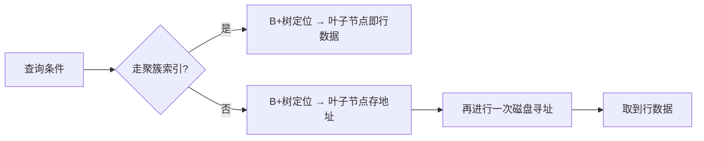

## 纲要

- 索引的两套分类
## 📎 代码说明

本讲代码以**内联片段**形式呈现在正文中。本章课件源码（`code/socialecom/第三章代码/`）中无正文直接引用的类文件，故不做文件级关联，请以正文片段为准。

## 正文

### 先分清两套索引分类

在工作里谈论"索引"时，其实混用了两套分类标准，必须区分清楚。

**第一套：按业务属性分**——唯一索引与非唯一索引，唯一索引里又分成主键索引和真正意义上的非主键唯一索引。这套分法用于判断"我用哪个条件查询最快""这条语句加的是行锁还是间隙锁"。

**第二套：按存储形态分**——聚簇索引（也叫聚集索引）与非聚簇索引（非聚集索引）。这套分法对应的是数据在内存/磁盘里真实的组织结构。两种叫法完全等价，只是不同教材的译名差异。

### 聚簇索引为什么一张表只能有一个

聚簇索引（Clustered Index）指的是：**索引的数据和索引背后对应的真实行数据存放在一起的索引结构。** MySQL 中默认的主键就是聚簇索引。

由此立刻能推出两个结论：

- 一张表**只能有一个聚簇索引**，但可以有无限多个非聚簇索引。
- 原因很朴素：如果聚簇索引有多个，数据就不知道该跟着哪一个走了。

同样可以理解为什么聚簇索引比非聚簇索引快：

- 主键索引（聚簇）命中后，数据就在叶子节点上，直接取走；
- 非主键的唯一索引虽然查询复杂度同样是 O(1)，但它记录在叶子节点上的是**真实数据的内存地址**，还需要根据这个地址再做一次磁盘路由。



那次额外的磁盘路由一旦命中 IO，开销就非常可观。这就是为什么非主键唯一索引会比主键唯一索引"慢上一个数量级"。

> 设计层面的结论很直接：**尽可能使用聚簇索引（也就是 ID 主键）去做查询，尽可能少用非聚簇索引做查询。**

### 五项索引优化原则

索引优化有五条必须遵守的原则。用不好索引，MySQL 的存取性能会是灾难性的；但用好了，也仅仅只是达到"合格"的标准。

#### 全值匹配原则

如果 `SELECT` 的 `WHERE` 条件里有三个字段，最好把这三个字段共同组成一个**联合索引**。如果是 `WHERE` 某字段 + `ORDER BY` 另一字段，也应尽量把这两个条件一起组成联合索引。

原因在于 B+ 树结构天生有序：当联合索引中的 `WHERE` 字段定位到树的某个位置后，第二级的 `ORDER BY` 字段在这个子树里天然已经排好序了，**不需要再把数据取回内存做一次排序**。

```sql
-- where a,b,c 三个条件 -> 建联合索引
CREATE INDEX idx_item_search ON item (seller_id, category_id, brand_id);

-- where 条件 + order by -> 一起进联合索引
CREATE INDEX idx_item_list ON item (category_id, update_time);
```

#### 最左原则（最左前缀）

联合索引里，要把 `WHERE` 条件最左边的那个字段当作真正能被使用的索引条件。如果索引建的顺序是 `(A,B)`，而查询条件写成了 `WHERE B = ? AND A = ?`，这条索引是**命中不了**的。

虽然 MySQL 最新的查询优化器已经会把这类语句在内存里改写成 `A = ? AND B = ?`，但我们写的代码要能跑在任何 MySQL 版本上，**最左原则到今天依然没有过时**。

额外一条衍生约束：**慎用 `OR`。** 一旦查询条件里出现 `OR` 而不是 `AND`，之前的联合索引就会失效。遇到 `OR` 应尽量拆成多个子查询用 `UNION` 拼接：

```sql
-- 索引失效
SELECT * FROM item WHERE category_id = 1 OR brand_id = 2;

-- 命中索引，语义等价
SELECT * FROM item WHERE category_id = 1
UNION
SELECT * FROM item WHERE brand_id = 2;
```

#### 不对索引列做转换操作

这是一类极其隐蔽、线上非常致命的问题。常见情形包括：对索引列施加函数、做字符串转换、多做一次类型转换等。

最典型的例子：索引列明明是 `INT`，查询时却给值加了引号。这条 SQL 能正常执行，但 MySQL 会认为数据被做了字符串转换，**无法用 INT 的索引树做等值比较，索引直接失效**。

```sql
-- 索引失效：id 是 BIGINT，却传了字符串
SELECT * FROM item WHERE id = '1';

-- 正确写法
SELECT * FROM item WHERE id = 1;
```

这类问题的可怕之处在于**它不会报错**。在使用 ORM 时，你永远不知道哪个条件被拼成了字符串灌进了查询里。在 MyBatis 的 XML 里把类型写错，是这条原则最常失守的地方。

#### 尽可能使用覆盖索引

大家都听过"不要写 `SELECT *`"，但很多人以为这只是"少查一点字段"。更重要的是**能不能命中覆盖索引**。

所谓覆盖索引，是指：**我要查询的数据完全命中了索引本身的要求，仅通过索引树的扫描和二分查找就能输出整个 SELECT 的结果，不需要回表。**

```sql
-- 索引: (seller_id, category_id, brand_id)
-- 覆盖索引：只查索引里已有的字段
SELECT id, seller_id, category_id, brand_id FROM item WHERE seller_id = 1;

-- 需要回表取值
SELECT * FROM item WHERE seller_id = 1;
```

最典型的覆盖索引场景是：先 `SELECT id`（主键就在二级索引叶子节点上），再通过这些 id 走聚簇索引扫描拿到最终数据。

#### JOIN 操作：小表驱动大表

复杂 JOIN 是关系型数据库最大的魅力，也是最大的性能杀手。使用 JOIN 时必须遵守：**把数据量小的一方作为驱动表放在 JOIN 条件左边，数据量大的放右边。**

用"小表驱动大表"可以减少大量无效的 JOIN 与查询次数。

### 用 explain 验证索引到底用没用

即使遵循了上述原则，有时查询耗时依然不如人意。这时候就要用 `EXPLAIN` 把 InnoDB 具体怎么使用索引给打印出来。

```sql
EXPLAIN SELECT * FROM item WHERE seller_id = 1;
```

`EXPLAIN` 结果里关注 `type` 列，它的优劣梯度如下表：

| type | 含义 | 可接受程度 |
| --- | --- | --- |
| `ALL` | 全表扫描 | 最不能接受，完全没走索引 |
| `index` | 全索引扫描 | 走了索引但无范围限制，效率依然差 |
| `range` | 索引范围查询 | 范围查询的底线，必须命中这一档 |
| `ref` | 非唯一索引等值查询 | 比较可接受，是等值查询的保底目标 |
| `eq_ref` | 唯一索引 / 主键等值查询 | 优秀，千万级数据下追求这一档 |
| `const` / `system` | 常量级查询 | 实战中出现频次较低 |

优化目标可以量化为一句话：

> **不得已要用范围查询时，至少命中 `range`；其它查询条件保底要打到 `ref`；做千万级数据查询时，尽可能使用 `eq_ref` 级别的唯一索引条件。**


### 五项原则速查

| 原则 | 要点 | 典型反例 |
| --- | --- | --- |
| 全值匹配 | WHERE / ORDER BY 字段组成联合索引 | 单字段各建一个索引 |
| 最左前缀 | 联合索引必须从最左字段开始用 | `(A,B)` 索引用 `WHERE B = ?` |
| 禁止列转换 | 索引列不能参与函数或类型转换 | `WHERE id = '1'` |
| 覆盖索引 | 只查索引已包含的字段 | `SELECT *` |
| 小表驱动大表 | 数据量小的表放 JOIN 左边 | 大表做驱动表 |

## 小结
