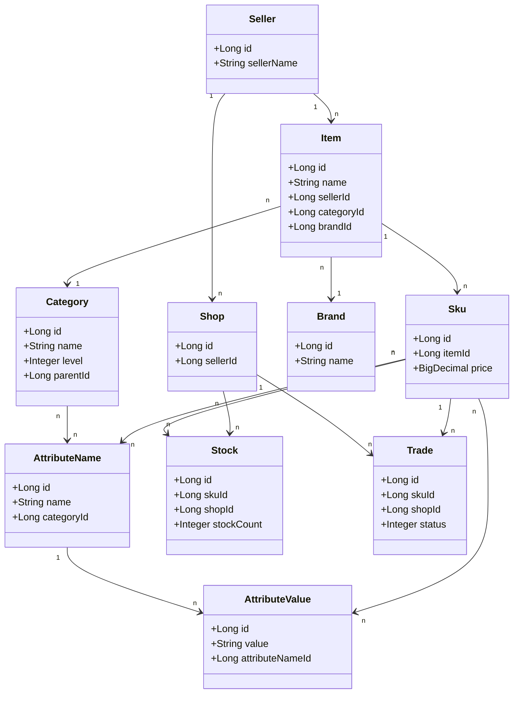

## 纲要

- 领域模型的根节点：商家（商家入驻 → 开店）
- 左侧运营体系：商家 → 商品 → 品牌 / 类目 / 属性库
- 中部发布体系：商品 → SKU → 门店 → 库存
- 右侧交易体系：订单与门店、SKU 的关联关系
- 新零售与传统电商在库存模型上的根本差异
- 领域模型与数据库表结构设计的差异对照

## 📎 文本↔代码关联

本讲对应课件源码（去品牌化副本，位于 `code/socialecom/`；包名已由原占位包名统一改写为 `com.social.ecom`）：

| 代码文件 | 正文提及 | 职责 |
| --- | --- | --- |
| `code/socialecom/第三章代码/socialecom/src/main/java/com/social/ecom/pojo/Item.java` | 6 次 | 实体类，主键 `IdType.AUTO` 自增，含自动填充时间字段 |
| `code/socialecom/第三章代码/socialecom/src/main/java/com/social/ecom/pojo/Shop.java` | 5 次 | 实体类，主键 `IdType.AUTO` 自增，含乐观锁 `version` 字段，含自动填充时间字段 |
| `code/socialecom/第三章代码/socialecom/src/main/java/com/social/ecom/pojo/AttributeName.java` | 5 次 | 实体类，主键 `IdType.AUTO` 自增，含自动填充时间字段 |
| `code/socialecom/第三章代码/socialecom/src/main/java/com/social/ecom/pojo/Category.java` | 4 次 | 实体类，主键 `IdType.AUTO` 自增，含自动填充时间字段 |
| `code/socialecom/第三章代码/socialecom/src/main/java/com/social/ecom/pojo/Seller.java` | 4 次 | 实体类，主键 `IdType.AUTO` 自增，含乐观锁 `version` 字段，含自动填充时间字段 |
| `code/socialecom/第三章代码/socialecom/src/main/java/com/social/ecom/pojo/Stock.java` | 4 次 | 实体类，主键 `IdType.AUTO` 自增，含自动填充时间字段 |
| `code/socialecom/第三章代码/socialecom/src/main/java/com/social/ecom/pojo/AttributeValue.java` | 4 次 | 实体类，主键 `IdType.AUTO` 自增，含自动填充时间字段 |
| `code/socialecom/第三章代码/socialecom/src/main/java/com/social/ecom/pojo/Brand.java` | 3 次 | 实体类，主键 `IdType.AUTO` 自增，含自动填充时间字段 |

## 新零售领域模型的全貌

新零售的整条链路从**商家**开始：先有商家，商家再开店，这个过程称为商家入驻。以商家为根节点，整个领域模型可以分为三块：左侧围绕运营体系，中部围绕发品与库存上架，右侧围绕订单交易。

## 左侧：运营体系与发品链路

### 商家与门店

商家到门店是一对多关系——一个商家可以开出多家门店。

### 商品是聚合体，不能独立售卖

商家到商品也是一对多。商品本身是**聚合商品详情内容展示的载体**，它不具备价格与库存这类可交易属性。要让商品进入交易环节，必须在其下发布 SKU，商品与 SKU 是一对多关系。

### 品牌与类目

除了商品名，商品背后还需要品牌与类目：

- **品牌**：商品被赋予的品牌属性，例如 iPhone 的品牌是 Apple
- **类目**：商品所处的品类路径，例如 iPhone 的类目是 3C 数码

一个品牌可以被多个商品使用，但某一个商品只能有一个品牌，因此商品到品牌是 n : 1；类目同理。

### 属性名与属性值

类目可以发布属性名与属性值。以 3C 类目为例，可以发布"尺寸"这个属性名，并在其下发布 3.5 寸、4 寸这样的属性值。不同类目之间可以限定不同的属性名与属性值——衣服的尺码和 3C 数码的尺码显然不是一回事，它们既可以共享同一套属性库，也可以完全区分开。

因此类目与属性名、属性名与属性值之间都是多对多的关系。

### SKU 与属性库

发布 SKU 时（例如 iPhone 4），需要为它绑定属性名与属性值：红色的 iPhone 4 与蓝色的 iPhone 4 是两个不同的 SKU，它们拥有不同的属性值组合。**SKU 与属性名、属性值之间同样是多对多关系**。

至此，左侧链路完成：商家开店 → 运营配置品牌、类目、属性库 → 商家发布商品 → 在商品下绑定属性组合发布 SKU。

## 中部：新零售独有的库存模型

这是新零售与传统电商最大的差异点。

传统电商没有门店概念，完全基于线上售卖，库存天然就是 SKU 上的一个计数值。而新零售的特点在于：**库存必须分配到不同门店去售卖**，因为发货履约能力是落在门店上的。

因此需要把 SKU 与门店共同组成一个多对多的关系，用库存实体承载 count 计数器：

- SKU → 库存：多对多（一个 SKU 可以分布在多个门店）
- 门店 → 库存：多对多（一个门店可以售卖多个 SKU）

用户最终看到的是"某一个门店中某个 SKU 还剩多少库存"。

## 右侧：订单交易体系

订单发生交易后，会落在对应的门店与对应的 SKU 上。在本项目的产品形态里，**一次只能购买一种 SKU，并且只能在单一门店内购买**，因此订单与门店是多对一关系，而不是像淘宝天猫那样一个订单可以包含多个 SKU 的多对多关系。

订单与 SKU 之间是"一个 SKU 可以被多个订单关联"的一对多关系。整个模型右半部分完全围绕订单的交易属性完成流程流转：下单 → 支付 → 取消。

## 领域模型与数据库设计的差异

这套模型看起来很像数据库的表结构 ER 图，原因在于关系型数据库的表结构设计与互联网领域的领域模型设计本就非常相似。但二者并不对等，差异体现在：

- **领域模型关注实体与实体之间的关联关系**，例如属性名与属性值的多对多关系，在领域视角就是一条直接的关联
- **数据库设计必须给出具体实现方案**，同样的多对多关系，在存储层需要引入一张中间关系表来承载

换句话说，领域模型站在业务视角描述"是什么关系"，数据库方案站在存储视角描述"怎么存这个关系"。做领域设计时如果过早陷入表结构，就会被存储细节绑住；做存储设计时如果忽略领域关系，表就会退化成没有语义的字段堆。

| 对比项 | 领域模型 | 数据库设计 |
| --- | --- | --- |
| 视角 | 业务与产品语义 | 存储与查询效率 |
| 关注点 | 实体之间的关联关系 | 表结构、外键、索引 |
| 多对多关系 | 一条实体间关联 | 需要额外的中间关系表 |
| 变更驱动 | 业务形态变化 | 数据量与查询模式变化 |

## 总结

新零售的领域模型可以概括为：左侧是商家、商品、品牌、类目、属性库构成的运营发品体系，中部是 SKU 与门店共同决定的库存分配体系，右侧是围绕订单的交易流转体系。其中"库存挂在 SKU × 门店上"是新零售区别于传统电商的关键设计。领域模型表达实体关系，数据库设计表达存储结构，二者互相映射但不等价——先想清楚前者，再动手做后者，模型才不会在迭代中失控。
