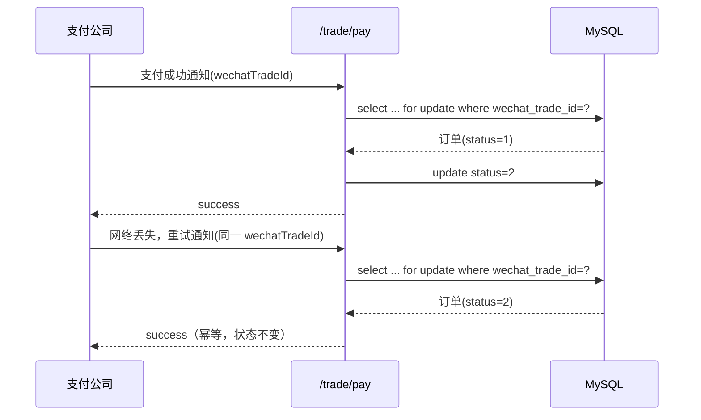

## 纲要

- 为什么支付回调必须做幂等
## 📎 文本↔代码关联

本讲对应课件源码（去品牌化副本，位于 `code/socialecom/`；包名已由原占位包名统一改写为 `com.social.ecom`）：

| 代码文件 | 正文提及 | 职责 |
| --- | --- | --- |
| `code/socialecom/第四章代码/socialecom/src/main/java/com/social/ecom/pojo/Trade.java` | 11 次 | 实体类，主键 `IdType.AUTO` 自增，含自动填充时间字段 |
| `code/socialecom/第四章代码/socialecom/src/main/java/com/social/ecom/base/JsonReturnType.java` | 4 次 | 统一 JSON 返回结构（code / message / data） |
| `code/socialecom/第四章代码/socialecom/src/main/java/com/social/ecom/controller/TradeController.java` | 3 次 | HTTP 接口层，路由前缀 `/trade`；端点：`/create`、`pay`、`cancel` |
| `code/socialecom/第四章代码/socialecom/src/main/java/com/social/ecom/service/TradeService.java` | 2 次 | `Trade` 业务服务接口 |
| `code/socialecom/第四章代码/socialecom/src/main/java/com/social/ecom/service/impl/TradeServiceImpl.java` | 2 次 | `Trade` 业务服务实现（继承 ServiceImpl） |

## 为什么支付回调必须做幂等

支付公司通知我们「某笔订单支付成功」时，需要订单系统明确答复成功还是失败。答复方式有两种：在 HTTP 的 response 里返回 `success` 关键字，或在 MQ 场景里用消费确认机制。

但「确认」本身也是一次网络往返，完全可能丢失——第三方支付公司没收到我们的 `success`，或 MQ 的 ACK 没被收到。一旦如此，支付公司会认定这次通知失败，于是**重推**同一条支付成功消息。

因此订单系统必须对支付成功通知做幂等：同样的预订单号又被通知一次时，要先确认订单当前状态——如果已经是支付成功，就绝不能再翻一次「支付成功」。否则同一个用户会被当成付了两次钱，导致给人家发两次货。

## 预下单字段与索引设计

原 `trade` 表没有承载「预支付订单号」的字段，前端也就无法拿到拉起微信收银台所需的预下单号。因此需要新增一个字段，并为其建索引——因为支付回调永远是用订单号（这里是预下单号）来关联数据的：

```sql
ALTER TABLE trade
  ADD COLUMN wechat_trade_id VARCHAR(64) DEFAULT '' COMMENT '第三方支付预下单号',
  ADD UNIQUE INDEX idx_wechat_trade_id (wechat_trade_id);
```

- 类型用 `VARCHAR` 而非数值，因为微信订单号本身就是字符串，兼容性更好。
- **唯一索引**：`trade` 订单号与 `wechat_trade_id` 是一对一关系，每重新生成一个订单就会重新生成一个预下单号；唯一约束保证按这个字段做 `select ... for update` 时锁定的就是那一行。

## createTrade 中完成预下单

在 `createTrade` 里，扣减库存、落库订单之后，还不能直接结束——需要去第三方支付公司预下单，把拿到的预下单号写回订单，前端才能凭它拉起收银台：

```java
@Override
@Transactional(rollbackFor = Exception.class)
public Trade createTrade(Trade trade) {
    // ... 加载 SKU、价格校验、扣库存、落订单（status=1）...

    // 去第三方支付公司预下单（此处用 UUID 模拟微信返回）
    String wechatTradeId = UUID.randomUUID().toString();
    trade.setWechatTradeId(wechatTradeId);
    updateById(trade);
    return trade;
}
```

这样下单一完成，订单里就带上了 `wechat_trade_id`，前端能拿到它去拉起微信支付收银台。

## 支付回调接口

订单系统需要对外提供一个供第三方支付回调的 HTTP 接口，本质只是组装：

```java
@RestController
@RequestMapping("/trade")
public class TradeController {

    @Autowired
    private TradeService tradeService;

    @RequestMapping(value = "pay", method = {RequestMethod.POST})
    @ResponseBody
    public JsonReturnType pay(@RequestBody Trade trade) {
        trade = tradeService.pay(trade);
        if (trade == null) {
            return JsonReturnType.createErrorType("支付失败");
        }
        return JsonReturnType.createType("success");
    }
}
```

约定：与微信网关的通信里，响应内容包含 `success` 即代表成功。

## pay 方法的落地

`pay` 的成败关键在于「怎么安全地读并改这一行订单」。完整实现：

```java
@Override
@Transactional
public Trade pay(Trade trade) {
    QueryWrapper<Trade> queryWrapper = new QueryWrapper<>();
    queryWrapper.eq("wechat_trade_id", trade.getWechatTradeId());
    queryWrapper.last("for update");
    trade = getBaseMapper().selectOne(queryWrapper);

    if (trade == null) {
        return null; // 数据不存在
    }
    if (trade.getStatus().intValue() == 2) {
        return trade; // 已支付成功：幂等返回，外部仍收到 success
    }
    if (trade.getStatus().intValue() == 3) {
        return trade; // 已取消：防御式返回（取消与支付并发的冲突在取消流程收口）
    }
    // status == 1：翻转支付成功
    trade.setStatus(2);
    updateById(trade);
    return trade;
}
```

三个关键决策：

**为什么用 `select ... for update` 而不是普通快照读。** 设想同一时刻外部有两个 `/trade/pay` 请求打进来，如果都不加锁直接读，两者读到的订单状态都是「待支付（1）」，然后各自把状态翻成「支付成功（2）」——这就是重复支付。悲观锁把这一行锁住，保证后续读改写串行，状态只会从 1 翻到 2 一次。

**为什么不用「先快照读、后 for update」的两段式。** 之前做库存累加时是先快照读再 `for update`，是为了规避「锁不存在行产生的间隙锁」。但这里不同：只要正常走过预下单，`wechat_trade_id` 一定存在，按唯一索引 `for update` 不会产生间隙，因此直接 `for update` 是安全的。

**`status=2` 返回的语义就是幂等。** 支付网关不关心我们内部状态到底是 1 还是 2，只要收到 `success` 就认为通知成功。所以对已支付的订单直接返回 `trade`，对外部而言就是一次成功的 `success`——这正是幂等操作的语义。

> 注：前述完整工程代码里，`status=3`（已取消）的分支会走一个 `exceptionPay(...,2)` 做「优先支付」的补偿（重新扣库存并翻转），属于取消与支付并发冲突的收口逻辑；本篇先按教学脉络把它作为防御式返回处理，完整的取消与支付并发在取消订单流程中闭合。

## 实测验证

启动应用，用 Postman 调用 `localhost:9090/trade/pay`，请求体只需要一个字段：

```json
{ "wechatTradeId": "此前下单返回的 UUID" }
```

- **第一次回调**：返回 `success`。查库，原 `status=1` 的订单变为 `status=2`（支付成功），`update_time` 被刷新。
- **假设支付公司再推一次**：仍然返回 `success`，但 `status` 没有再次翻转，`update_time` 也没有变化——说明操作被幂等住了。



## API 速览

| API / 字段 | 取值示例 | 说明 |
| --- | --- | --- |
| `trade.wechat_trade_id` | `UUID` 字符串 | 第三方预下单号，唯一索引，回调关联键 |
| `QueryWrapper#eq` | `eq("wechat_trade_id",...)` | 按预下单号定位订单 |
| `QueryWrapper#last` | `last("for update")` | 加行锁，防并发重复支付 |
| `Trade#getStatus` | `1 待支付 / 2 支付成功 / 3 已取消` | 状态机载体 |

## Demo 示例

**运行说明**

1. 执行 `ALTER TABLE trade ... ADD wechat_trade_id` 并建立唯一索引。
2. 先调用 `/trade/create` 完成下单，从返回体取 `wechatTradeId`。
3. 调用 `/trade/pay`，请求体带该 `wechatTradeId`，确认返回 `success` 且 `status` 变 2。
4. 再次调用 `/trade/pay`（同 `wechatTradeId`），确认仍返回 `success` 但 `status` 与 `update_time` 不变。

**代码说明**

- `createTrade`：预下单写入 `wechatTradeId`，使前端能拉起收银台。
- `TradeController#pay`：仅组装，把结果转成 `success` 关键字。
- `TradeServiceImpl#pay`：悲观锁锁行 + 防御式状态分支，核心是 `status=2` 的幂等返回。

**技术点总结**

- 支付回调的网络确认可能丢失并触发重推，订单系统必须幂等。
- 预下单号 `wechat_trade_id` 用字符串并加唯一索引，既是关联键也是锁行依据。
- 支付回调用 `select ... for update` 直接锁行，防两个并发通知造成重复支付。
- 唯一索引保证行一定存在，因此无需先快照读再 `for update`，不存在间隙锁顾虑。
- 幂等的正确实现是「已支付就返回成功但不再翻转状态」，而非「拒绝请求」。
