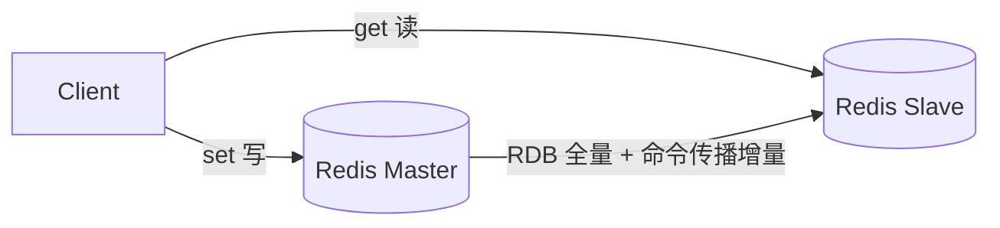
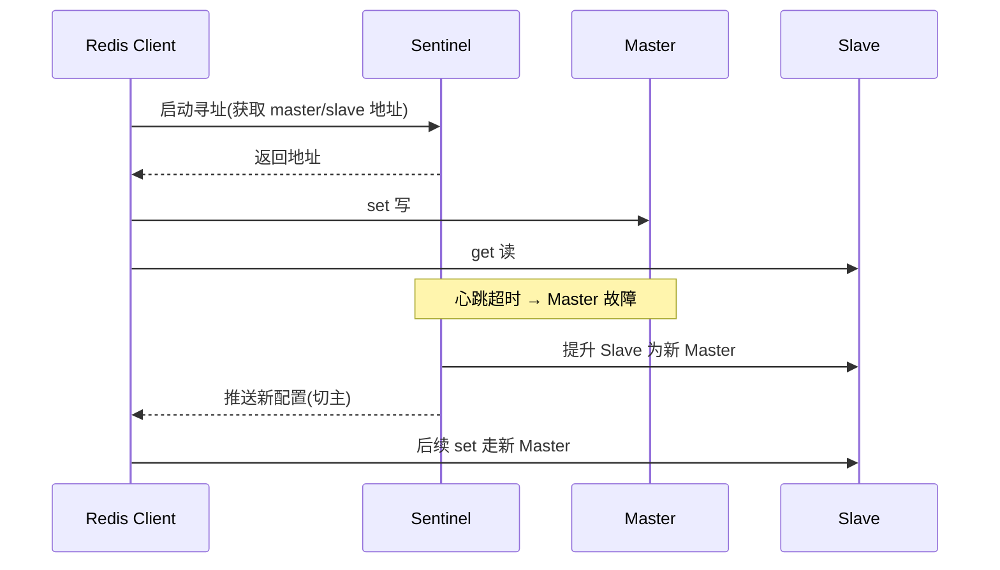

## 纲要

- Redis 四类分布式部署策略：主从、哨兵、Redis Cluster、基于 Cluster 源码改造的分片
- 单机模式：client 直连单节点，节点挂则全挂，存在单点问题
- 主从模式（Redis 2.0+）
## 📎 代码说明

本讲为**原理 / 架构 / 选型**篇，正文以图示与推演为主，无配套代码片段，课程课件亦未提供本章源码文件。

## Redis 为什么适合做分布式缓存

Redis 作为缓存与内存级数据库被广泛使用，核心原因之一是它的分布式策略强大，能适配各种场景，而且开源——不少公司在开源版基础上做了符合自身微服务的部署与升级。Redis 的分布式部署主要有四种：主从、哨兵、Redis Cluster，以及基于 Cluster 源码改造的分片部署。本篇先讲前三种。

## 单机模式：最简单的起点

最基础的用法是单机：Redis 客户端向单节点发送 `get` / `set`（例如 `set key value` 并设 1 秒超时），在单节点上做存取。

这种模式的缺陷很明显：单机一旦出问题挂掉，所有 `get` / `set` 都走这台机器，必然跟着出问题。这就是单点故障。

## 主从模式：读写分离的基础

Redis 在 2.0 以上版本就支持 master-slave 结构：把一台 Redis 设为 master，另一台设为 slave，启动后 slave 挂载在 master 上。

### 数据如何同步

- **首次全量同步**：master 把 RDB 文件传给 slave，slave 在自己的内存里回放，于是 master 的数据就到了 slave 上。
- **增量同步**：后续 master 上任何 `set` 等写命令，会被 slave 监听到并同样执行一遍（命令传播）。注意主从同步**不依赖 AOF**，只在首次依赖 RDB，之后的增量靠 master 把写命令转发给 slave 回放。

### 读写路由

采用主从结构后，`set` 写操作走 master，`get` 读操作走 slave（当然读也可以走 master，对 master 负载影响不大）。这样就能覆盖绝大部分单机房的读写分离场景。

主从的短板也很明确：如果 master 挂了，slave **无法自动切主**，系统就失去了写入能力。于是引入哨兵。

## 哨兵模式：自动切主

哨兵（Sentinel）是在主从之上增加的一个高可用方案。

- master 与 slave 照常启动，彼此之间通过 RDB 传输数据。
- 额外起一个 Sentinel 节点，同时与 master、slave 保持**心跳连接**，快速探测二者是否存活。
- client 启动时的第一步不是直连，而是先找 Sentinel **寻址**：从 Sentinel 拿到当前 master 与 slave 的地址，再据此直连。

一旦 master 发生故障，Sentinel 与 master 的心跳超时，而 slave 还活着，Sentinel 就修改内部配置，把 master 与 slave 互换——slave 升级为 master。由于 client 与 Sentinel 是长连接心跳，Sentinel 会反向把"已切主"的消息推送给 client，client 于是把最新的 slave 当作 master 去发 `set` 命令。等原 master 恢复后，Sentinel 感知到它，会把它降级为 slave，继续提供服务。

哨兵设计的本质，非常像微服务框架里的**注册中心**：需要一个中央管控节点，做服务注册与发现；用心跳机制做健康探测；以心跳结果为依据管理"谁活谁死"，联动做切换，并把切换结果推送给 client，让 client 通过切换直连新的 master/slave 结构。

## 四类策略对照

| 策略 | 高可用 | 自动切主 | 典型用途 |
| --- | --- | --- | --- |
| 单机 | 否 | 否 | 开发、极简场景 |
| 主从 | 部分（slave 有数据） | 否 | 读写分离，单机房 |
| 哨兵 | 是 | 是 | 主从之上的自动故障转移 |
| Redis Cluster | 是 | 是（分片 + 副本） | 大规模分布式，数据分片 |

本篇详述了单机、主从、哨兵三种；Redis Cluster 与基于其源码改造的分片部署，是应对更大规模与数据分片的方案。

## 技术点总结

- 主从同步：首次 RDB 全量，之后写命令传播增量（不依赖 AOF）。
- 主从读写分离：写 master、读 slave；短板是 master 挂了不能自动切主。
- 哨兵在主从上加一层心跳监控与自动切主，并把新配置推给 client，类比注册中心。
- 选型的递进：单点 → 主从（读写分离）→ 哨兵（自动故障转移）→ Cluster（分片）。
