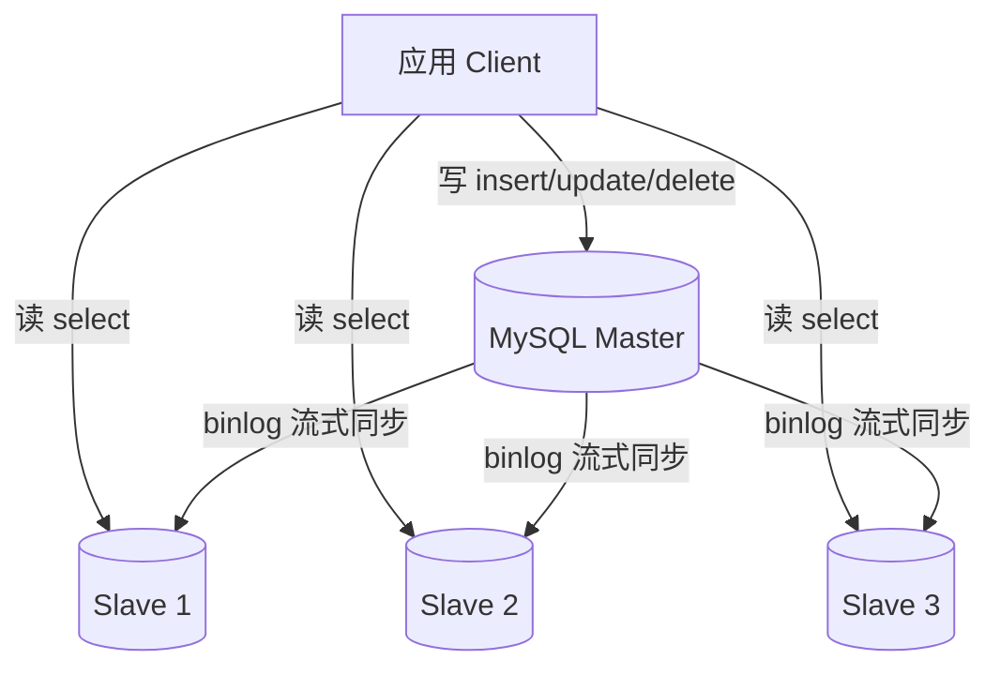
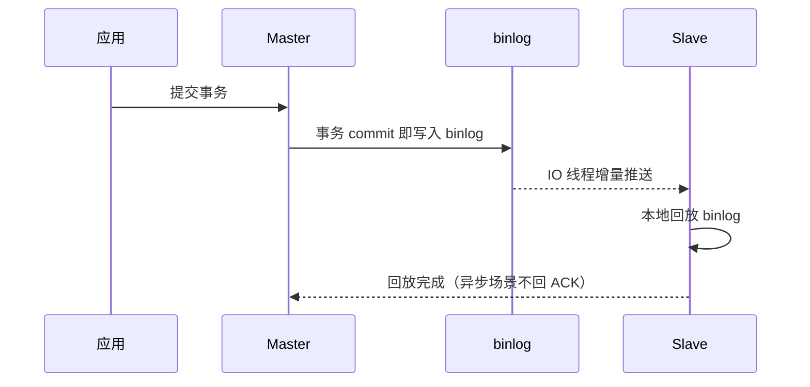
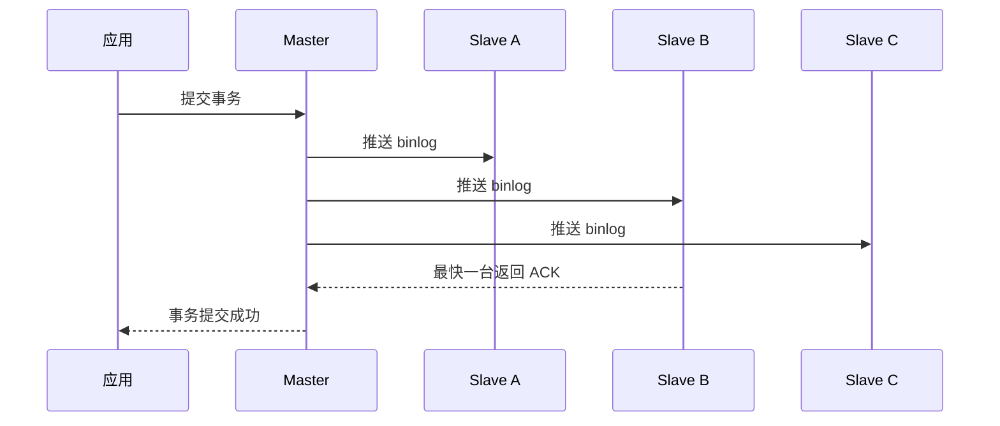

## 纲要

- 读写分离的本质：主库（master）承担所有写，从库（slave）承担读；把读流量从单点主库卸载到多台从库，读 QPS 随从库数量线性放大
- 数据通路靠 binlog：主库把所有写操作（insert/update/delete）记入二进制日志，再流式推送给各 slave 做本地回放，实现最终一致
- binlog 写入时机：默认 `sync_binlog = 1`，即事务 commit 即落 binlog；值越大，主库宕机时丢失的已提交数据越多
- 复制语义：默认异步复制，保证 CAP 中的可用性 A，牺牲强一致 C，只保证最终一致
- 半同步复制：事务提交须至少一台 slave 已收下 binlog 并返回 ACK，主库宕机时可放心把"binlog 最新"的 slave 直接提为新主
- 主从切换：master 宕机后，从多台 slave 中选出 binlog 位点最大（数据最新）的一台顶上，避免新旧数据错乱

## 📎 代码说明

本讲为**原理 / 架构 / 选型**篇，正文以图示与推演为主，无配套代码片段，课程课件亦未提供本章源码文件。

## 为什么需要读写分离

即便缓存设计得再完善，穿透、击穿、雪崩都挡住了，面对大并发、海量商品，仍会有大量请求落到 MySQL。单点主库承担所有读写，读就成了瓶颈。

而绝大多数互联网业务是**读多写少**：用户端疯狂浏览商品，真正做商品发布的商家端操作少得多。既然读远多于写，最自然的方案就是把读和写拆到不同节点——这就是读写分离。

只要挂多台 slave，读流量就被平滑分摊到多台机器，读 QPS 可近似放大到 slave 机器数量的倍率。

## 数据通路：binlog 流式同步

读写分离的底层完全依赖 MySQL 的 binlog（binary log，二进制日志）。

主库上只要发生了 `insert/update/delete` 这类写事务，执行完成后都会进入 binlog，binlog 因此成为主库的操作记录中心。当事务提交、binlog 写入完成后，主库通过一个独立 IO 线程把 binlog **增量**同步给每一台 slave；slave 拿到 binlog 后在本地回放，从而与主库保持一致。

### binlog 写入时机

binlog 什么时候写，是可以配置的。默认 `sync_binlog = 1`，即数据库一 commit，binlog 就必须写入一次。这个值也可以调大（2 次 commit 写一次、3 次写一次……），但代价是：若在 commit 与 binlog 落盘之间发生宕机，这部分已提交数据在 binlog 中丢失。既然选了 MySQL 当关系型数据库，就要扛住数据的强制性，所以一般固定为 1。

## 异步复制与最终一致

默认的 binlog 传输是**异步复制**：应用向主库 commit 事务后，不需要等 binlog 同步到 slave 并回放成功，主库直接返回 commit 成功。也就是说，主从之间不保证强一致，只保证异步写复制。

异步复制的唯一目的就是保性能——若采用多点强一致写入，不仅要承担主从间网络开销，还要顾忌 slave 机器性能，不能因为大批量写入导致主库事务提交不进去。

只要 binlog 成功写到主库，迟早会同步、回放到 slave，因此主从最终会一致。代价是切换瞬间可能短暂不一致。

## 半同步复制：让主从切换无后顾之忧

单纯异步复制带来一个运维难题：当 master 宕机，从多台 slave 里选一台顶上，DBA 往往不敢切。原因很现实——无论选哪台 slave（通常选 binlog 位点最新、数据最新的一台），都难保它和原 master 完全一致。假设不一致的正好是一笔千万级转账，谁敢切？

于是 MySQL 提供**半同步复制**：开启后，应用向主库提交事务时，必须等待**任意一台** slave 已同步到该数据并返回 ACK，本次事务才算提交成功。

注意半同步不是"固定双写"——它不要求某一台固定 slave 同步，而是"固定的 master + 任意一台 slave 中最快的那台"。哪一刻哪台 slave 负载低、跟得上主库节奏，就由它来确认。

半同步的好处：master 宕机时，从 slave 中选 binlog 最新的那台，可以放心地当作原 master 的完全替代品，因为数据已被确认是最新的。

## 主从切换的取舍

master 宕机后通常有两套应对：

- 停写，只对外提供读，把读切到 slave；
- 做一次主从切换，从 slave 中选 binlog 位点最新的一台提为新主。

有了半同步，第二套方案在一致性上才站得住脚。但再完善的软件方案（半同步、补偿、同步确认）也替代不了硬件与运维的稳定性——关键数据链路上仍需硬件和运维人员兜底，这也是 MySQL 运维成本比 Redis 高的重要原因。

## 技术点总结

- 读写分离把写路由到 master、读路由到任意 slave，读 QPS 随 slave 数量线性放大，专治读多写少
- binlog 是读写分离的数据通路：主库记写操作，IO 线程增量推送，slave 本地回放
- `sync_binlog = 1` 保证已提交事务不丢，是关系型数据库的默认底线
- 默认异步复制保可用 A 牺牲强一致 C，只保证最终一致
- 半同步复制要求至少一台 slave 收下 binlog 并返回 ACK 才提交，使"选最新 slave 顶主"安全可行
- 主从切换应在半同步保障下选 binlog 位点最新者，且不能替代硬件/运维稳定性
