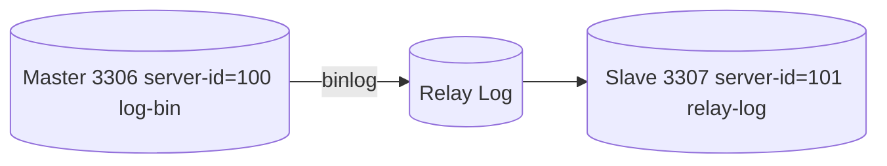
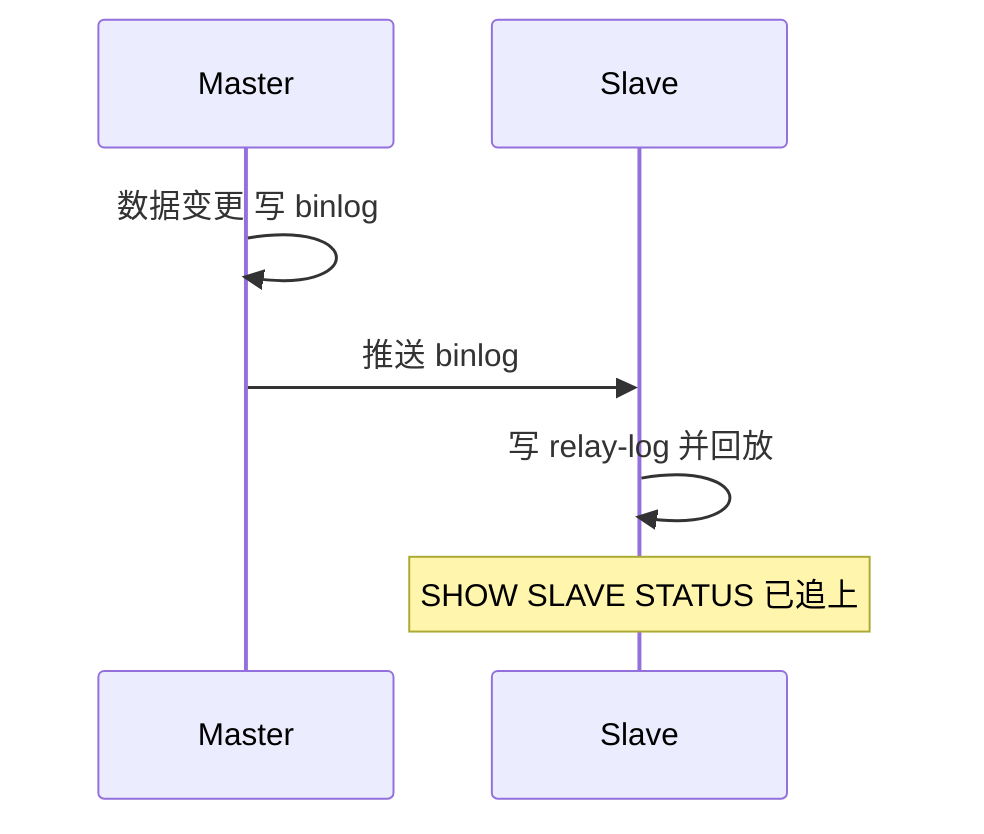

## 纲要

- 主库先开 binlog：导出 `my.cnf` 加 `server-id=100`、`log-bin=mysql-bin`，导回并重启
- 起 slave 容器（镜像同，端口 3307→3306），改默认加密方式为 `mysql_native_password` 才能连
- slave 的 `my.cnf` 加 `server-id=101`、`log-bin=mysql-slave-bin`、`relay-log=mysql-relay-bin`
- 主库建 slave 账号并授权 `REPLICATION SLAVE / CLIENT`，`SHOW MASTER STATUS` 记 binlog 名与位置
- 全量同步：`mysqldump` 导出 `test.sql`，`docker cp` 到 slave 回放
- slave 用 `CHANGE MASTER TO` 指向主库虚拟 IP（docker inspect 查），`START SLAVE` 验证级联更新

## 📎 代码说明

本讲代码以**内联片段**形式呈现在正文中。课程课件仅发布第 2/3/4 章（MySQL 核心能力）的完整工程源码，本讲所属章节未随课件发布独立源码文件，故不做外部文件关联，请以正文片段为准。

## 一、主库开启 binlog

主从复制依赖 binlog，先改主库配置。进主库容器，找到 `/etc/my.cnf`（默认几乎没有 binlog 相关内容），把它 `docker cp` 导出到本地修改，改完再导回：

```bash
# 主库内 my.cnf 导到本地
docker cp <master容器ID>:/etc/my.cnf ./my.cnf
# 编辑：去掉 log-bin 注释，新增 server-id 与 binlog 配置
#   server-id=100
#   log-bin=mysql-bin
# 导回容器
docker cp ./my.cnf <master容器ID>:/etc/my.cnf
# 重启生效
docker restart <master容器ID>
```

`server-id` 是主从集群里每个节点的唯一标识，不能重复；`log-bin=mysql-bin` 开启 binlog。

## 二、启动 slave 容器并修加密方式

用同样的 `mysql:latest` 镜像再起一个容器，端口映射到 3307：

```bash
docker run --name mysql-slave -p 3307:3306 -e MYSQL_ROOT_PASSWORD=123456 -d mysql:latest
```

MySQL 8.0 默认用 `caching_sha2_password` 加密，很多客户端连不上，需改回 `mysql_native_password`（本篇讲过）：

```sql
ALTER USER 'root'@'%' IDENTIFIED WITH mysql_native_password BY '123456';
FLUSH PRIVILEGES;
```

slave 的 `my.cnf` 同样 `docker cp` 出来改：

```bash
# server-id=101
# log-bin=mysql-slave-bin
# relay-log=mysql-relay-bin
```

`relay-log` 是 slave 专有的中继日志，用于回放主库 binlog。



## 三、主库建同步账号

进主库 client，创建专用于复制的 slave 账号并授权：

```sql
CREATE USER 'slave'@'%' IDENTIFIED BY '123456';
GRANT REPLICATION SLAVE, REPLICATION CLIENT ON *.* TO 'slave'@'%';
ALTER USER 'slave'@'%' IDENTIFIED WITH mysql_native_password BY '123456';
FLUSH PRIVILEGES;
SHOW MASTER STATUS;
```

`SHOW MASTER STATUS` 会输出当前 binlog 文件名（如 `mysql-bin.00000X`）和位置（position），**这两个值后面必须记下来**。

## 四、全量同步做数据对齐

主从启动增量同步前，先让两边数据对等：用 `mysqldump` 把主库全量导出，回放到 slave。

```bash
# 主库导出
mysqldump -uroot -p123456 --databases test > test.sql
# docker cp 到 slave 容器后回放
mysql -uroot -p123456 < test.sql
```

回放完，主从数据静态一致。

## 五、slave 指向主库并启动

主从两个容器在同一 docker 网络里，各有虚拟 IP。用 `docker inspect` 查主库 IP（如 `172.17.0.2`），再在 slave 上 `CHANGE MASTER TO`：

```sql
CHANGE MASTER TO
  MASTER_HOST='172.17.0.2',
  MASTER_USER='slave',
  MASTER_PASSWORD='123456',
  MASTER_PORT=3306,
  MASTER_LOG_FILE='mysql-bin.00000X',   -- 来自 SHOW MASTER STATUS
  MASTER_LOG_POS=1116,                   -- 来自 SHOW MASTER STATUS
  MASTER_CONNECT_RETRY=30;
START SLAVE;
SHOW SLAVE STATUS\G
```

`SHOW SLAVE STATUS` 出现 `Slave has read all relay log;waiting for more updates` 即代表已完全跟上主库。验证：在主库把某商品名 `iphoneSE` 改成 `iphoneSE1`，从库随即同步成 `iphoneSE1`——级联更新生效。



## 技术点总结

- 主从复制前提：主库开 binlog、各节点唯一 `server-id`。
- slave 需改 `mysql_native_password` 加密、配 `relay-log`。
- 同步账号授权 `REPLICATION SLAVE/CLIENT`，并记下 `SHOW MASTER STATUS` 的 file 与 pos。
- 先 `mysqldump` 全量对齐，再 `CHANGE MASTER TO` + `START SLAVE` 增量同步。
- 同 docker 网络用 `docker inspect` 虚拟 IP 互通，改主库数据验证级联更新。
