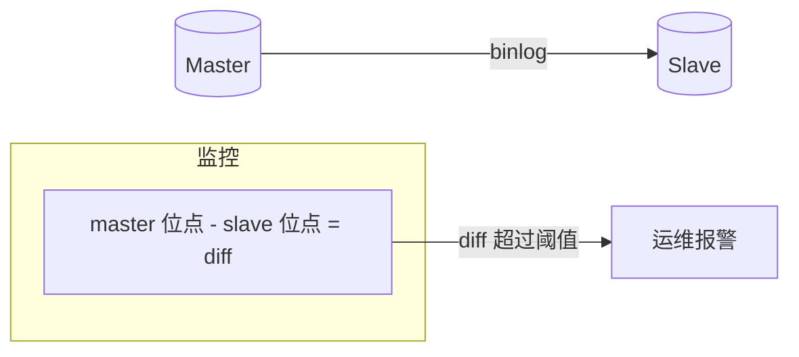
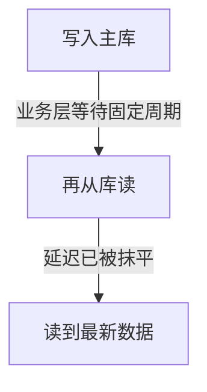

## 纲要

- 只要做读写分离，就必须面对主从延迟；极端时 relay log 回放跟不上，延迟可达分钟级
- 手段一：监控 binlog 位点偏移
## 📎 代码说明

本讲代码以**内联片段**形式呈现在正文中。课程课件仅发布第 2/3/4 章（MySQL 核心能力）的完整工程源码，本讲所属章节未随课件发布独立源码文件，故不做外部文件关联，请以正文片段为准。

## 问题：为什么会有主从不一致

只要采用了读写分离的部署架构，就必须面对主从延迟。延迟可多可少，极限情况下 slave 消费 master 的 binlog/relay log 回放消化不掉，延迟几分钟都有可能。试想一条刚插入的数据，要过几分钟才能被读到——这种体验显然不可接受。

## 手段一：监控 binlog 位点偏移量

第一步是加监控报警。逻辑很简单：监控 master 与 slave 各自关于 binlog 的位点偏移——一边是 master 写入 binlog 的位点，一边是 slave 消费 master binlog 的位点，对二者做差值（diff）。



如果 diff 超过一万，就假定读写分离的数据延迟已经很高，触发产线运维报警。有人会问"都延迟了报警有什么用"——其实最简单的根治办法，就是提升 slave 消费 master binlog 的硬件资源能力。只要 slave 对 binlog 的消费能力压到毫秒甚至微秒级，主从延迟就完全可以忽略。所以监控的意义在于：先看到产线上读写分离的真实延迟，才能针对性地扩容解决。

## 手段二：敏感读操作路由到主库

加了监控仍有延迟时，最直接可用的方案是把**敏感读操作路由到主库**。

在代码上，就是把原本走从库的读请求切回 primary。例如商品详情的 `getItem`，可以在动态数据源（DS）层面把它路由到主库；甚至可以精确到 mapper 级别——比如给 `BrandService` 里某个 mapper 单独设置走主库。

```java
// 根据讲稿逻辑补充：MyBatis-Plus 动态数据源，把敏感读打回主库
@DS("master")               // 该读方法路由到主库，规避从库延迟
public ItemVO getItem(Long itemId) {
    return itemMapper.selectItemDetail(itemId);
}
```

这个方案非常有用，但要避免"一刀切"：并不是所有读都敏感。典型场景是用户用邮箱注册后刷新个人页面——如果个人页的读被 binlog 严重拖延，只需把"用户注册后、给定时间段内产生的读操作"路由到 master，而不是把全部个人页读都打回主库。配合监控，读写分离造成的影响就能降到很小。

## 手段三：业务逻辑层规避

如果觉得代码里一个个切分场景、开不同接口太脏，还有第三招：在业务逻辑层主动规避。

典型的例子是早年论坛网站：注册成功后要转一个"菊花圈"loading，提示"约 10 秒后跳转"。这个 10 秒背后的原理，就是针对"大批量写入后立刻要读"的场景，让用户在界面上等待一个固定时间周期，以此抹平读写分离带来的影响。这是一种业务层面的取舍，用体验换一致性。



## 核心思路

主从延迟的处理方案千变万化，可以用各种复杂兜底逻辑把敏感读做路由分离或数据备份，但核心只有两条：

1. 先搞定主从延迟的**报警**，看清真实延迟，才能减少大批量 SQL 造成的延迟放大；
2. 运维与硬件资源要跟得上，从源头抹平读写分离带来的延迟。

在此之上，再用"敏感读路由主库"和"业务层等待"做针对性兜底。

## 技术点总结

- 主从延迟本质是从库回放 binlog 慢于主库写入，极端可达分钟级。
- 监控 binlog 位点 diff 是发现延迟的第一步，治本是提升从库消费硬件。
- 敏感读路由主库是立竿见影的兜底，但要精确到"敏感读"而非全量读。
- 业务层等待（如注册后 loading）是用体验换一致性的最后一招。
- 三者顺序：监控报警 → 路由/等待兜底 → 硬件扩容根治。
