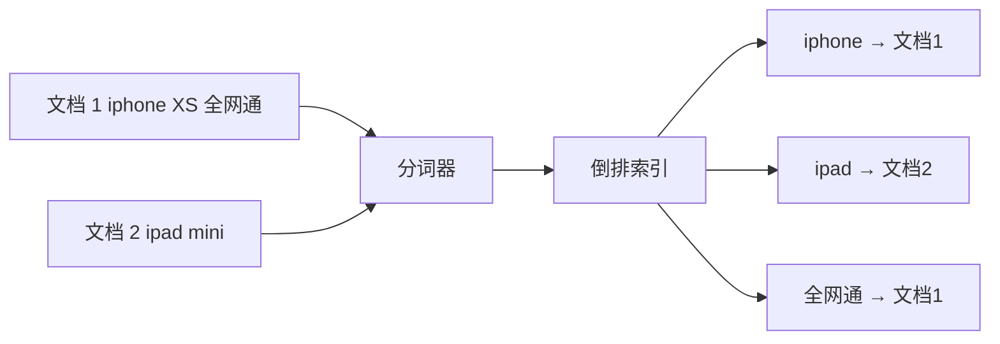
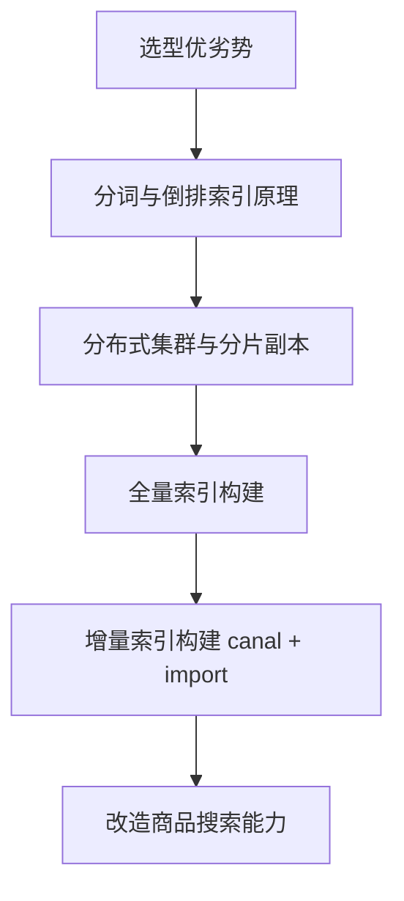

## 纲要

- 数据库 `like` 模糊查询的三个死穴：性能、只能前后缀或中间匹配、没有相关性排序
- ElasticSearch 的四大优势：分词、倒排索引、TF-IDF 打分、原生分布式集群
- 有状态服务（存储）与无状态服务（Java 应用）在扩容上的本质差异
- 两大劣势：新增索引字段要重刷历史数据、搜索引擎并非只能做全文检索
- 扩展索引字段的正确姿势：新建备份集群 → build 全量 + 增量索引 → 线上切换

## 📎 代码说明

本讲代码以**内联片段**形式呈现在正文中。课程课件仅发布第 2/3/4 章（MySQL 核心能力）的完整工程源码，本讲所属章节未随课件发布独立源码文件，故不做外部文件关联，请以正文片段为准。

## 为什么 `like` 撑不起搜索

在前面的章节里，商品搜索是用数据库的模糊查询实现的：

```sql
select * from item where name like '%iphone%';
```

这套方案在数据量小的时候能跑，一旦进入真实电商场景就会暴露三个问题：

- **性能问题**：`%xxx%` 形式的模糊匹配无法命中 B+ 树索引，只能全表扫描，数据量上来后响应时间不可控
- **匹配能力单一**：只能做前缀、后缀、中间这种字面匹配，用户输入的词序、错别字、同义词一概处理不了
- **没有相关性**：只要命中就返回，几条结果谁排前面完全没有依据，而电商搜索的核心恰恰是「谁更应该被用户看到」

换句话说，搜索场景需要的不是「能不能查到」，而是「按相关性排序后返回最该返回的那批」。这正好是搜索型存储的设计目标。

## ElasticSearch 的四个核心优势

### 分词与倒排索引

传统数据库建的是正排索引：按主键找到整行记录。ElasticSearch 建的是倒排索引：先对文本**分词**得到一串 token，再以 token 为键建立「token → 文档 ID 列表」的映射。



查询时不再是「逐行扫一遍看是否包含关键字」，而是「拿关键字直接取回文档 ID 集合」，复杂度从 O(N) 降到接近 O(1)。

### TF-IDF 打分

倒排索引解决的是**召回**（哪些文档该被查出来），打分机制解决的是**排序**（谁排在前面）。ElasticSearch 最经典的 TF-IDF 打分，把词频、文档频率综合成一个 `_score`，让杂乱文本中的关键字检索也有靠谱的排序结果。

### 原生分布式

ElasticSearch 把分片、副本、选主、数据迁移全部内置，横向加机器就能同时扩展存储量与查询吞吐，不需要像关系型数据库那样自己搭分库分表中间件。

### 应用与存储的扩容差异

做架构设计时必须区分两类节点：

| 对比项 | Java 应用节点 | 存储节点 |
| --- | --- | --- |
| 是否有状态 | 无状态 | 有状态，持有数据 |
| 水平扩容 | 直接加机器，天然支持 | 需要分布式协议支撑 |
| 扩容代价 | 低 | 高，涉及数据搬移与一致性 |

因此选型时有一条硬原则：**如果一个存储受限于分布式解决方案，无法支撑水平扩容，那优先考虑舍弃它，而不是硬上**。无状态应用永远可以加机器，有状态存储做不到这一点就会成为整个系统的天花板。

## 两个必须提前想清楚的劣势

### 索引字段的扩展成本很高

假设商品名 `name` 字段一开始没有建倒排索引，某天产品要求支持按名称搜索。此时要做的是：

- 修改 mapping，给 `name` 字段加分词器
- **重刷全部历史数据**：已有的文档不会自动按新的分词规则重新生成倒排索引
- 重建索引

整个过程会大量占用 CPU 与内存，对线上稳定性有明显影响。所以搜索型字段应该在设计阶段就规划好，而不是事后补。

真到了必须加字段的时候，稳妥做法是**双集群切换**：


这样做的好处是：整个 build 过程发生在备用集群上，线上集群的 CPU、内存和稳定性完全不受影响，切换动作的粒度也可以控制到秒级。

### 搜索引擎不等于只能做全文检索

这一点经常被误解。倒排索引的前提是分词，但**也可以不分词**：把整个字段当成一个完整的 term 塞进倒排索引，就得到了一个「全字段精确匹配」的能力。

所以只要涉及查询，尤其是**高并发的宽表查询**，都可以考虑用 ElasticSearch。它叫搜索型数据库，但服务的场景远不止全文检索。

## 选型速查

| 场景 | 是否适合 ElasticSearch |
| --- | --- |
| 商品全文搜索、相关性排序 | 非常适合 |
| 高并发宽表多条件查询 | 适合，可替代数据库复杂查询 |
| 强事务（下单、扣库存） | 不适合，用 MySQL |
| 高频写入后立即强一致读取 | 不适合，ES 是近实时（秒级延迟） |
| 需要频繁变更索引字段的业务 | 谨慎，重建索引成本高 |
| 简单的主键查询 | 没必要，直接查数据库或缓存 |

## 本章学习路径



索引的构建采用「全量 + 增量」的组合：全量负责初始数据导入，增量通过 canal 这类管道机制订阅数据库变更，再借助 Java 的 import 程序写入索引，两者配合才能保证索引与数据库最终一致。
