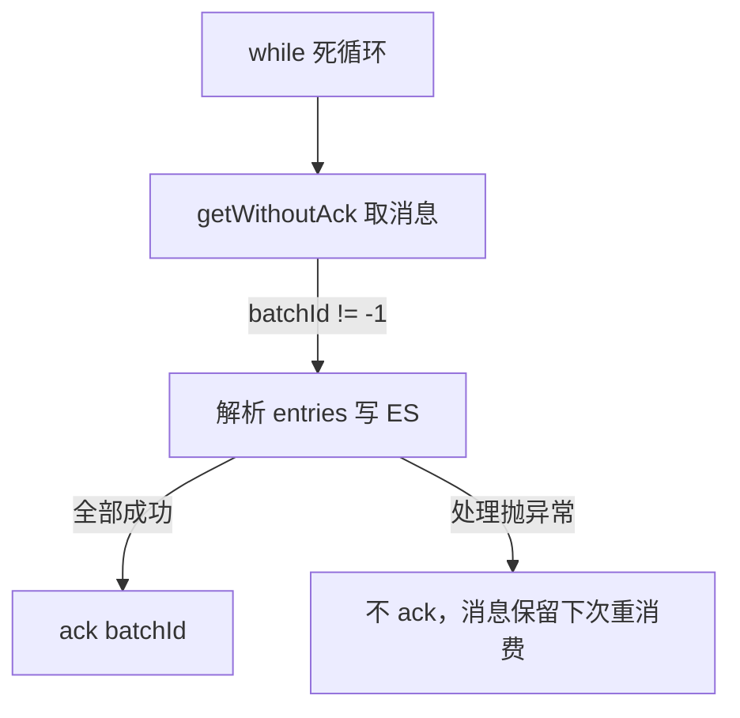

## 纲要

- canal 的本质：伪装成 MySQL 的 slave，通过主从协议读取 binlog，把增量变更以消息形式推给 Java 消费端
- 部署：用 Docker 起 `canal/canal-server:1.1.5`，拷贝并修改 `instance.properties`
- 配置关键点：`canal.instance.master.address`（主库地址）、`canal.instance.master.journalname/position`（从主库 `show master status` 拿位点）、`canal.instance.dbUsername/Password`（slave 账号）、`canal.destinations`（MQ topic，默认 `example`）
- 改完配置 `docker cp` 回容器并重启，看到 `start successful` 即部署成功
- Java 接入骨架：用 `ApplicationRunner` 在 Spring 容器启动后起后台驻留监听；`connect` → `subscribe` → `rollback` → `while(true)` 每 100ms `getWithoutAck` 拉消息
- 必须手动 ACK：用 `getWithoutAck` 而非 `get`，处理完再 ACK，避免处理中异常导致消息丢失

## 📎 代码说明

本讲代码以**内联片段**形式呈现在正文中。课程课件仅发布第 2/3/4 章（MySQL 核心能力）的完整工程源码，本讲所属章节未随课件发布独立源码文件，故不做外部文件关联，请以正文片段为准。

## canal 是什么

增量索引构建要借助 canal 这个管道工具。canal 利用了 MySQL 主从之间的协议，把自己伪装成主库的一个 slave，通过 binlog 采集到所有增量变更，再像消息中间件一样把消息推送给 Java 接入端。

全量索引由 Java 程序分页 `select` 后批量 `index`，增量这部分则完全交给 canal。

## 第一步：Docker 部署 canal-server

使用 Docker 部署 canal（课程环境版本 `1.1.5`）：

```bash
docker run -d --name canal -p 11111:11111 canal/canal-server:1.1.5
```

启动后进入容器，找到配置路径（在 `home/admin/canal-server/conf/example/` 下），把 `instance.properties` 拷出来改：

```bash
docker exec -it canal bash
# 容器内路径：home/admin/canal-server/conf/example/instance.properties
```

## 第二步：修改 instance.properties

配置项较多，需要改的关键内容如下（值来自课程讲稿环境）：

```properties
# 1. slave 标识，课程已用过 1/2，这里取 103
canal.instance.mysql.slaveId=103

# 2. 主库地址（局域网内 MySQL master 的 IP）
canal.instance.master.address=172.17.0.2:3306

# 3. 从主库当前 binlog 位点开始消费（见下文如何获取）
canal.instance.master.journalname=
canal.instance.master.position=33205

# 4. slave 账号密码（字符集 UTF-8）
canal.instance.dbUsername=slave
canal.instance.dbPassword=723456
canal.instance.connectionCharset=UTF-8

# 5. MQ 目的地：canal 把监听到的 binlog 投放到该 topic，Java 程序监听它
canal.destinations=example
```

### 如何拿到主库位点

binlog 的位点要从主库实时查，不能拍脑袋写：

```bash
mysql -uroot -p123456 -e "show master status"
```

`show master status` 返回当前的 `File` 和 `Position`，把 `Position` 填进 `canal.instance.master.position`（讲稿环境为 `33205`）。这一步不能搞错，否则 canal 会从错误位点开始消费。

### 拷回容器并重启

```bash
# 把改好的 instance.properties 拷回容器对应路径
docker cp instance.properties canal:/home/admin/canal-server/conf/example/
# 重启容器
docker restart canal
```

看到日志打印 `start successful` 且没有报错，说明 canal 容器启动成功。

## 第三步：Java 接入骨架

canal 本身是一个需要单独部署、单独启动的应用。课程用 Spring 提供的 `ApplicationRunner` 在 Spring 容器启动完成后自动拉起一个后台驻留程序——相当于在容器里模拟一个 `main` 方法。

```java
// 根据讲稿逻辑补充：canal 接入骨架（上）——连接、订阅、轮询
@Component
public class CanalApplicationRunner implements ApplicationRunner {

    // canal 服务地址与端口（默认 11111）
    private static final String ADDRESS = "127.0.0.1";
    private static final int PORT = 11111;
    // 监听的 destination，对应 instance.properties 里的 example
    private static final String DESTINATION = "example";

    @Autowired
    private ItemService itemService;
    @Autowired
    private RestHighLevelClient restHighLevelClient;

    @Override
    public void run(ApplicationArguments args) throws Exception {
        // 1. 连接 canal（单机部署，直接用单连接）
        CanalConnector connector = CanalConnectors.newSingleConnector(
                new InetSocketAddress(ADDRESS, PORT), DESTINATION, "", "");
        connector.connect();

        // 2. 订阅：正则 // 表示订阅所有库所有表
        connector.subscribe(".*\\..*");

        // 3. 回滚到订阅前的位点（追溯语义，名字易误解）
        connector.rollback();

        // 4. 死循环监听，每 100ms 拉一次
        while (true) {
            Message message = connector.getWithoutAck(1000);   // 1000 为 batch size
            long batchId = message.getId();
            if (batchId != -1) {
                // 处理 message 内的 entries
                // handleEntries(message.getEntries());
            }
            // 5. 处理完再手动 ACK
            connector.ack(batchId);
        }
    }
}
```

## 为什么用 getWithoutAck 而不是 get

canal 有自动 ACK 机制。若直接用 `get`，消息一取出就被 ACK；倘若后续处理抛异常，这条消息就再没机会被消费，造成增量漏索引。

因此用 `getWithoutAck`：先把消息取出来处理，**确认全部处理完成后再手动 `ack(batchId)`**。只有处理成功才确认，异常时消息保留，下次仍可消费。



## 技术点总结

- canal 伪装成 MySQL slave，基于主从协议读 binlog，把增量变更推给 Java 消费端
- 部署核心是 `instance.properties`：主库地址、起始位点（从 `show master status` 取）、slave 账号、destination（topic）
- 改完配置要 `docker cp` 回容器并重启，日志 `start successful` 才算就绪
- Java 侧用 `ApplicationRunner` 在 Spring 启动后起后台监听：`connect` → `subscribe` → `rollback` → `while` 轮询
- 必须用 `getWithoutAck` + 手动 `ack`，防止处理异常丢消息
