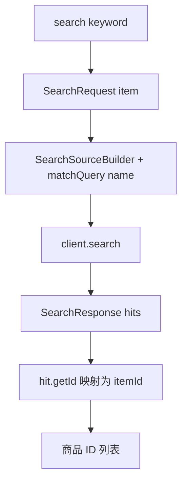

## 纲要

- 改造搜索能力体现了 Spring 分层的价值：`search` 方法签名不变，只替换内部实现（面向接口编程）
- 用 `InitializingBean` 的 `afterPropertiesSet` 钩子，在 Spring Bean 初始化完成后创建 `RestHighLevelClient` 单实例，避免重复实例化
- 搜索核心：`SearchRequest` 指定索引 → `SearchSourceBuilder` 装配 `QueryBuilders.matchQuery("name",keyword)` → `client.search` 执行
- 结果转换：从 `SearchResponse.getHits()` 取每个 `hit` 的文档 ID，映射成商品 ID 列表
- 验证：搜 `iphone` 命中 iPhone SE，搜 `ipad` 命中 iPad mini，说明搜索已切到 ES

## 📎 代码说明

本讲代码以**内联片段**形式呈现在正文中。课程课件仅发布第 2/3/4 章（MySQL 核心能力）的完整工程源码，本讲所属章节未随课件发布独立源码文件，故不做外部文件关联，请以正文片段为准。

## 为什么改造只动内部实现

要把商品搜索能力迁到 ES，最省事的地方在于 Spring 的分层：`ItemService` 的 `search` 方法**签名不需要任何改动**，只把方法内部实现从查 MySQL 换成查 ES。这就是面向接口编程的目标——上层调用方无感知。

## 用 InitializingBean 创建 ES 客户端

课程没有用 `@Autowired` 注入 client，而是让 `ItemService` 实现 `InitializingBean`，在 `afterPropertiesSet` 钩子里 `new` 出 `RestHighLevelClient`。这样 client 成为 service 内的单实例，不会面临重复实例化的问题。

```java
// 根据讲稿逻辑补充：改造 search 方法，底层从 MySQL 切到 ES
@Service
public class ItemServiceImpl implements ItemService, InitializingBean {

    private RestHighLevelClient client;

    // Spring Bean 初始化完成后建 ES 客户端，单实例
    @Override
    public void afterPropertiesSet() {
        client = new RestHighLevelClient(
                RestClient.builder(new HttpHost("localhost", 9200, "http")));
    }

    @Override
    public List<Long> search(String keyword) throws IOException {
        // 1. 指定搜索哪张索引
        SearchRequest searchRequest = new SearchRequest("item");

        // 2. 装配查询：在 name 字段上做 match 全文检索
        SearchSourceBuilder sourceBuilder = new SearchSourceBuilder();
        sourceBuilder.query(QueryBuilders.matchQuery("name", keyword));
        searchRequest.source(sourceBuilder);

        // 3. 执行搜索
        SearchResponse response = client.search(searchRequest, RequestOptions.DEFAULT);

        // 4. 把命中的文档 ID 映射成商品 ID 列表
        List<Long> itemIdList = Arrays.stream(response.getHits().getHits())
                .map(hit -> Long.valueOf(hit.getId()))
                .collect(Collectors.toList());
        return itemIdList;
    }
}
```

几个要点：

- `SearchRequest("item")` 指定要搜的索引名，等价于"原先搜哪张表"
- `QueryBuilders.matchQuery("name",keyword)` 是面向对象的查询构建方式，比手写 JSON 更安全；`name` 字段在 mapping 里已配 `ik_max_word` 索引、`ik_smart` 查询
- `hit.getId()` 取的是 ES 文档 ID，构建全量索引时我们把它设成了业务主键 `item.getId()`，所以文档 ID 即商品 ID



## 验证搜索是否生效

启动应用后，原本走数据库的搜索接口现在报告给 ES。打开浏览器访问商品搜索接口：

- 搜 `iphone`：返回 iPhone SE（文档 ID = 1）
- 搜 `ipad`：返回 iPad mini

原先商品详情页里还有两个 SKU，搜索时把 SKU 屏蔽，只按商品维度返回。至此，搜索能力从"查 MySQL"完整切到"查 ES"，且 ES 的查询语法满足 `match` 的 name 匹配方式。

## 技术点总结

- 面向接口编程：search 签名不变，只换内部实现，上层无感知
- 用 `InitializingBean.afterPropertiesSet` 在 Bean 初始化后建 `RestHighLevelClient` 单实例
- 搜索三件套：`SearchRequest` 指定索引 + `SearchSourceBuilder` 配 `matchQuery` + `client.search` 执行
- 命中结果从 `getHits()` 取文档 ID（即商品 ID）映射成列表
- 验证：iphone/ipad 能正确命中，说明搜索已切到 ES
