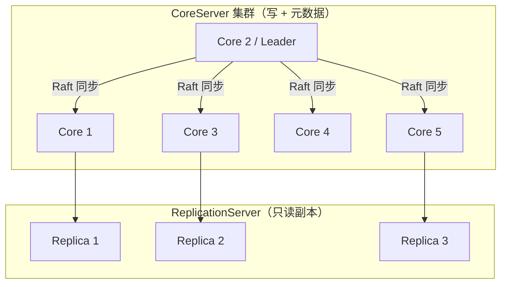
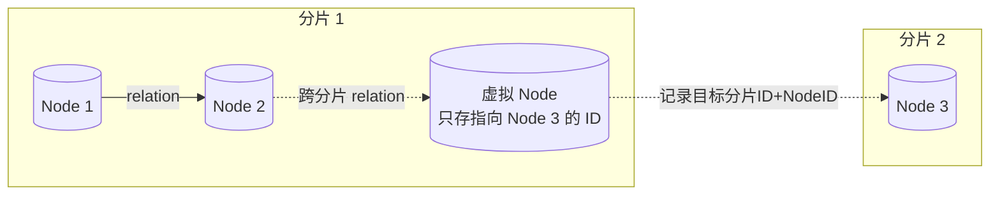

## 纲要

- Neo4j 单机图存储的结构：节点（Node）、关系（Relation），以及节点与关系上都可以挂载属性（Property）
- 分布式扩展的两条主线：先解决"读放大 / 主从"，再解决"写分片"
- CoreServer 通过 Raft 协议竞争 Leader，集群至少 5 台 Core 才能保证多数派存活与写入不丢
- 写一致性：Leader 同步写 Follower，需多数派（2N+1 中的 N/2+1）节点 ACK 才提交
- ReplicationServer（只读副本）承担读流量，读能力可横向无限扩展
- 写分片是图数据库的硬骨头：图的节点 + 边 + 属性结构难以切分，社区版未提供，需要在应用层用"按节点分片 + 虚拟节点"兜底
- 当前工程实践的取舍：大内存、大磁盘的单机 CoreServer 加 ReplicationServer，通常已能平衡存储与流量

## 📎 代码说明

本讲为**原理 / 架构 / 选型**篇，正文以图示与推演为主，无配套代码片段，课程课件亦未提供本章源码文件。

## 图数据在单机里长什么样

回顾一下图数据库的存储元素，分布式扩展的所有难题都源于此。一张图里只有两类一等公民：

| 元素 | 说明 | 可否挂属性 |
| --- | --- | --- |
| Node（节点） | 实体，如用户、商品 | 可以 |
| Relation（关系） | 节点之间的边，如关注、好友 | 可以 |

关键点在于：**关系本身也是数据，而且关系上也能挂属性，节点上也能挂属性**。这意味着一条边在物理上同时牵连着两个节点以及它们各自的属性。当我们要把图拆到多台机器时，这种"边 + 双端节点 + 各自属性"的耦合，比关系型数据库的表行要难切得多——这正是后面写分片之所以棘手的根源。

## 第一步：用主从解决读放大

互联网场景绝大多数都是读多写少，因此分布式扩展的第一要务不是切写，而是把读流量摊开。Neo4j 给出的方案分两层节点：

### CoreServer：通过 Raft 选主与写一致

CoreServer 之间用 Raft 协议竞争 Leader，机制和 Elasticsearch 的选主类似。所有写操作都从 Leader 走，Leader 收到写入后，会**同步**地向各个 Follower 复制：

- Leader 不自己写完就返回，而是必须等到多数派节点写盘成功、返回 ACK，客户端的写入才算成功；
- 多数派的定义是 `N/2 + 1`。因此 Neo4j 有一个硬性约束：**CoreServer 至少要有 5 台**，这样在宕机 2 台之后，剩下的 3 台仍能构成多数派，可以重新竞争出最新的 Leader，保证数据不丢。

换句话说，CoreServer 存在的意义就是"写控制节点 + 多数派同步"，把单点写入的安全性兜住。

### ReplicationServer：把读摊开

ReplicationServer 是从 CoreServer 做主从同步出来的**只读副本**，逻辑上类似 MySQL 的主从复制。它不参与写，只承载读请求。因为读副本可以不断增加，所以**读能力可以无限制横向扩展**，读放大问题在这里被解决。

到这里，主从问题（读放大）已经搞定，但写仍然是单点——Leader 一台机器扛所有写入。

## 第二步：写分片为什么这么难

读可以靠副本摊开，写要分片却异常困难，根因就是前面说的图结构：节点带属性、边带属性、边还牵连两端节点。

设想一个图节点的数据量爆炸到上亿，全部堆在一台机器的存储里。Follower 只是备份，并不分担 Leader 的写入量。要分片，典型做法是"按节点分片"而非"按边分片"：

思路是：把 Node 1、Node 2 放在分片 1，Node 3 放在分片 2。跨分片的边，在本地分片里放一个"虚拟 Node"，这个虚拟节点**只记录目标节点所在的分片 ID 和目标 Node ID**，并不需要把对方的属性和其它关系也搬过来。这样：

- 数据在各自分片上保持完备；
- 跨分片访问时，通过虚拟节点记录的目标地址二次查询，把背后的连带关系拉通；
- 虚拟节点只存"分片 ID + Node ID"，省掉了大量冗余属性，确实能削减不少数据量。

但必须诚实说明：**当前开源社区版并没有提供这套分片方案**，它只能在应用层自己实现——在 Neo4j 做跨分片路由存储时把虚拟节点方案设计进去，并在应用层用二次查询把关系链补全。复杂度不低，也期待后续版本官方支持。

## 工程上的现实取舍

正因为写分片的代价高，现阶段更常见的做法是"不强行分片"：

- 给 CoreServer 配大内存、大磁盘，单机承载图存储与运算；
- 用 ReplicationServer 吸收读流量，平衡存储与访问压力。

对绝大多数业务规模，这种"强单机 + 只读副本"的组合已经够用。只有当图真的膨胀到单机天花板时，才需要上应用层的虚拟节点分片方案。

## 小结

Neo4j 的分布式能力可以一句话概括：**读靠 ReplicationServer 无限扩，写靠 CoreServer 的 Raft 多数派保安全，真正的写分片留给应用层兜底**。理解这一点，才能在选型时想清楚"图数据库能不能横向扩、扩的是什么"。
