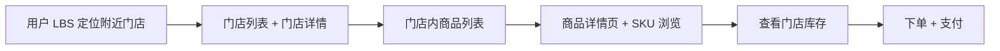
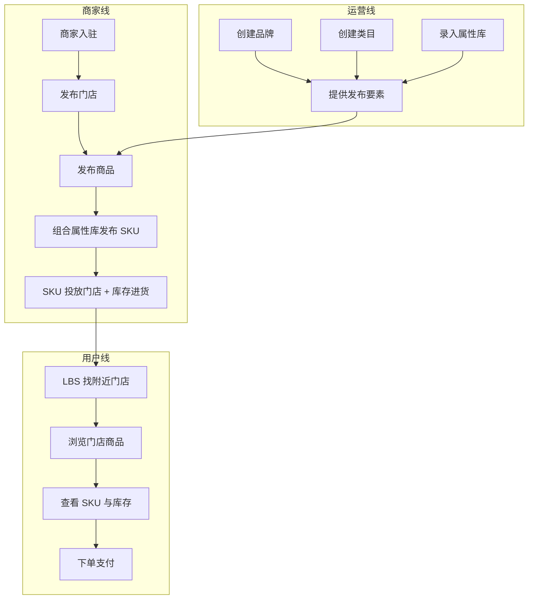
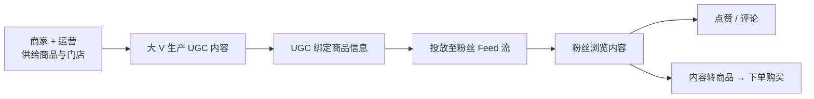

## 纲要

- 零售业态的三个发展阶段
## 📎 代码说明

本讲为**原理 / 架构**篇，正文以推演与图示为主，无配套代码片段；本章课件源码中亦无对应类文件。

## 零售业态的三个阶段

要设计一套合理的存储架构，第一步是把业务背景梳理清楚。整个零售行业的发展，可以划分为三个阶段。

### 传统电商时代

最典型的代表是货架式线上商城（淘宝、天猫这类入驻商家模式）。在这个阶段，消费者的行为路径非常线性：

1. 浏览商品详情页：主图、详情内容、品牌类目信息、SKU 规格选型；
2. 确认商品满足需求后，进入订单信息页；
3. 完成下单——支付购买的整套流程，通常会接入支付宝、微信支付这类第三方支付渠道；
4. 完成履约交付。

这个阶段沉淀出了最基础的几个数据要素：**商品、SKU、品牌、类目**，以及**订单、支付**的流程模型。

### 新零售时代：线上线下联动

纯粹线上的商城很难完整满足用户的购物体验。无论商品详情页的配图画得多精细、参数列得多详细，很多消费者依然希望去线下门店亲眼看看实物。

于是新零售模式出现：**把商品放进门店体系，用线下实体店构建流量体验场所**。典型例子是品牌直营零售店——Apple 的零售店把 Apple 商品放到门店体系内，货品管理和库存管理都在门店维度运营。

此时的消费路径变为：

线上加线下联动合作的这种模式，就被定义为新零售电商时代。它对技术提出了新的要求：**商品不再是平台级的，而是门店维度的**；库存也要落到门店粒度。

### 社交新零售时代：社交关系驱动流量

新零售解决了体验问题，但流量很快还是会遇到瓶颈。因为无论是线上购物还是线下消费，决策往往来自冲动型消费或者熟人推荐。

于是第三个阶段——社交新零售——登场。典型形态是小红书这类内容社区：通过关注—粉丝关系，或者大 V 发布的内容列表，绑定一批要推广的商品信息，促成熟人圈或社交圈中的购物欲望与流程。

在这个模式下，商品的流量入口从"搜索/货架"变成了"社交分发"：

- **熟人闭环社交领域**：私域流量内的推荐；
- **关注粉丝的公域流量体系**：大 V 的粉丝池；
- **完全公开的散点式流量**：内容广场、推荐流。

### 三个阶段对比

| 阶段 | 流量来源 | 核心数据要素 | 关键流程 |
| --- | --- | --- | --- |
| 传统电商 | 搜索 / 货架浏览 | 商品、SKU、品牌、类目、订单 | 浏览 → 下单 → 支付 |
| 新零售 | 地理位置 + 门店体验 | 门店、门店库存、门店商品关系 | 找店 → 看货 → 下单 → 支付 |
| 社交新零售 | 社交关系 + 内容推荐 | UGC 内容、关注粉丝关系、点赞评论 | 刷 Feed → 内容转商品 → 下单 |

## 新零售业务流程：三条主线

梳理完背景，接下来把业务流程拆清楚。整个项目可以分成两大部分：新零售业务流程 + 社交业务流程。先看新零售部分，它由三条线并行推进。

### 商家线

1. **商家入驻**：商家在平台上创建自己的商家实体；
2. **发布门店**：因为属于新零售而非纯线上零售，所以商家必须创建线下门店实体；
3. **发布商品**：使用运营提供的品牌与类目，发布商品；
4. **发布 SKU**：将商品与属性库建立销售属性联动，形成可售卖的 SKU；
5. **门店进货**：把 SKU 投放到已发布的门店中，完成门店库存进货。

### 运营线

运营人员在平台上创建**品牌**和**类目**——品牌需要商家授权才能完成商品绑定，类目则是发布商品的必要前提。此外还要录入**属性库**：例如商品的尺寸属性、颜色属性、内存容量属性等。

只有当运营完成了品牌、类目、属性库的供给，商家线才能借这些基础要素把商品真正发布成可售卖的 SKU。

### 用户线

用户通过 LBS 地理位置信息找到附近门店，通过门店 ID 浏览门店内的商品列表，查看商品详情、SKU 信息与门店库存，最终完成下单交易支付。

这一整套流程走完之后，才算把"一个带有商品主体信息、可售卖的 SKU、在某家门店有一定库存"这件事真正做到了可售状态。

## 社交新零售流程：内容与交易的连接

完成了基础零售链路之后，再加入社交元素，链条会延长一段：

1. 平台采用关注—粉丝体系；
2. 大 V 发布 UGC 内容（可以是推广图文、种草笔记，也可以是图片朋友圈式的内容）；
3. 将 UGC 内容与要代理的某个商品建立**绑定关系**；
4. 内容投放到大 V 的粉丝圈（Feed 流）；
5. 关注了该大 V 的粉丝用户刷 Feed 时捕获到这条内容；
6. 用户可以对该内容做**点赞和评论**（社交互动），也可以顺着内容背后的商品信息完成**下单购买**（流量转化）。

## 从业务流程到技术架构

把这两部分流程叠加起来，就能看出整个系统需要存储层支撑哪些能力：

| 业务环节 | 数据特征 | 存储诉求 |
| --- | --- | --- |
| 商家、门店、商品、SKU、订单 | 强事务、强一致、结构稳定 | 关系型数据库 MySQL |
| 门店与商品的搜索、筛选 | 全文搜索、多条件聚合 | 搜索引擎 Elasticsearch |
| 关注 / 粉丝关系 | 多度关系 traversal | 图数据库 Neo4j |
| UGC 内容 Feed 流 | 海量半结构化、时序性强、查询维度单一 | 列式存储 HBase |
| 点赞 / 评论 | 写入量大、字段灵活、查询条件复杂 | 文档型数据库 MongoDB |
| 热点内容、会话、计数 | 读多写少、可容忍少量丢失 | KV 缓存 Redis |

## 小结

从传统电商到新零售，再到社交新零售，业务的演进本质上是**流量入口的变化**与**数据形态的丰富**。技术上真正要做的，是先把商家线、运营线、用户线、社交线这四条链路上的实体和关系识别清楚，再为每一类数据找到最合适的存储。业务流程梳理得越清楚，后面的模块拆分和技术选型就越不容易返工。
