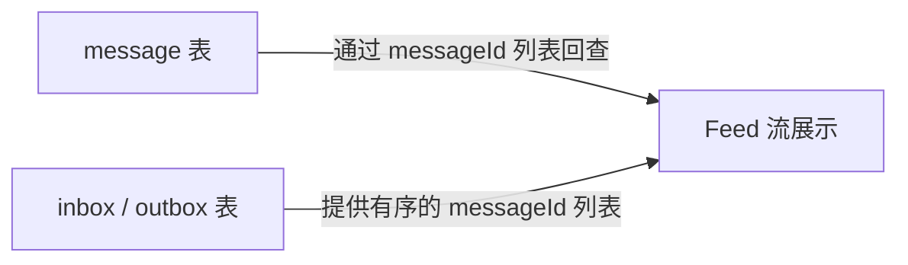
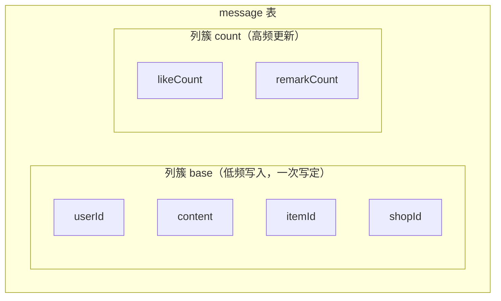
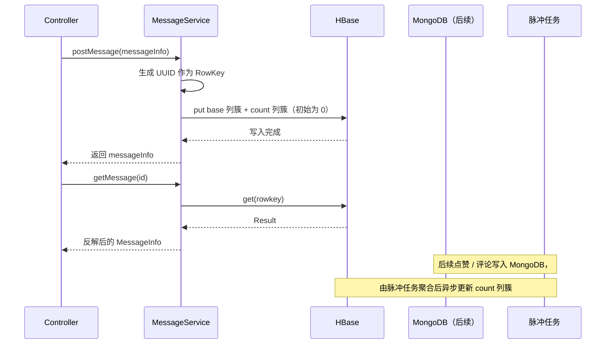

## 纲要

- Maven 依赖引入：`hbase-client` 与 `commons-codec`
- `application.properties` 中的 ZooKeeper 连接配置
- 用 `@Configuration` 装配 `org.apache.hadoop.conf.Configuration` 与 HBase `Connection`
- `MessageInfo` 实体设计：为什么预留 `likeCount` / `remarkCount` 两个字段
- `MessageService` 的 `postMessage` / `getMessage` 接口设计
- 建表 DDL：`message` 表拆 `base` 与 `count` 两个列簇
- `put` 写入与 `get` 读取的完整 Java 实现，以及二进制交互约定

## 📎 代码说明

本讲代码以**内联片段**形式呈现在正文中。课程课件仅发布第 2/3/4 章（MySQL 核心能力）的完整工程源码，本讲所属章节未随课件发布独立源码文件，故不做外部文件关联，请以正文片段为准。

## 为什么要先把消息实体建模出来

Feed 流是带时序的 message 列表，但在处理时序之前，必须先有一个"消息本体"的存储。也就是用户分享出去的商品卡片、门店卡片这些信息。

这一层的设计目标与收件箱/发件箱完全不同：



- `message` 表：以 `messageId` 为主键，只承担"按 ID 批量回查"，因此 RowKey 只要足够散列即可；
- `inbox` / `outbox` 表：承担时序索引，RowKey 要散列 + 集中 + 有序。

因此 `message` 的 RowKey 直接用 UUID 就够了，不需要嵌入时间戳或用户维度。

## 引入依赖

```xml
<dependency>
    <groupId>org.apache.hbase</groupId>
    <artifactId>hbase-client</artifactId>
    <version>2.4.11</version>
</dependency>

<!-- 后续 RowKey 生成需要做 MD5 编码 -->
<dependency>
    <groupId>commons-codec</groupId>
    <artifactId>commons-codec</artifactId>
    <version>1.14</version>
</dependency>
```

`hbase-client` 提供了 `Connection`、`Table`、`Put`、`Get` 等核心 API；`commons-codec` 的 `DigestUtils` 用于后续把自增 userId 散列成 RowKey 前缀。

## 连接配置

先在配置文件里定义 ZooKeeper 的地址与端口：

```properties
# application.properties
hbase.zookeeper.quorum=127.0.0.1
hbase.zookeeper.property.clientPort=2181
```

注意这里配的是 **ZooKeeper** 的地址，不是 HMaster 的地址。客户端的连接流程是先连 ZooKeeper 拿集群元数据，再定位 Region。

然后装配连接：

```java
package com.social.ecom.config;

import org.apache.hadoop.conf.Configuration;
import org.apache.hadoop.hbase.HConstants;
import org.apache.hadoop.hbase.client.Connection;
import org.apache.hadoop.hbase.client.ConnectionFactory;
import org.springframework.beans.factory.annotation.Value;
import org.springframework.context.annotation.Bean;
import org.springframework.stereotype.Component;

import java.io.IOException;

/**
 * HBase 连接装配
 */
@Component
public class CustomHBaseConfiguration {

    @Value("${hbase.zookeeper.quorum}")
    private String quorum;

    @Value("${hbase.zookeeper.property.clientPort}")
    private String port;

    @Bean
    public Connection hbaseConnection() throws IOException {
        Configuration configuration = HBaseConfiguration.create();
        configuration.set(HConstants.ZOOKEEPER_QUORUM, quorum);
        configuration.set(HConstants.ZOOKEEPER_CLIENT_PORT, port);
        return ConnectionFactory.createConnection(configuration);
    }
}
```

三个容易踩的点：

- `Configuration` 要引 `org.apache.hadoop.conf.Configuration`，与 Spring 的 `@Configuration` 同名但完全不同；
- 必须用 `HBaseConfiguration.create()` 而不是 `new Configuration()`，前者会加载 `hbase-default.xml` 等默认配置；
- 配置类要加 `@Component`（或 `@Configuration`），否则内部的 `@Bean` 不会被扫描到，运行时报 `connection could not be found`。

`Connection` 是重量级、线程安全的对象，全局单例即可；`Table` 则相反，非线程安全，用完必须关闭。

## 消息实体设计

```java
package com.social.ecom.pojo;

/**
 * 消息实体：用户分享出去的商品 / 门店卡片
 */
public class MessageInfo {

    /** 消息 ID，同时作为 HBase RowKey，使用 UUID 生成 */
    private String id;

    /** 发布者用户 ID */
    private Integer userId;

    /** 消息文本内容 */
    private String content;

    /** 点赞数，由 MongoDB 侧聚合后脉冲回写 */
    private Integer likeCount;

    /** 评论数，同上 */
    private Integer remarkCount;

    /** 分享的商品 ID */
    private Integer itemId;

    /** 商品所属门店 ID */
    private Integer shopId;

    public String getId() {
        return id;
    }

    public void setId(String id) {
        this.id = id;
    }

    public Integer getUserId() {
        return userId;
    }

    public void setUserId(Integer userId) {
        this.userId = userId;
    }

    public String getContent() {
        return content;
    }

    public void setContent(String content) {
        this.content = content;
    }

    public Integer getLikeCount() {
        return likeCount;
    }

    public void setLikeCount(Integer likeCount) {
        this.likeCount = likeCount;
    }

    public Integer getRemarkCount() {
        return remarkCount;
    }

    public void setRemarkCount(Integer remarkCount) {
        this.remarkCount = remarkCount;
    }

    public Integer getItemId() {
        return itemId;
    }

    public void setItemId(Integer itemId) {
        this.itemId = itemId;
    }

    public Integer getShopId() {
        return shopId;
    }

    public void setShopId(Integer shopId) {
        this.shopId = shopId;
    }
}
```

`likeCount` 与 `remarkCount` 是这一章就预留好的字段。点赞与评论的高并发写入不会直接落在这里，而是先写 MongoDB，再通过脉冲方案异步聚合回写——这两个字段就是最终回写的落点。提前建模可以避免后续改动 HBase 表结构。

## 表结构设计

进入 HBase Shell 建表：

```shell
create 'message', 'base', 'count'
```

两个列簇的划分依据是**更新频率**：



`base` 里的内容发布后基本不再变化；`count` 里的数字每次点赞、评论都会被更新。把它们放进不同列簇，可以让计数更新触发的 MemStore flush 与 Compaction 不牵连内容字段——这是列簇划分最实际的收益。

## 服务接口

```java
package com.social.ecom.service;

import com.social.ecom.pojo.MessageInfo;

import java.io.IOException;

public interface MessageService {

    /**
     * 发布一条消息
     */
    MessageInfo postMessage(MessageInfo messageInfo) throws IOException;

    /**
     * 按 ID 获取消息
     */
    MessageInfo getMessage(String id) throws IOException;
}
```

## 写入实现

```java
package com.social.ecom.service.impl;

import com.social.ecom.pojo.MessageInfo;
import com.social.ecom.service.MessageService;
import org.apache.hadoop.hbase.TableName;
import org.apache.hadoop.hbase.client.*;
import org.apache.hadoop.hbase.util.Bytes;
import org.springframework.beans.factory.annotation.Autowired;
import org.springframework.stereotype.Service;

import java.io.IOException;
import java.util.UUID;

@Service
public class MessageServiceImpl implements MessageService {

    @Autowired
    private Connection hbaseConnection;

    @Override
    public MessageInfo postMessage(MessageInfo messageInfo) throws IOException {
        // 数据组装
        messageInfo.setId(UUID.randomUUID().toString().replace("-", ""));
        messageInfo.setLikeCount(0);
        messageInfo.setRemarkCount(0);

        Table table = hbaseConnection.getTable(TableName.valueOf("message"));
        try {
            Put put = new Put(Bytes.toBytes(messageInfo.getId()));
            put.addColumn(Bytes.toBytes("base"), Bytes.toBytes("content"),
                    Bytes.toBytes(messageInfo.getContent()));
            put.addColumn(Bytes.toBytes("base"), Bytes.toBytes("userId"),
                    Bytes.toBytes(String.valueOf(messageInfo.getUserId())));
            put.addColumn(Bytes.toBytes("base"), Bytes.toBytes("itemId"),
                    Bytes.toBytes(String.valueOf(messageInfo.getItemId())));
            put.addColumn(Bytes.toBytes("base"), Bytes.toBytes("shopId"),
                    Bytes.toBytes(String.valueOf(messageInfo.getShopId())));
            put.addColumn(Bytes.toBytes("count"), Bytes.toBytes("likeCount"),
                    Bytes.toBytes(String.valueOf(messageInfo.getLikeCount())));
            put.addColumn(Bytes.toBytes("count"), Bytes.toBytes("remarkCount"),
                    Bytes.toBytes(String.valueOf(messageInfo.getRemarkCount())));
            table.put(put);
        } finally {
            table.close();
        }
        return messageInfo;
    }
}
```

几个必须记住的约定：

- **RowKey 由 `Put` 的构造函数指定**，没有自动主键；
- **所有数据都以 `byte[]` 交互**，字符串要 `Bytes.toBytes`，数值要先转字符串再转字节，读取时按同样规则反解；
- 用 `UUID` 生成 ID 并去掉横杠，得到一个纯十六进制字符串，分布天然均匀，不会造成 Region 热点；
- `Table` 用完必须 `close()`，建议 `try-finally` 或 try-with-resources；
- 异常统一向上抛，由 Controller 层处理。

## 读取实现

```java
    @Override
    public MessageInfo getMessage(String id) throws IOException {
        Table table = hbaseConnection.getTable(TableName.valueOf("message"));
        try {
            Get get = new Get(Bytes.toBytes(id));
            Result result = table.get(get);
            if (result.getRow() == null) {
                return null;
            }
            MessageInfo messageInfo = new MessageInfo();
            messageInfo.setId(new String(result.getRow()));
            messageInfo.setContent(new String(result.getValue(
                    Bytes.toBytes("base"), Bytes.toBytes("content"))));
            messageInfo.setUserId(Integer.valueOf(new String(result.getValue(
                    Bytes.toBytes("base"), Bytes.toBytes("userId")))));
            messageInfo.setItemId(Integer.valueOf(new String(result.getValue(
                    Bytes.toBytes("base"), Bytes.toBytes("itemId")))));
            messageInfo.setShopId(Integer.valueOf(new String(result.getValue(
                    Bytes.toBytes("base"), Bytes.toBytes("shopId")))));
            messageInfo.setLikeCount(Integer.valueOf(new String(result.getValue(
                    Bytes.toBytes("count"), Bytes.toBytes("likeCount")))));
            messageInfo.setRemarkCount(Integer.valueOf(new String(result.getValue(
                    Bytes.toBytes("count"), Bytes.toBytes("remarkCount")))));
            return messageInfo;
        } finally {
            table.close();
        }
    }
```

读取侧的映射规则必须与写入时严格对称：写入时是 `String.valueOf(int)` 再转字节，读取时就是 `new String(byte[])` 再 `Integer.valueOf`。一旦两侧不一致，就会得到乱码或转换异常。

`getRow()` 返回 `null` 表示这条 RowKey 不存在，此时要返回 `null` 而不是抛异常，让上层决定如何处理。

## 数据流转全景



## API 速览

| API | 签名 | 说明 |
| --- | --- | --- |
| `HBaseConfiguration.create()` | `static Configuration create()` | 创建带默认配置的 Hadoop Configuration |
| `HConstants.ZOOKEEPER_QUORUM` | 常量 | 配置项 key，对应 ZooKeeper 地址 |
| `HConstants.ZOOKEEPER_CLIENT_PORT` | 常量 | 配置项 key，对应 ZooKeeper 端口 |
| `ConnectionFactory.createConnection(Configuration)` | `static Connection` | 创建全局连接，线程安全、重量级 |
| `Connection.getTable(TableName)` | `Table getTable(TableName)` | 获取表句柄，非线程安全，需关闭 |
| `new Put(byte[] row)` | 构造函数 | RowKey 必须在此指定 |
| `Put.addColumn(byte[] family,byte[] qualifier,byte[] value)` | `Put` | 写入一个单元格 |
| `Table.put(Put)` | `void` | 执行写入 |
| `new Get(byte[] row)` | 构造函数 | 构造主键查询 |
| `Table.get(Get)` | `Result` | 执行查询 |
| `Result.getRow()` | `byte[]` | 返回 RowKey，为 null 表示不存在 |
| `Result.getValue(byte[] family,byte[] qualifier)` | `byte[]` | 取指定列簇与列的值 |
| `Bytes.toBytes(String)` | `byte[]` | 字符串转字节的便捷方法 |

## Demo 示例

### 运行说明

需要本地 HBase 可用（参考 Docker 部署章节），并先建表：

```shell
docker exec -it hbase hbase shell
create 'message', 'base', 'count'
```

### 完整代码

```java
import org.apache.hadoop.conf.Configuration;
import org.apache.hadoop.hbase.HBaseConfiguration;
import org.apache.hadoop.hbase.HConstants;
import org.apache.hadoop.hbase.TableName;
import org.apache.hadoop.hbase.client.*;
import org.apache.hadoop.hbase.util.Bytes;

import java.io.IOException;
import java.util.UUID;

/**
 * 根据讲稿逻辑补充：HBase Java API 写入 / 读取 message 的最小可运行示例
 */
public class MessageCrudDemo {

    private static final byte[] BASE = Bytes.toBytes("base");
    private static final byte[] COUNT = Bytes.toBytes("count");

    public static void main(String[] args) throws IOException {
        Configuration configuration = HBaseConfiguration.create();
        configuration.set(HConstants.ZOOKEEPER_QUORUM, "127.0.0.1");
        configuration.set(HConstants.ZOOKEEPER_CLIENT_PORT, "2181");

        try (Connection connection = ConnectionFactory.createConnection(configuration)) {
            String id = post(connection, 1, "这个商品太赞了", 1, 2);
            System.out.println("写入 messageId = " + id);
            System.out.println("读取结果 = " + get(connection, id));
        }
    }

    private static String post(Connection connection, Integer userId, String content,
                               Integer itemId, Integer shopId) throws IOException {
        String id = UUID.randomUUID().toString().replace("-", "");
        try (Table table = connection.getTable(TableName.valueOf("message"))) {
            Put put = new Put(Bytes.toBytes(id));
            put.addColumn(BASE, Bytes.toBytes("content"), Bytes.toBytes(content));
            put.addColumn(BASE, Bytes.toBytes("userId"), Bytes.toBytes(String.valueOf(userId)));
            put.addColumn(BASE, Bytes.toBytes("itemId"), Bytes.toBytes(String.valueOf(itemId)));
            put.addColumn(BASE, Bytes.toBytes("shopId"), Bytes.toBytes(String.valueOf(shopId)));
            put.addColumn(COUNT, Bytes.toBytes("likeCount"), Bytes.toBytes("0"));
            put.addColumn(COUNT, Bytes.toBytes("remarkCount"), Bytes.toBytes("0"));
            table.put(put);
        }
        return id;
    }

    private static String get(Connection connection, String id) throws IOException {
        try (Table table = connection.getTable(TableName.valueOf("message"))) {
            Result result = table.get(new Get(Bytes.toBytes(id)));
            if (result.getRow() == null) {
                return null;
            }
            return String.format("id=%s, userId=%s, content=%s, itemId=%s, shopId=%s, like=%s, remark=%s",
                    new String(result.getRow()),
                    str(result, BASE, "userId"),
                    str(result, BASE, "content"),
                    str(result, BASE, "itemId"),
                    str(result, BASE, "shopId"),
                    str(result, COUNT, "likeCount"),
                    str(result, COUNT, "remarkCount"));
        }
    }

    private static String str(Result result, byte[] family, String qualifier) {
        byte[] value = result.getValue(family, Bytes.toBytes(qualifier));
        return value == null ? null : new String(value);
    }
}
```

### 代码说明

- `Connection` 用 try-with-resources 管理，整个进程复用一个即可；
- `Table` 每次获取、用完即关，避免线程间共享；
- 读取侧的 `str()` 做了空值保护——列不存在时 `getValue` 返回 `null`，直接 `new String(null)` 会 NPE；
- 数值统一用"写时转字符串、读时转回"的约定，规避字节序问题。

### 技术点总结

- HBase 的 Java 接入核心就三个对象：`Connection`（全局单例）、`Table`（短生命周期）、`Put`/`Get`（一次请求一个对象）；
- 所有交互都是 `byte[]`，约定必须写入侧与读取侧严格对称；
- `message` 表的 RowKey 只需散列，用 UUID 即可，时序能力交给 inbox/outbox 层；
- 按更新频率划分列簇，把高频更新的计数字段与低频内容字段隔离；
- 提前预留 `likeCount` / `remarkCount`，为后续 MongoDB 的脉冲回写留出落点。
