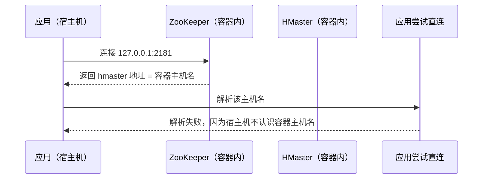
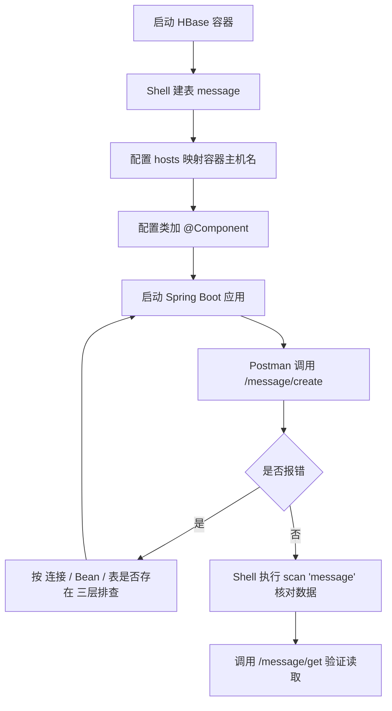

## 纲要

- `Result` 到 POJO 的类型映射：字符串、数值两套转换规则
- Controller 层暴露 `create` 与 `get` 两个接口，统一返回包装类型
- Docker 部署下最典型的两个坑：ZooKeeper 返回容器主机名、配置类缺少 `@Component`
- 容器卡死后重建表与重启服务的排查顺序
- 用 Postman 验证写入，再用 HBase Shell 核对数据
- 从异常现象反推根因的排查路径

## 📎 代码说明

本讲代码以**内联片段**形式呈现在正文中。课程课件仅发布第 2/3/4 章（MySQL 核心能力）的完整工程源码，本讲所属章节未随课件发布独立源码文件，故不做外部文件关联，请以正文片段为准。

## 结果集映射：把 Result 还原成对象

HBase 的 `Result` 是一堆 `byte[]`，映射回 POJO 时要分两类处理。

**字符串字段**直接用 `String` 的字节构造函数：

```java
messageInfo.setId(new String(result.getRow()));
messageInfo.setContent(new String(result.getValue(
        Bytes.toBytes("base"), Bytes.toBytes("content"))));
```

**数值字段**必须先还原成字符串，再转成数值类型：

```java
messageInfo.setUserId(Integer.valueOf(new String(result.getValue(
        Bytes.toBytes("base"), Bytes.toBytes("userId")))));
messageInfo.setItemId(Integer.valueOf(new String(result.getValue(
        Bytes.toBytes("base"), Bytes.toBytes("itemId")))));
messageInfo.setShopId(Integer.valueOf(new String(result.getValue(
        Bytes.toBytes("base"), Bytes.toBytes("shopId")))));
```

计数字段同样处理，只是列簇换成了 `count`：

```java
messageInfo.setLikeCount(Integer.valueOf(new String(result.getValue(
        Bytes.toBytes("count"), Bytes.toBytes("likeCount")))));
messageInfo.setRemarkCount(Integer.valueOf(new String(result.getValue(
        Bytes.toBytes("count"), Bytes.toBytes("remarkCount")))));
```

完整方法：

```java
@Override
public MessageInfo getMessage(String id) throws IOException {
    Table table = hbaseConnection.getTable(TableName.valueOf("message"));
    try {
        Get get = new Get(Bytes.toBytes(id));
        Result result = table.get(get);
        if (result.getRow() == null) {
            return null;
        }
        MessageInfo messageInfo = new MessageInfo();
        messageInfo.setId(new String(result.getRow()));
        messageInfo.setContent(str(result, "base", "content"));
        messageInfo.setUserId(intVal(result, "base", "userId"));
        messageInfo.setItemId(intVal(result, "base", "itemId"));
        messageInfo.setShopId(intVal(result, "base", "shopId"));
        messageInfo.setLikeCount(intVal(result, "count", "likeCount"));
        messageInfo.setRemarkCount(intVal(result, "count", "remarkCount"));
        return messageInfo;
    } finally {
        table.close();
    }
}

private String str(Result result, String family, String qualifier) {
    byte[] value = result.getValue(Bytes.toBytes(family), Bytes.toBytes(qualifier));
    return value == null ? null : new String(value);
}

private Integer intVal(Result result, String family, String qualifier) {
    String value = str(result, family, qualifier);
    return value == null ? null : Integer.valueOf(value);
}
```

抽出两个私有方法后，映射逻辑从"七段重复代码"收敛成"两段规则"。这里也补上了空值保护：列不存在时 `getValue` 返回 `null`，直接 `new String(null)` 会抛 NPE，而 HBase 是弱结构存储，缺列是完全可能发生的事。

## Controller 暴露接口

```java
package com.social.ecom.controller;

import com.social.ecom.helper.JsonReturnType;
import com.social.ecom.pojo.MessageInfo;
import com.social.ecom.service.MessageService;
import org.springframework.beans.factory.annotation.Autowired;
import org.springframework.web.bind.annotation.*;

import java.io.IOException;

@RestController
@RequestMapping("/message")
public class MessageController {

    @Autowired
    private MessageService messageService;

    @RequestMapping(value = "/create", method = RequestMethod.POST)
    @ResponseBody
    public JsonReturnType create(@RequestBody MessageInfo messageInfo) throws IOException {
        MessageInfo created = messageService.postMessage(messageInfo);
        return JsonReturnType.createType(created);
    }

    @RequestMapping(value = "/get", method = RequestMethod.GET)
    @ResponseBody
    public JsonReturnType get(@RequestParam(name = "id") String id) throws IOException {
        return JsonReturnType.createType(messageService.getMessage(id));
    }
}
```

约定：

- 路径统一挂在 `/message` 下，发布用 `POST`、查询用 `GET`；
- 入参用 `@RequestBody` 接收 JSON，出参统一包一层 `JsonReturnType`，方便前端统一处理错误码；
- `IOException` 不在这里吞掉，交给全局异常处理器转换成友好响应。

## 联调中真实踩到的两个坑

### 坑一：ZooKeeper 返回的是容器主机名

请求发出后报错，异常栈指向 Hadoop 获取信息失败。根因在连接流程：



我们配置的 `hbase.zookeeper.quorum=127.0.0.1` 只是"找到 ZooKeeper 的地址"，而 ZooKeeper 返回给客户端的 HMaster 地址是**容器内部的主机名**。应用跑在宿主机上，解析不了这个名字。

解决办法是在宿主机的 `hosts` 文件里补一条映射：

```shell
sudo vi /etc/hosts

# 追加一行，把容器主机名映射到本地
127.0.0.1   <容器主机名>
```

用 `docker exec -it hbase hostname` 就能拿到容器主机名。

这类问题在任何"应用在外面、集群在容器里"的组合下都会出现，本质上就是集群元数据里记录的地址对客户端不可达。

### 坑二：配置类少了 @Component

修改 hosts 之后仍然报 `connection could not be found`。原因很简单——配置类上没有加 Spring 的组件注解，`@Bean` 根本没被扫描到：

```java
@Component   // 少了这一行，@Bean 不会被注册
public class CustomHBaseConfiguration {
    // ...
}
```

`@Bean` 方法只有在被 Spring 管理的类中才会生效。这个错误的表现是"Bean 找不到"，而不是"配置写错了"，所以排查时要先看容器里到底有没有这个 Bean。

### 坑三：容器卡死导致建表失败

建表时返回失败，原因是长时间没有操作导致容器卡死。处理顺序：

```shell
# 重启容器
docker restart hbase

# 重新建表
docker exec -it hbase hbase shell
create 'message', 'base', 'count'
```

启动 HBase 需要一定时间，重启后不要立刻发请求，等 16010 控制台显示 RegionServer 就绪再操作。

## 完整联调流程



用 Postman 发起写入，请求体只需要业务字段，`id` 与计数字段由服务端生成：

```json
{
  "userId": 1,
  "itemId": 1,
  "shopId": 2,
  "content": "这个商品太赞了"
}
```

`userId` 要取真实存在的用户，`itemId` / `shopId` 同样要对应 `item` 表与 `shop` 表中的实际记录，否则虽然写入成功，后续关联查询会查不到东西。

写入后用 Shell 核对：

```shell
scan 'message'
```

能看到一条记录，RowKey 是去掉横杠的 UUID，`base` 列簇下有 `content` / `userId` / `itemId` / `shopId`，`count` 列簇下 `likeCount` / `remarkCount` 均为 0。

## 排查路径总结

遇到 HBase 接入失败时，按从下到上的顺序排查效率最高：

| 层级 | 检查点 | 典型症状 |
| --- | --- | --- |
| 网络与地址 | 端口是否暴露、hosts 是否映射容器主机名 | 连接超时、UnknownHostException |
| 容器状态 | 容器是否存活、RegionServer 是否就绪 | 建表失败、请求无响应 |
| Spring 容器 | 配置类是否有 `@Component`、`@Bean` 是否注册 | `connection could not be found` |
| 表与列簇 | 表是否存在、列簇名是否与代码一致 | 写入时报 table not found |
| 数据映射 | 写入与读取的类型约定是否一致 | 读取到乱码或转换异常 |

绝大多数问题都落在前三层——HBase 本身 rarely 出问题，出问题的是"应用与集群之间的连通性"和"Spring 装配"。

## API 速览

| API | 说明 |
| --- | --- |
| `Result.getRow()` | 返回 RowKey 字节数组，null 表示记录不存在 |
| `Result.getValue(byte[],byte[])` | 按列簇 + 列取值，缺失时返回 null |
| `new String(byte[])` | 字节还原为字符串，需做空值保护 |
| `Integer.valueOf(String)` | 字符串转数值，与写入侧 `String.valueOf` 对称 |
| `@RestController` | 组合注解，等价于 `@Controller` + `@ResponseBody` |
| `@RequestMapping(path,method)` | 声明路径与 HTTP 方法 |
| `@RequestBody` | JSON 请求体反序列化为对象 |
| `@RequestParam(name)` | 绑定 query 参数 |

## Demo 示例

### 运行说明

```shell
# 1. 确认容器主机名
docker exec -it hbase hostname

# 2. 追加 hosts 映射（主机名替换为上一步的输出）
echo "127.0.0.1   <容器主机名>" | sudo tee -a /etc/hosts

# 3. 建表
docker exec -it hbase hbase shell -e "create 'message', 'base', 'count'"

# 4. 启动应用后调用
curl -X POST http://localhost:9090/message/create \
  -H 'Content-Type: application/json' \
  -d '{"userId":1,"itemId":1,"shopId":2,"content":"这个商品太赞了"}'

curl 'http://localhost:9090/message/get?id=<上一步返回的 id>'
```

### 关键代码

```java
/**
 * 根据讲稿逻辑补充：结果集映射的最小实现，含空值保护
 */
private MessageInfo map(Result result) {
    if (result.getRow() == null) {
        return null;
    }
    MessageInfo info = new MessageInfo();
    info.setId(new String(result.getRow()));
    info.setContent(str(result, "base", "content"));
    info.setUserId(intVal(result, "base", "userId"));
    info.setItemId(intVal(result, "base", "itemId"));
    info.setShopId(intVal(result, "base", "shopId"));
    info.setLikeCount(intVal(result, "count", "likeCount"));
    info.setRemarkCount(intVal(result, "count", "remarkCount"));
    return info;
}
```

### 代码说明

- `getRow() == null` 是判断记录是否存在的唯一可靠方式；
- `str()` 与 `intVal()` 把"字节 → 字符串"与"字符串 → 数值"两段规则收敛，避免七处重复代码里出现六种写法；
- 弱结构存储意味着列随时可能缺失，所有取值都要考虑 null。

### 技术点总结

- 映射规则必须与写入侧严格对称，尤其是数值统一走"字符串中转"；
- Controller 层只做协议转换，异常向上抛给统一处理器；
- 容器化部署的两个经典坑：ZooKeeper 返回容器主机名导致不可达、配置类缺注解导致 Bean 未注册；
- 联调时用 Shell 直接核对数据，能立刻区分"写没写进去"和"读出来解析错了"这两类问题；
- 排查顺序从网络到容器再到 Spring 装配，绝大多数问题都在前三步。
