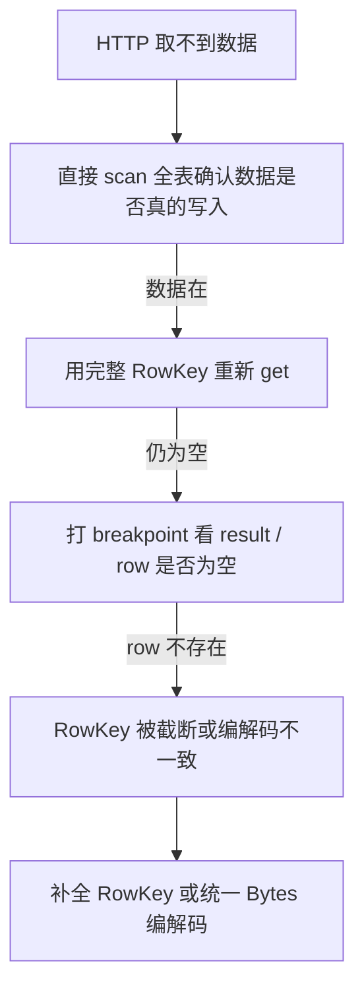

## 纲要

- 接入 HBase 的第一道坎不是 CRUD，而是环境与配置：Spring `@Value` 注入语法、容器主机名解析
- Docker 部署的 HBase，必须把容器名映射到本地 IP，否则应用找不到 Master / RegionServer
- 首次建立 Hadoop 连接耗时不短，进程"卡住"往往是在 `Connection` 里建链，并非死锁
- 联调典型坑一：字段名写错（如 `likeCount` 误写成去读 `remarkCount`），scan 看到的值对不上
- 联调典型坑二：RowKey 拷贝不全（被换行截断），导致 `get` 按残缺 RowKey 查不到任何行
- 一条排错主线：先 scan 全表确认数据已写入，再用完整 RowKey 去 `get`，最后才进 Controller / debug

## 📎 代码说明

本讲代码以**内联片段**形式呈现在正文中。课程课件仅发布第 2/3/4 章（MySQL 核心能力）的完整工程源码，本讲所属章节未随课件发布独立源码文件，故不做外部文件关联，请以正文片段为准。

## 配置注入：别把 `@Value` 写成字符串

通过 Spring 注入 HBase 配置时，最常见的低级错误是把占位符直接写成裸字符串。正确写法必须包一层 `${...}`：

```java
// 错误：把 "hbase.zookeeper.quorum" 当成普通字符串，注入不到配置文件的值
@Value("hbase.zookeeper.quorum")
private String zkQuorum;

// 正确：从配置文件中按 key 取值
@Value("${hbase.zookeeper.quorum}")
private String zkQuorum;
```

少写一对 `${}` 和 `}`，配置就变成了一个字面量，连接时自然拿不到真正的 ZK 地址。复制粘贴配置文件时尤其容易漏掉。

## 主机名解析：把容器名映射到本地 IP

当 HBase 跑在 Docker 容器里时，应用代码里连接的往往是容器名（如 `hbase`）。本机如果不认识这个域名，就无法映射到 Master / RegionServer。需要在本机 `hosts` 文件里手动加一行：

```shell
# /etc/hosts（macOS / Linux）或 C:\Windows\System32\drivers\etc\hosts
# 把容器名指向本地回环，让应用能解析到 Master 服务
127.0.0.1   hbase
```

否则应用在连接阶段就会因为无法解析主机名而失败，或连到一个不存在的地址。

## 首次连接耗时要心里有数

第一次调用 Hadoop / HBase 的 `Connection` 时，耗时明显比后续请求长。表现上应用程序可能"卡住"不动，但实际上它正在：

1. 连上 ZooKeeper；
2. 通过 ZK 拿到 Master 与 RegionServer 的路由；
3. 建立起会话（session build 成功）。

只要最终 session 建立成功、ZK 与 Master / RegionServer 都连上了，这种"卡顿"就是正常的建链开销，耐心等一会即可，不必误判为死锁。

## 联调坑一：字段名写错，scan 看到的值对不上

写入消息实体后，直接 `scan 'message'` 全表校验，应该能看到 `content`、`itemID`、`shopID`、`userID`、`likeCount`、`remarkCount` 都已写入。但联调时经常发现某个计数"数值不对"——例如期望 `likeCount` 是别的数字，表里却显示 `2`。

根因往往是代码里字段串了：写的时候写的是 `likeCount`，读 / 展示的时候却误调用了 `getRemarkCount()`，两个计数字段互相串台。这类问题 `scan` 一眼就能看出"值存对了但取错了"，定位极快：

```java
// 写入时：likeCount 正确赋值
put.addColumn(Bytes.toBytes("count"), Bytes.toBytes("likeCount"),
        Bytes.toBytes(messageInfo.getLikeCount()));

// 读取时常见的笔误：本该取 likeCount，却取了 remarkCount
// int like = messageInfo.getRemarkCount();   // 错误
int like = messageInfo.getLikeCount();        // 正确
```

## 联调坑二：RowKey 拷贝不全，get 永远查不到

另一个高频坑是 RowKey 因换行被截断。通过 HTTP `GET /messageAct?id=xxx` 取数据时，如果返回的列表里 ID 没有拷全（比如一行结尾的换行把 RowKey 截掉一截），拿这个残缺的 RowKey 去 `get`，结果必然是"row 不存在"。

排错顺序应该是：



实际经验是：先回 HBase Shell 把那一行 `scan` 出来，把 RowKey 原样复制（注意别吃掉结尾字符），再拿去 `get`，往往就通了。问题从来不是"数据没写进去"，而是"拿了一个错的 RowKey 去查"。

## 一条排错主线

把上面所有坑收敛成一条可复用的联调顺序：

1. `scan` 全表，确认数据确实写入、字段值正确；
2. 校验 RowKey 完整（尤其注意换行截断与 Bytes 编解码一致）；
3. 用完整 RowKey 直接 `get`，确认单条可取；
4. 最后才进 Controller，用 HTTP 接口联调，必要时打 breakpoint 看 `Result` / `row`。

绝大多数"取不到数据"的故障，都止步在第 1~2 步，而不是业务逻辑本身。

## API 速览

| 环节 | 要点 |
| --- | --- |
| `@Value("${key}")` | Spring 配置占位符，必须带 `${}` |
| 本地 `hosts` 映射 | 容器名 → `127.0.0.1`，保证主机名可解析 |
| `Connection` 首次建链 | 经 ZK 路由到 Master / RegionServer，首连偏慢属正常 |
| `scan '表'` | 联调第一步，确认写入与字段值 |
| `get '表','完整RowKey'` | 单条校验，RowKey 必须完整一致 |
