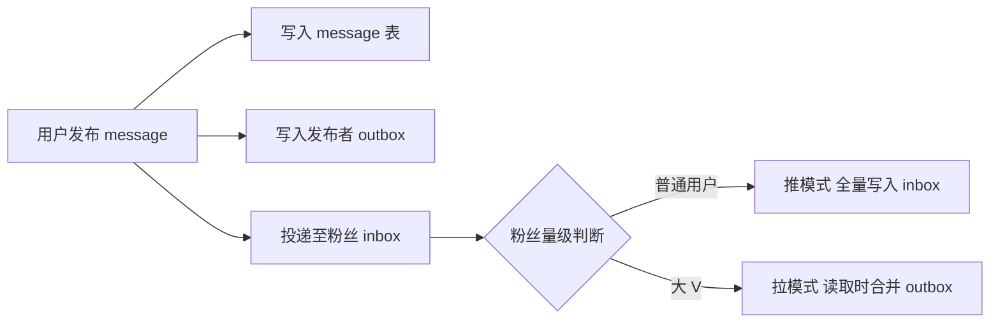
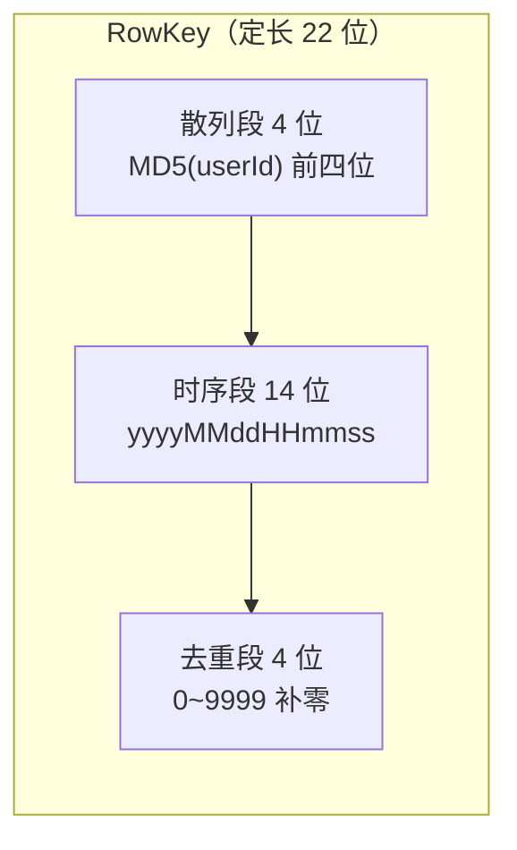
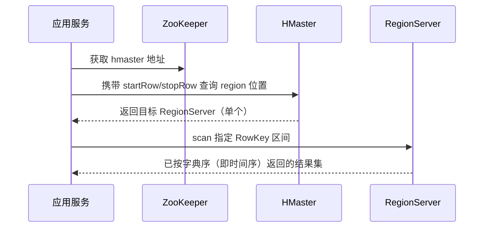

## 纲要

- 收件箱（Inbox）与发件箱（Outbox）为何要在 HBase 中以两张表承载，列簇如何划分
- HBase 弱结构特性带来的后果：列簇要预定义，列不需要预定义，字段约束落在 Java 模型上
- RowKey 的三段式设计：散列段（userId 的 MD5 前四位）+ 时序段（createTime 十四位）+ 去重段（随机数补零）
- 为什么"自增数字 + 时间戳"不是好 RowKey，为什么要做 padding 保证定长
- BoxService 的 putBox 语义：一条消息同时写入发件箱与粉丝收件箱，大 V 走特殊策略
- RowKey 生成工具类的完整实现与单元测试思路

## 📎 代码说明

本讲代码以**内联片段**形式呈现在正文中。课程课件仅发布第 2/3/4 章（MySQL 核心能力）的完整工程源码，本讲所属章节未随课件发布独立源码文件，故不做外部文件关联，请以正文片段为准。

## 为什么需要收件箱与发件箱

Feed 流的数据模型可以拆成两层：

第一层是消息实体本身（`message` 表），存的是"这条消息是什么"——内容、发布者、分享的商品、所属门店、点赞数与评论数。它的 RowKey 只需要足够散列，因为访问它的方式永远是"拿到一批 ID 之后批量回查"。

第二层是时序索引层，也就是发件箱与收件箱：

- `outbox`：以**发布者**为维度，记录"我发过什么"
- `inbox`：以**接收者**为维度，记录"我该看到什么"



这一层才是 RowKey 设计发挥价值的地方：用户拉取首页时，本质上是对 `inbox` 做一次带 `startRow`/`stopRow` 的范围扫描，RowKey 是否把"同一个人的数据聚在一起、且天然按时间倒序"，直接决定这次扫描是命中单个 Region 还是退化成全表扫描。

## 表结构与列簇设计

先进入 HBase Shell 建表，两张表都只保留一个列簇 `base`：

```shell
# 发件箱：以发布者 userId 为维度
create 'outbox', 'base'

# 收件箱：以接收者 userId 为维度
create 'inbox', 'base'
```

这里体现了 HBase 的弱结构特性：我们只声明了列簇，没有声明任何列。列的集合可以在写入时任意扩展，但**列簇必须预先定义**，因为同一个列簇下的所有列会被存储在同一份 StoreFile 中，列簇的划分等价于物理存储划分。

列簇划分的原则是"把一起被读取的列放在一起"。发件箱与收件箱的所有字段都是被整体读取的（拉取列表时一次性拿出），因此单列簇是最优解；而 `message` 表则拆成 `base`（内容、userID、itemID、shopID）与 `count`（likeCount、remarkCount）两个列簇，因为计数字段的更新频率远高于内容字段。

## Java 模型：把弱结构约束回强类型

由于 HBase 侧没有 schema，字段的定义与校验必须由应用层承担。两个实体的字段几乎一致，区别在于 `userId` 的语义：

```java
package com.social.ecom.pojo;

import java.util.Date;

/**
 * 发件箱实体：userId 表示消息的发布者
 */
public class OutboxInfo {

    /** RowKey：由 userId + createTime + 随机数 组成 */
    private String id;

    /** 发布者用户 ID */
    private Integer userId;

    /** 消息创建时间，等价于 message 的发布时间 */
    private Date createTime;

    /** 关联的 message ID */
    private String messageId;

    public String getId() {
        return id;
    }

    public void setId(String id) {
        this.id = id;
    }

    public Integer getUserId() {
        return userId;
    }

    public void setUserId(Integer userId) {
        this.userId = userId;
    }

    public Date getCreateTime() {
        return createTime;
    }

    public void setCreateTime(Date createTime) {
        this.createTime = createTime;
    }

    public String getMessageId() {
        return messageId;
    }

    public void setMessageId(String messageId) {
        this.messageId = messageId;
    }
}
```

```java
package com.social.ecom.pojo;

import java.util.Date;

/**
 * 收件箱实体：userId 表示消息的接收者，其余字段与发件箱一致
 */
public class InboxInfo {

    /** RowKey */
    private String id;

    /** 接收者用户 ID */
    private Integer userId;

    /** 消息发布时间 */
    private Date createTime;

    /** 关联的 message ID */
    private String messageId;

    // getter / setter 省略，结构与 OutboxInfo 相同
}
```

字段完全一致是有意为之：两条链路共用同一套序列化与分页逻辑，只是 `userId` 的语义不同。真正需要注意的是 `createTime`——它既是业务上的发布时间，也是 RowKey 的时序段来源，两者必须严格同源，否则排序结果会与展示时间不一致。

## BoxService：一次发布，多处投递

服务接口只暴露一个入口，把"投递策略"收敛在实现类内部：

```java
package com.social.ecom.service;

import com.social.ecom.pojo.MessageInfo;

public interface BoxService {

    /**
     * 用户发布一条消息后，同时写入其发件箱与关联用户的收件箱
     *
     * @param messageInfo 已持久化的消息实体
     */
    void putBox(MessageInfo messageInfo);
}
```

实现类上需要注入两类依赖：HBase 连接，以及前面封装的关注关系仓储（用于拿到粉丝列表）：

```java
package com.social.ecom.service.impl;

import com.social.ecom.pojo.MessageInfo;
import com.social.ecom.repository.NeoUserRepository;
import com.social.ecom.service.BoxService;
import org.apache.hadoop.hbase.client.Connection;
import org.springframework.beans.factory.annotation.Autowired;
import org.springframework.stereotype.Service;

@Service
public class BoxServiceImpl implements BoxService {

    @Autowired
    private Connection hbaseConnection;

    @Autowired
    private NeoUserRepository neoUserRepository;

    @Override
    public void putBox(MessageInfo messageInfo) {
        // 1. 写入发布者发件箱
        // 2. 查询粉丝列表，按量级决定推 / 拉策略
        // 3. 普通用户：批量写入粉丝收件箱；大 V：跳过写入，读取时合并
    }
}
```

把策略判断放在这里是关键：如果大 V 每次发布都向千万级粉丝的收件箱写入，写放大是不可承受的；而对普通用户做拉模式，又会让读取侧产生大量随机 IO。推拉混合的判断点上移到服务层，存储层保持纯粹。

## RowKey 三段式设计

RowKey 必须同时满足三个互相牵制的目标：

| 目标 | 实现方式 | 违反后的后果 |
| --- | --- | --- |
| 足够散列 | `MD5(userId)` 取前四位作为前缀 | 数据集中到少数 RegionServer，形成热点 |
| 请求路由集中 | 同一 `userId` 恒定映射到同一前缀 | 一次拉取要跨多个 RegionServer 归并，无法利用本地缓存 |
| 天生带排序 | 中间段嵌入 `yyyyMMddHHmmss` | 拉取列表后还要在应用层排序，且无法利用 `startRow` 分页 |
| 同一秒去重 | 尾段追加定长随机数 | 同秒多条消息 RowKey 冲突，后写覆盖先写 |



### 散列段：为什么要对 userId 做 MD5

`userId` 在我们的系统里是 `1、2、3…` 这样的自增整数。如果直接把它作为 RowKey 前缀，那么 RowKey 的取值空间只有 0-9 这十个字符，做字典序分区后大量数据会落在同一个 Region 区间内——活跃用户和新用户的分布极度不均，热点几乎是必然的。

对 `userId` 取 MD5 再截取前四位，等价于把自增序列映射到 `0~f` 的十六进制空间，分布被彻底打散。同时这个映射是**确定性**的：同一个用户每次请求算出的前缀都一样，因此"路由集中"的目标同时被满足。

截取而不是全量使用，是因为 RowKey 越长，MemStore、BlockCache 与 HFile 索引的开销越大，查询效率反而下降。四位十六进制（约 6.5 万个桶）对我们这个量级已经足够。

### 时序段：让排序发生在存储层

中间十四位固定为 `yyyyMMddHHmmss`。因为前缀已被用户锁定，这一段的字典序就等价于时间序。HBase 的 scan 默认按 RowKey 升序返回，因此"拉取最新一页"可以直接用 `stopRow` 从时间上限往回扫，或者在设计上做时间戳反转（`Long.MAX_VALUE - timestamp`）来实现降序，应用层完全不需要再排序。

### 去重段：定长是关键

同一用户在同一秒内连发多条消息完全可能。尾段追加 `0~9999` 的随机数后，冲突概率降到可接受水平。

这里最容易被忽略的是**定长**：RowKey 是字符串比较，如果某次生成的是 `7`、下次是 `1234`，那么 `7` 会排在 `1234` 之后（字符 `7` > 字符 `1`），时间序被破坏。因此不足四位的随机数必须左补零。

## RowKey 生成实现

```java
package com.social.ecom.helper;

import org.apache.commons.codec.digest.DigestUtils;

import java.text.SimpleDateFormat;
import java.util.Date;
import java.util.Random;

/**
 * RowKey 生成工具：散列段 + 时序段 + 去重段
 */
public class RowKeyGenerator {

    /** 时序段格式：定长十四位 */
    private static final String TIME_PATTERN = "yyyyMMddHHmmss";

    /** 尾段随机数的定长位数 */
    private static final int RANDOM_LENGTH = 4;

    private static final Random RANDOM = new Random();

    private RowKeyGenerator() {
    }

    /**
     * 生成发件箱 / 收件箱 RowKey
     *
     * @param userId    用户 ID（发件箱为发布者，收件箱为接收者）
     * @param createTime 消息创建时间
     * @return 定长 RowKey
     */
    public static String generate(Integer userId, Date createTime) {
        String begin = DigestUtils.md5Hex(String.valueOf(userId)).substring(0, 4);
        String middle = new SimpleDateFormat(TIME_PATTERN).format(createTime);
        String end = padding(RANDOM.nextInt(10000));
        return begin + middle + end;
    }

    /**
     * 左补零至定长，保证 RowKey 整体长度一致
     */
    private static String padding(int sequence) {
        String value = String.valueOf(sequence);
        StringBuilder builder = new StringBuilder();
        for (int i = 0; i < RANDOM_LENGTH - value.length(); i++) {
            builder.append('0');
        }
        builder.append(value);
        return builder.toString();
    }
}
```

几个实现细节值得强调：

- `DigestUtils` 来自 `commons-codec`，也就是课程中额外引入的依赖，避免手写 `MessageDigest` 的十六进制转换；
- `SimpleDateFormat` 不是线程安全的，在工具类里作为局部变量创建，或改为 `DateTimeFormatter`；
- `padding` 必须保证返回值定长，任何一位的缺失都会让字典序失真；
- `Random` 实例复用即可，不需要每次新建。

## 拉取侧的收益

有了这套 RowKey，"拉取某个用户的收件箱第 N 页"就变成了一次完全落在单个 Region 上的范围扫描：



由于前缀固定，HMaster 在元数据中可以基于 RowKey 区间直接定位到唯一的 Region，请求不会广播给所有 RegionServer；由于时序段内嵌，返回结果天然有序；由于定长，分页的 `startRow` 可以直接由上一页最后一条记录推导，不需要维护额外的游标。

## API 速览

| API | 说明 |
| --- | --- |
| `DigestUtils.md5Hex(String)` | commons-codec 提供，返回 32 位十六进制 MD5 串 |
| `SimpleDateFormat(String)` | 格式化时间戳为定长字符串，注意线程安全 |
| `Random.nextInt(int bound)` | 生成 `[0,bound)` 区间随机数 |
| `Connection.getTable(TableName)` | 获取 HBase 表句柄，非线程安全，用完需关闭 |
| `Table.put(Put)` | 单行写入，RowKey 由 `Put` 构造函数指定 |
| `Table.getScanner(Scan)` | 范围扫描，配合 `startRow`/`stopRow` 使用 |

## Demo 示例

### 运行说明

一个独立的 Java 类即可验证 RowKey 的分布与排序特性，只需引入 `commons-codec`：

```xml
<dependency>
    <groupId>commons-codec</groupId>
    <artifactId>commons-codec</artifactId>
    <version>1.14</version>
</dependency>
```

### 完整代码

```java
import org.apache.commons.codec.digest.DigestUtils;

import java.text.SimpleDateFormat;
import java.util.*;

/**
 * 根据讲稿逻辑补充：验证 RowKey 的散列性、时序性与定长特性
 */
public class RowKeyDemo {

    private static final String TIME_PATTERN = "yyyyMMddHHmmss";
    private static final int RANDOM_LENGTH = 4;
    private static final Random RANDOM = new Random(20240101L);

    public static void main(String[] args) throws Exception {
        SimpleDateFormat format = new SimpleDateFormat(TIME_PATTERN);
        Date now = format.parse("20240101120000");
        Calendar calendar = Calendar.getInstance();

        List<String> keys = new ArrayList<>();
        // 模拟 12 个用户，每个用户在相邻秒内各发 3 条
        for (int userId = 1; userId <= 12; userId++) {
            for (int n = 0; n < 3; n++) {
                calendar.setTime(now);
                calendar.add(Calendar.SECOND, n);
                keys.add(generate(userId, calendar.getTime()));
            }
        }

        // 校验定长
        Set<Integer> lengths = new TreeSet<>();
        for (String key : keys) {
            lengths.add(key.length());
        }
        System.out.println("RowKey 长度集合 = " + lengths);

        // 统计前缀分布（散列性）
        Map<String, Integer> buckets = new TreeMap<>();
        for (String key : keys) {
            buckets.merge(key.substring(0, 1), 1, Integer::sum);
        }
        System.out.println("首字符分桶 = " + buckets);

        // 校验同一用户的时序性
        List<String> userOne = keys.subList(0, 3);
        List<String> sorted = new ArrayList<>(userOne);
        sorted.sort(Comparator.naturalOrder());
        System.out.println("用户 1 的三条 RowKey 升序 = " + sorted);
    }

    public static String generate(Integer userId, Date createTime) {
        String begin = DigestUtils.md5Hex(String.valueOf(userId)).substring(0, 4);
        String middle = new SimpleDateFormat(TIME_PATTERN).format(createTime);
        return begin + middle + padding(RANDOM.nextInt(10000));
    }

    private static String padding(int sequence) {
        String value = String.valueOf(sequence);
        StringBuilder builder = new StringBuilder();
        for (int i = 0; i < RANDOM_LENGTH - value.length(); i++) {
            builder.append('0');
        }
        return builder.append(value).toString();
    }
}
```

### 代码说明

- 第一段输出验证"定长"：所有 RowKey 长度必须一致，否则字典序不可信；
- 第二段统计首字符分桶，验证自增 userId 经过 MD5 后不再单调聚集；
- 第三段验证同一用户的三条记录按字典序排列时，时间顺序也是递增的。

### 技术点总结

- RowKey 是 HBase 唯一的索引，设计质量直接决定系统是命中 Region 还是退化为全表扫描；
- 散列与集中并不矛盾：用确定性哈希把"用户"这个查询维度锁定到固定前缀，其余维度随机化；
- 定长是字典序排序生效的前提，补零不可省略；
- 收件箱与发件箱是同一套 RowKey 规则的两个语义实例，模型可以复用，但 `userId` 的含义必须区分清楚。
