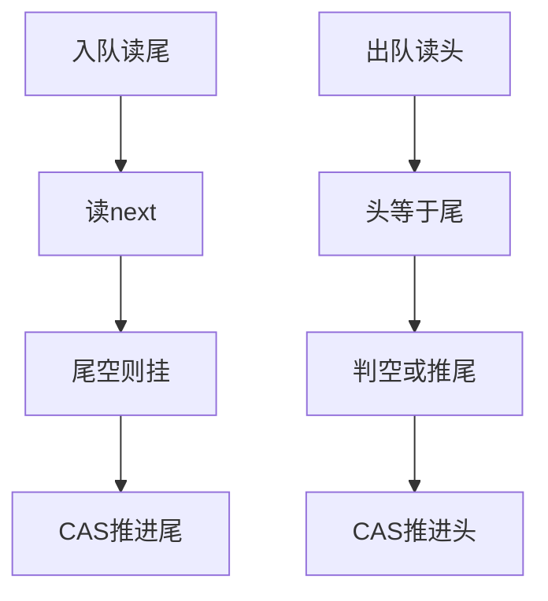

# 1011 指针原子深挖：无锁链表队列

> 分类：并发模型 | 难度：L4 | 题型：工程题 | 频率：中
> 原文锚点：第 89~126 段「queen2 无锁链表队列用 CS 推进 head/tail；queen 用头尾两把锁」

## 思路与架构
无锁队列（Michael-Scott）把 head/tail 做成 `atomic.Pointer[Node]`，入队/出队靠 CAS 自旋推进指针，永不调用锁。核心：先尝试把新节点挂到 tail.next，成功后再把 tail 往前推。

- 入队：读 tail、读 tail.next；next 为空则 CAS 把 node 挂上，再 CAS 推 tail。
- 出队：读 head/next；head==tail 且 next 空则队列空，否则 CAS 推进 head 取走值。
- 两次 CAS 是"先挂后推"，保证任一瞬间结构都自洽。

## 方案取舍
| 方案 | 并发度 | 一致性 | 复杂度 | 适用 |
|---|---|---|---|---|
| 单锁切片队列 | 低 | 强 | 低 | 简单低频 |
| 头尾两锁链表 | 中 | 强 | 中 | 头尾分离热点 |
| 无锁 CAS 链表 | 高 | 单指针原子 | 高 | 高吞吐低延迟 |

选型结论：读多写少或头尾分离明显用两锁链表即可；极致吞吐且 CAS 成功率高才上无锁。无锁不等于更快，需压测。

不适用边界：CAS 在极高写竞争下自旋空转，反而比休眠锁更耗 CPU；且实现易出 ABA 类 bug。

## 性能量级与实测数据
CAS 单操作约数 ns 级（接近原子指令开销），无锁入队在中等竞争下吞吐高于互斥锁 `[经验]`；但具体拐点取决于 CPU 核数、队列长度与竞争强度，无普适结论，必须 `go test -bench` 实测。

## 答题技巧

## 细节与核心 API
- `atomic.Pointer[Node]`：head/tail 用泛型指针，免 unsafe 转换 `[源码]`。
- `CompareAndSwap(old, new *Node)`：比地址，挂节点与推进指针都靠它 `[源码]`。
- `Load()`：读当前头/尾，无竞争零开销 `[源码]`。
- ABA：中间被换走又换回同地址会让 CAS 误判成功，需用计数或不可复用节点规避 `[经验]`。
- `Swap`：整体替换指针时用，替换配置对象比 CAS 更直接 `[源码]`。

- 30 秒版：head/tail 用 atomic.Pointer，入队 CAS 挂尾再推尾，出队 CAS 推头。
- 3 分钟版：讲清"先挂后推"两次 CAS 与 head==tail 空队判定。
- 白板版：画出 head→node→...→tail 与两次 CAS 的时序。
- 不会怎么接：承认无锁细节易错，迁移到"两锁链表"或 sync 原语，诚实收尾。

## 广度与深度延伸
- 横向：Java `ConcurrentLinkedQueue`、C++ `std::atomic` 的 CAS 同构思路。
- 纵向：runtime 里 `atomic.Pointer` 底层即 `atomic.LoadPointer`，CAS 走 `cmpxchg` 指令 `[源码]` sync/atomic。

## 反问环节
可反问面试官：业务峰值写竞争多大？是否实测过无锁 vs 两锁？展示"不为无锁而无锁"的判断力。
