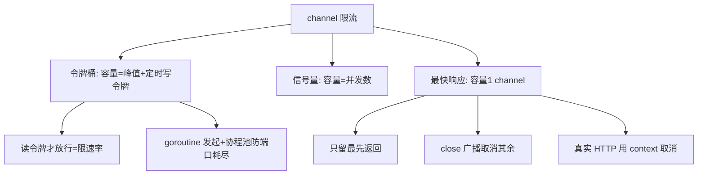

# 1016 用 channel 实现限流 深挖

> 覆盖源 10-16 全文：channel 令牌桶限速、goroutine 发起与协程池、最快响应与取消。主卡已拆成令牌桶实现、最快响应、令牌桶 vs 信号量三张，本附录做横向串联与取舍。

## 思路与架构

## 方案取舍
- **令牌桶 vs 信号量**：令牌桶控「每周期请求数」、允许积存令牌短时突发；信号量只卡在飞数、不平滑速率。选型看要「多快」还是「多少」。
- **goroutine 发起**：必须，否则请求耗时拉长实际速率；但无协程池会堆积 goroutine、拥堵致本地端口耗尽。
- **最快响应 vs 限速**：两者都是 channel 妙用，前者竞速收敛（谁先谁赢）、后者恒定节流；生产常组合（限速发 + 竞速取）。

## 答题技巧
- 被问「channel 限速」先定位语义（速率 or 并发），再给实现，比直接甩代码显体系 [经验]。
- 主动边界到 `1015`(信号量)/`108`(分布式)/`158`(微服务限流)/`711`(协程池)，构成限流全栈 [边界]。
