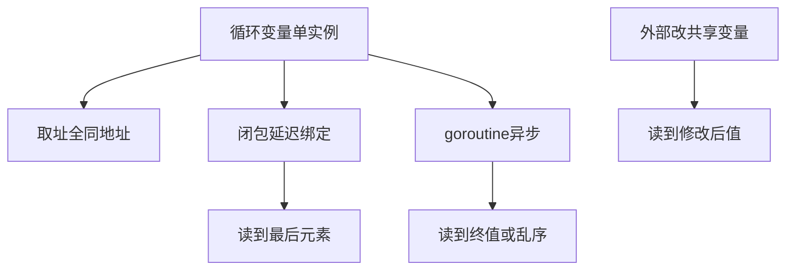

# 1017 Goroutine 闭包陷阱 深挖附录

> 关联主卡：1017-closure-loop-var / 1017-closure-late-binding / 1017-goroutine-loop-var / 1017-closure-shared-modify / 1017-goroutine-solutions
> 深挖门槛命中：L3（竞态本质 + 版本翻转）+ 源码层（循环变量 scope 演进）

## 思路与架构
四个坑本质是同一条链：闭包/goroutine 捕获的是**变量本身**而非值快照，执行时机晚于迭代/外部修改 → 读到意外值。切入顺序：取址陷阱 → 闭包延迟绑定 → goroutine 异步竞态 → 共享变量被改，最后归一解法。

文字版：① 旧版循环变量全程一个地址，是三坑共同根因；② 取址与闭包延迟绑定在同步场景也可复现；③ goroutine 因异步调度让结果更不确定；④ 共享变量被外部改写是另一种时序竞态；⑤ 解法统一为"让每轮/每次有独立存储"。

## 方案取舍
| 维度 | 循环内重赋值 | 传值参数 | 传指针 |
|---|---|---|---|
| 每轮独立 | 是（新变量） | 是（值拷贝） | 否（同地址） |
| 可读性 | 中 | 高 | 低 |
| 兼容性 | 全版本 | 全版本 | 全版本(无效) |
| 推荐 | 可用 | 首选 | 不推荐 |

选型结论：首选传值参数，最清晰且全版本有效；重赋值为旧版常见写法；传指针是伪解。不适用边界：真正的多 goroutine 共享状态仍须靠锁/chan，而非靠变量独立。

## 细节与核心 API
- `go func(){...}()`：异步启动 goroutine，调度时机不确定 `[源码]`。
- `for i := range/0..n`：旧版 `i` 单实例，1.22+ 每轮独立 `[源码]` release notes。
- `i := i`：循环内重声明，制造每轮独立变量。
- `go func(v int){}(i)`：传值，参数独立拷贝。
- `sync.WaitGroup`：`Add/Done/Wait` 同步，`Done` 须在 goroutine 内 `[源码]`。
- `go test -race`：检测捕获变量共享写的数据竞态 `[源码]`。

## 性能量级与实测数据
重赋值/传值本身零额外开销，开销只在 goroutine 创建与调度。循环内启大量 goroutine 受调度与栈影响，无普适数值 `[存疑]`。验证：`GOMAXPROCS=1` 下旧版稳定输出全 10，多核多跑出现乱序（需真实复现）。

## 答题技巧
- 30 秒版：闭包捕获变量不是值，执行时才读；goroutine 异步 → 读终值或乱序；修法是传值或重赋值。
- 3 分钟版：补取址坑、延迟绑定、共享变量竞态三变体，点出 Go 1.22 per-iteration scope 翻转。
- 白板版：画"循环变量单实例 → 闭包/goroutine 捕获 → 执行晚 → 读到意外值"因果链。
- 话术模板："捕获的是变量本身，执行时才取值；1.22 前循环变量共享，现在每轮独立，但我仍会显式传参。"
- 不会怎么接：诚实说"per-iteration scope 是 1.22 引入的，老版本不是"，不编语义。

## 广度与深度延伸
- 横向：其他语言闭包（JS 的 `let` 同款修复、Python 默认延迟绑定需默认参数）。
- 纵向：Go 1.22 release notes 循环变量语义、编译器如何实现 per-iteration scope。

## 反问环节
可反问："咱们代码库最低支持的 Go 版本是多少？循环变量语义翻转后，老修复代码是否还要保留？"——体现版本治理意识。
