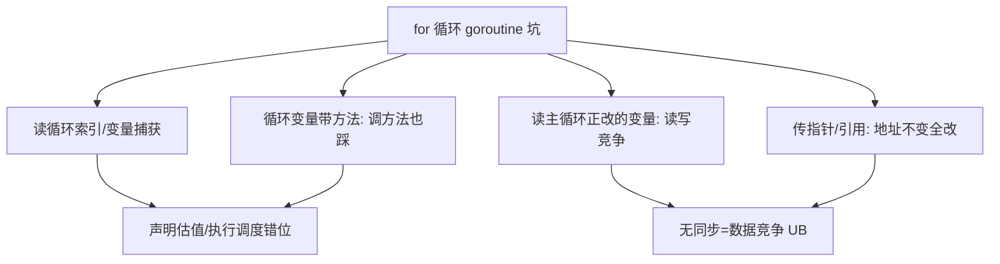

# 1018 for 循环 goroutine 坑 深挖

> 覆盖源 10-18 全文：for 循环里启动 goroutine 读共享/循环变量导致的各类竞态。
> 主卡已详述估值/执行模型（1018-goroutine-eval-exec-model）、读写竞争（1018-goroutine-shared-write-race）、-race 检测（1018-goroutine-data-race-detector）；循环变量捕获基础见 1017、修法见 1017。

## 思路与架构



- 一条主线：所有坑都来自"声明即估值、执行才调度"这一时间错位，以及"地址共享"导致的写读无隔离。
- 与 1017 的关系：1017 聚焦"循环变量捕获 + 传值/重赋值修法"；本卡补"读写竞争、指针传递、带方法、检测工具、心智模型"四块，互补不重复。

## 方案取舍

| 坑 | 本质 | 修法 | 备注 |
|---|---|---|---|
| 读循环索引 | 共享变量读终值 | 传值/重赋值 | 1017 已详 |
| 读写共享变量 | 数据竞争 UB | 拷贝/锁/chan | 危害最大 |
| 传指针/引用 | 地址不变全改 | 传值 | 与"不修"同效 |
| 带方法循环变量 | 地址不变读当时值 | 传值/重赋值 | 方法也读当前值 |

- **选型结论**：最稳的是"传值参数"——天然断开心地址共享；需要共享状态时用锁/chan，勿依赖时序。
- **不适用边界**：Go 1.22+ 循环变量 per-iteration 已自愈，但显式传值仍更清晰、向后兼容。

## 细节与核心 API

- `go f(args)`：args 在 go 语句处求值，函数体异步调度 `[源码]`。
- 值类型参数：每次调用做值拷贝，goroutine 持有独立副本，安全 `[经验]`。
- 指针/引用参数：多个 goroutine 共享同一地址，写读无同步即竞争 `[经验]`。
- `go test -race`：竞态检测器，报"写-读无 happens-before"的冲突栈；建议 CI 常开、生产关 `[源码]`。
- `sync.Mutex` / `atomic` / `channel`：保护共享读写的三种标准手段 `[源码]`。

## 性能量级与实测数据

- -race 运行时开销约 2~10x 内存与耗时（官方量级），仅测试/CI 启用 `[经验]`。
- GOMAXPROCS=1 或 sleep 让"看起来对"只是调度巧合，非语义保证，不可作为正确性依据 `[经验]`。
- 数据竞争是 UB：不崩、不 panic 也可能悄悄错乱，无法靠"多跑几次"排除 `[经验]`。

## 关键代码
```go
// 示意，未验证：四类坑的统一修法——传值断共享
for i := 0; i < n; i++ {
    go func(v int) { use(v) }(i) // 值拷贝，安全
}
```

## 答题技巧

- 30 秒版：背出"估值/执行两阶段 + 地址共享两类根因 + 传值最稳 + -race 验证"。
- 3 分钟版：按"模型→四类坑→修法→工具"展开，强调数据竞争是 UB。
- 白板版：画"声明求值/执行调度"两阶段时间轴，标出读写错位点。
- 话术模板：先说"坑都来自时间错位+地址共享"，再给修法"传值断共享，要共享就上锁"。
- 不会怎么接：被问到具体调度器细节时，承认时序非保证、以 -race 为准，比编调度逻辑强。

## 广度与深度延伸

- 横向：与 1017（循环变量捕获、传值/重赋值修法）、712（loop var capture/fix）同属 for+并发家族，本卡补工具与读写竞争。
- 纵向：数据竞争→happens-before→内存模型，是并发正确性的基石；Go 内存模型文档是母本。
- 经典资料：Go 官方博客 "The Go Memory Model"、Effective Go 的并发章节。

## 反问环节

- "团队 CI 会开 -race 吗？有没有靠它抓到过线上隐患？"——把单向考核变双向交流。
- "你们对 for 循环里启 goroutine 有 code review 红线吗？"——展示你懂工程而非只背坑。
