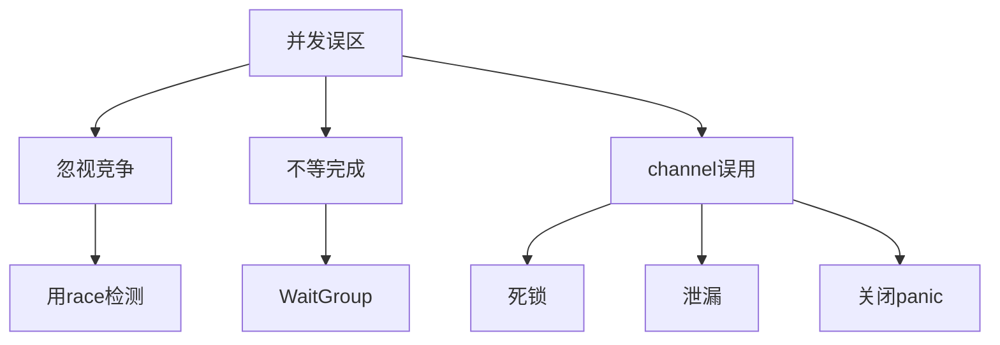

# 1019 并发编程误区（一） 深挖附录

> 关联主卡：1019-data-race / 1019-goroutine-not-wait / 1019-channel-deadlock / 1019-channel-leak / 1019-channel-close-panic
> 深挖门槛命中：L3（三大误区横向对比 + 检测工具）+ 版本无翻转（行为稳定）+ 争议拆解（sleep/自旋伪同步）

## 思路与架构
并发误区可按"竞争 → 同步缺失 → channel 误用"递进：先是无意识共享内存，再是启动了却不等，最后是 channel 用错导致死锁/泄漏/panic。排障顺序也该如此。

文字版：① 竞争靠 -race 同进程内定位；② 不等完成用 WaitGroup/channel；③ channel 三类坑：死锁/泄漏/关闭panic，各自有正则。

## 方案取舍
| 维度 | 加锁 mutex | 原子 atomic | WaitGroup | channel | 外部环境 |
|---|---|---|---|---|---|
| 解决竞争 | 是 | 是(单值) | 否 | 否(传值) | 事务/锁 |
| 同步等待 | 否 | 否 | 是 | 是 | - |
| 死锁风险 | 有(误用) | 无 | 无 | 有 | - |
| 适用 | 临界区 | 计数/标志 | 等一组 | 传数据 | DB层 |

选型结论：计数/标志用 atomic；临界区用 mutex；等 N 个任务用 WaitGroup；传数据/信号用 channel。不适用边界：channel 不是万能同步，纯等待用 WaitGroup 更轻。

## 细节与核心 API
- `go run -race main.go`：编译插桩检测同进程 data race，输出调用栈 `[源码]` race detector。
- `sync.WaitGroup`：Add/Done/Wait 三叉，Done 即原文"淡"；必须配对 `[源码]`。
- `chan` 收发配对：仅一方且对方未并发就绪 → fatal error，不可 recover。
- `v, ok := <-ch`：ok=false 表示 channel 已关闭，必须据此退出避免空转。
- `close(ch)`：仅一次，重复关或向已关写 → panic；读已关安全得零值。
- `time.NewTicker`：`Stop()` 必须手动调，否则泄漏；`time.After` 同理。
- `runtime.NumGoroutine()`：观测协程数，定位泄漏的利器 `[源码]`。

## 性能量级与实测数据
-race 有显著运行时开销（约 2~10x 内存与 CPU），仅测试用 `[源码]`。无竞争下 mutex 比 channel 轻；channel 带调度成本，纯同步优先 WaitGroup/mutex `[经验]`。

## 答题技巧
- 30 秒版：竞争用 -race；不等完成用 WaitGroup 别 sleep；channel 配对+判 ok+单次关。
- 3 分钟版：补 atomic/sync.Map 并发安全、-race 抓不到跨请求冲突、fatal error 不可 recover。
- 白板版：画"竞争→同步缺失→channel 三坑"的递进树。
- 话术模板："我先用 -race 自查同进程竞争，等 goroutine 用 WaitGroup，channel 一定判 ok 且只关一次。"
- 不会怎么接：诚实说"跨服务并发我靠事务/分布式锁，Go 层 race 只管同进程"，不夸大。

## 广度与深度延伸
- 横向：Java 用 synchronized/ReentrantLock，Rust 用所有权在编译期杜绝数据竞争。
- 纵向：happens-before 模型、race detector 插桩原理、GMP 调度与 goroutine 泄漏的 GC 边界。

## 反问环节
可反问："咱们并发场景主要卡在 IO 还是 CPU？有没有用 pprof 看过 goroutine 泄漏？"——体现排障与性能意识。
