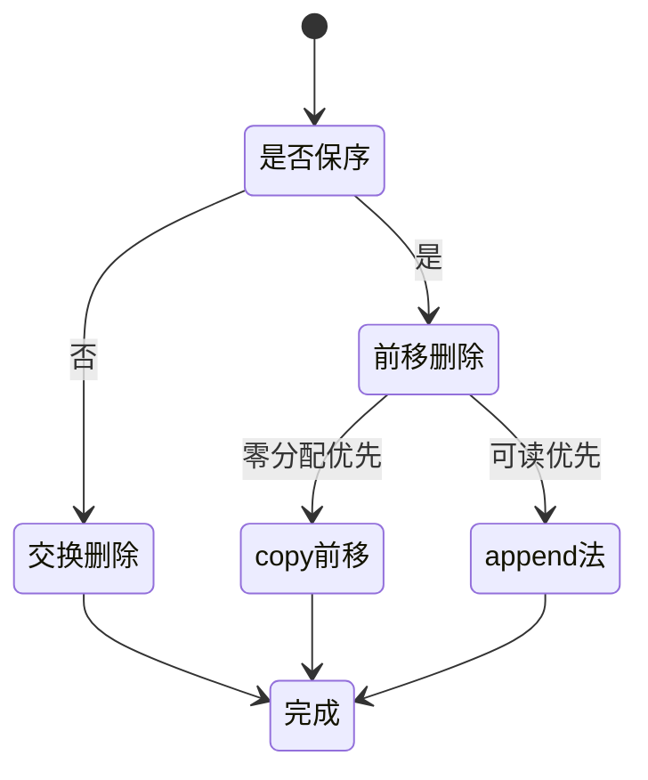

# 1111 切片元素删除优化 · 深挖

## 思路与架构
删除的本质是"让某些元素不再出现在逻辑 len 内"。两条主线：① 是否保序（保序要搬移、乱序可交换）；② 是否批量（单点推广到区间）。再叠加"底层数组共享导致的内存释放陷阱"。选型先问"顺序重要吗"，再问"单点还是一段" `[源码]`。

文字说明：① 不保序→交换末元素 O(1)；② 保序→把后段前移（copy 或 append）；③ copy 多为零分配、append 可读最好；④ 区间删除是单点的推广，len 减 end-start。

## 方案取舍
| 策略 | 时间 | 空间 | 保序 | 适用 |
|---|---|---|---|---|
| 交换删除 | O(1) | 0 分配 | 否 | 集合/栈、顺序无关 |
| copy 前移 | O(n) | 0 新分配 | 是 | 保序、性能敏感 |
| append 拼接 | O(n) | 可能扩容 | 是 | 保序、可读性优先 |
| 区间 copy | O(n) | 0 新分配 | 是 | 删连续段、保序 |
| 区间 append | O(n) | 可能扩容 | 是 | 删连续段、可读 |

选型结论：顺序无关选交换删除；保序且 profiling 敏感选 copy；否则 append 可读性优先。区间同理。

## 性能量级与实测数据
- 交换删除：1 次赋值、0 alloc/op（go1.26.5 推断 `[源码]`）。
- copy/append 单点删除：O(n)，搬移 `len-i-1` 个元素；原文基准（x86）append 略快于 copy，差距极小 `[经验]`。
- 区间删除移动量 = `len-end`（尾部段长度）；段越靠后代价越小 `[源码]`。
- 验证版本：go1.26.5。

## 答题技巧

## 细节与核心 API
- `a[i] = a[len(a)-1]; a = a[:len(a)-1]`：交换删除，唯一 O(1) 方案，打乱顺序 `[源码]`。
- `copy(a[i:], a[i+1:])`：重叠 copy 是定义行为，原地前移 `[源码]`。
- `a = append(a[:i], a[i+1:]...)`：切片表达式拼接，cap 足够时复用数组。
- 区间：`copy(a[start:], a[end:]); a = a[:len-(end-start)]`，左闭右开。
- 截断长度务必 `len-(end-start)`，不是 `len-end`，否则多留/少删。
- 引用类型元素删除后，旧槽位若仍被底层数组持有，需置 `nil` 断引用 `[源码]`。

- 30 秒版：不保序用交换删除 O(1)；保序用 copy 前移或 append 拼接；区间删 `copy(a[s:],a[e:])` 再缩 len。
- 3 分钟版：展开三种单点法 + 区间法 + 内存泄漏（置 nil）。
- 白板版：先写 `a = append(a[:i], a[i+1:]...)`，再补"不保序可 O(1) 交换"。
- 不会怎么接：被问"哪个最快"→ 答"不保序交换删除 O(1)；保序里 copy 与 append 都 O(n)，基准差距极小，可读优先选 append，除非 profiling 证明是瓶颈" `[经验]`。

## 广度与深度延伸
- 横向：其他语言（Python list 用切片/`del`、Rust `Vec::remove`/`swap_remove`、C++ `erase`+`std::move`）。
- 纵向：底层数组共享与扩容（cap 翻倍策略）、`copy` 重叠语义、GC 对引用类型槽位的回收。
- 进阶：用 `filter` 式一次性收集保留元素（稳定、无重叠坑，但 O(n) 额外分配）；去重场景结合 `map` 或 `unique` 思路。

## 反问环节
- 线上这个切片是保序业务数据还是顺序无关的缓存/集合？决定能不能用交换删除。
- 删除后底层大数组是否还被别处引用？有没有内存驻留风险？
