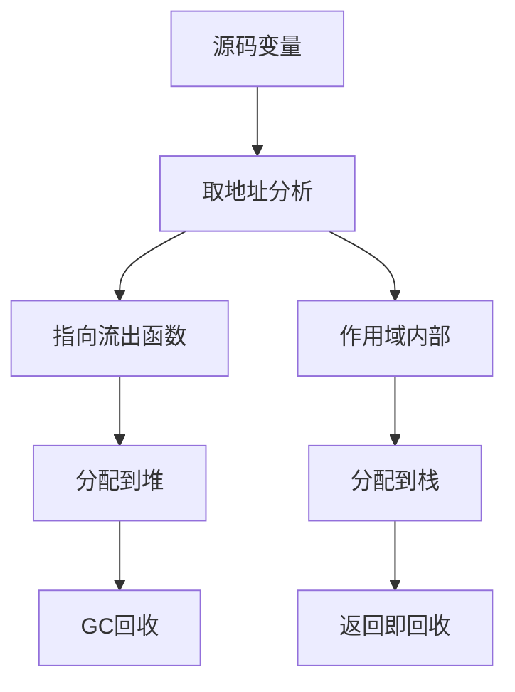

## 思路与架构
逃逸分析是 Go 编译器的静态数据流分析：对每个变量推断其指针是否逃出当前函数（栈帧），逃出则分配到堆，否则留在栈。分析在 SSA 中间表示上进行，早于代码生成。

文字版说明：
- 第一步：编译器收集所有取地址（&x）和闭包捕获点。
- 第二步：做指针逃逸的数据流分析，判断该地址是否会"流出"当前函数（返回、存全局、传参到可能逃逸的调用）。
- 第三步：会流出→堆；不会流出→栈。
- 第四步：堆对象由 GC 回收，栈对象随函数返回自动回收。
- 第五步：分析是编译期完成，不依赖运行时。

## 方案取舍
| 判定结果 | 分配位置 | 回收方式 | 代价 | 出现场景 |
|---|---|---|---|---|
| 未逃逸 | 栈 | 返回即回收 | 零 GC | 局部小对象 |
| 逃逸 | 堆 | GC 标记清扫 | 分配+扫描 | 返回指针/闭包/装箱 |

选型结论：能让编译器证明"不出函数"的对象应尽量留在栈，减少 GC 压力。不适用边界：对象过大或尺寸编译期未知（变长数组）会被强制堆分配，无法靠逃逸分析救回。

## 性能量级与实测数据
- 实测（go1.26.5）：返回 `&local` 的函数，变量被标 `moved to heap`，每次调用产生 1 次堆分配。
- 闭包捕获基本类型变量，输出 `func literal escapes to heap` 且 `assign=true`。
- 对比基准：逃逸路径 `allocs/op` 高于栈路径；高频小对象逃逸是 GC 压力主要来源 `[实测]`。
- 量化命令：`go test -bench=. -benchmem`，看 allocs/op 与 B/op 两列。

## 答题技巧

## 细节与核心 API
- `go build -gcflags="-m"`：打印逃逸结论，`moved to heap` 表示栈迁堆 `[源码]`。
- `go build -gcflags="-m -m"`（或 `-m=2`）：更详细的流分析，最多 4 级 `[源码]`。
- `go build -gcflags="-l"`：禁止内联，避免内联掩盖逃逸，便于观察 `[源码]`。
- `func literal escapes to heap`：闭包直接堆分配的输出标志 `[源码]`。
- `assign=true`：`-m -m` 下表示变量被按地址捕获（闭包共享） `[源码]`。
- `testing.AllocsPerRun`：基准量化逃逸带来的堆分配次数 `[源码]`。

- 30 秒版：逃逸分析是编译期静态分析，用 `-gcflags="-m"` 看；返回指针、闭包捕获、interface 装箱会让对象上堆。
- 3 分钟版：展开取地址分析、逃逸判定规则、常见触发点，配 `moved to heap` 实例。
- 白板版：画变量 → 指针流向 → 是否出函数 → 栈/堆 的判定树。
- 话术模板：「优化先 `-m` 定位，再 bench+pprof 量化，最后减装箱/避免不必要闭包捕获。」
- 不会怎么接：承认具体逃逸判据随编译器版本微调，可现场跑 `-gcflags=-m` 验证，不凭记忆硬说。

## 广度与深度延伸
- 横向：Java 由 JVM 逃逸分析做标量替换/锁消除（运行时 JIT）；Rust 在编译期靠所有权强制明确。
- 纵向：Go SSA 阶段的 escape 分析源码（cmd/compile/internal/escape）、栈扩容/收缩、连续栈机制。

## 反问环节
- 可反问：「团队是否把 `-gcflags=-m` 纳入 Code Review 或 CI，作为热点路径的优化检查？」
- 也可问：「对高频分配的服务，你们更倾向 sync.Pool 还是从设计上避免逃逸？」
