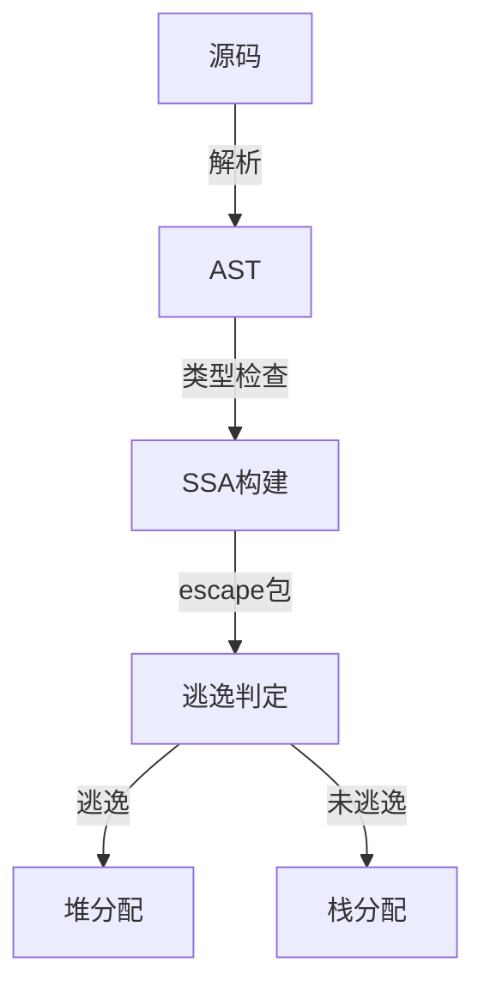

# 1119 Go 逃逸分析全景（深挖）

> 分类：Go 编译器 | 难度：L4 | 题型：原理题 | 频率：高 | 关键词：**escape analysis**/**SSA**/**heap**
> 原文锚点：第 1~104 段（11-9 内存逃逸分析 二 全篇）

## 思路与架构
逃逸分析是 `cmd/compile` 在 **SSA 构建阶段**由 `escape` 包完成的**静态数据流分析**：从每个函数的参数、返回值、全局变量出发，沿"取地址 / 赋值 / 传参 / 返回"等边做指向分析，判定每个变量是否"逃出当前栈帧"。



文字说明：逃逸分析发生在类型检查之后的 SSA 阶段，并不依赖任何运行期数据；判定为"逃逸"的变量在生成中间代码时被改为堆分配（`newobject`/`mallocgc`），未逃逸的留在栈上随函数返回自动回收。

## 方案取舍
| 维度 | 栈分配 | 堆分配（逃逸） |
| --- | --- | --- |
| 性能 | 函数返回自动回收，零 GC 成本 | 走分配器 + 后续 GC 标记清扫 |
| 一致性 | 生命周期=栈帧 | 生命周期由引用决定，可能长期存活 |
| 适用 | 小对象、生命周期明确 | 大对象、需跨栈帧共享 |
| 结论 | **默认优先栈**，逃逸是编译器为安全/共享做的上策 | 逃逸非"坏"，是必要代价；盲目避免反而失真 |

不适用边界：并发场景下共享变量本就要逃逸，强行改成栈反而破坏语义。

## 完整逃逸诱因清单（L3+ 拓展）
1. 对象过大（约 >64KB，按类型启发式）
2. 变量被取地址且地址逃出函数
3. 转为 interface 且接口生命周期超出栈帧
4. 容器元素为 interface/指针
5. 传给 fmt/日志/反射（反射取值需地址）
6. 发送进 channel（interface/指针元素）
7. `make([]T, n)` 长度来自变量
8. 闭包捕获变量并被并发/外部持有

## 答题技巧
- 30 秒版：逃逸分析是编译期静态分析，决定变量放堆还是栈；大对象、接口/指针装箱、fmt 反射入参是三大常见逃逸诱因。
- 3 分钟版：讲清"逃逸=活过栈帧"的充要条件，区分对象逃逸（64KB 启发式）与栈自身扩容（连续栈拷贝）两套机制，举 `f11/f17/f22` 三类案例。
- 白板：画"源码→AST→类型检查→SSA escape 包→堆/栈分配"的流水。
- 话术："我用 `go build -gcflags='-m'` 看 `moved to heap` 来定位逃逸点。"
- 不会怎么接：诚实说"具体阈值随编译器版本微调，但判定逻辑稳定"，别背死 64KB。

## 版本与兼容性
| 结论成立版本 | 翻转点 | 现在该怎么答 |
| --- | --- | --- |
| Go 1.3+ 连续栈时代 | 逃逸判定算法持续微调 | 答"编译期静态、结果随编译器版本/GOOS/GOARCH 确定"，与运行期内核无关 |

## 关键代码
```go
// 统一验证手段：编译期打印逃逸决策
go build -gcflags='-m' ./...
// 典型输出：./x.go:10:6: s escapes to heap
//           ./x.go:12:9: &buf escapes to heap
```

## 总结与追问预判
逃逸分析是零运行期开销的编译期优化，结论可复现；面试核心是"活过栈帧才逃逸"的充要逻辑，而非死记诱因清单。
