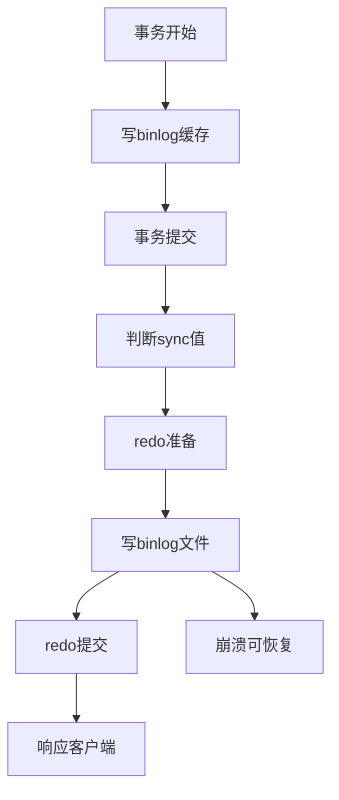

## 思路与架构
binlog 刷盘命题分三层：写路径（事务→binlog cache→文件）、持久化策略（sync_binlog 决定何时 fsync）、与 redo 的协同（两阶段提交+组提交）。核心矛盾是「持久性 vs 写入吞吐」。

文字版说明：
- 第一步：事务执行先写各自线程的 binlog cache，不立即落盘。
- 第二步：提交时按 sync_binlog 决定 fsync 时机（这是持久性闸门）。
- 第三步：与 redo 配合走 prepare→binlog→commit 两阶段，保证两份日志一致。
- 第四步：任一环节崩溃，崩溃恢复依据 redo 状态+binlog 是否完整来补全或回滚。
- 第五步：高并发下两日志的组提交合并 fsync，是吞吐关键点。

## 方案取舍
| 方案 | 持久性 | 写入吞吐 | 崩溃丢失 | 适用场景 |
|---|---|---|---|---|
| sync_binlog=0 | 低 | 最高 | 不可控（OS 回写） | 可丢数据的日志型业务 |
| sync_binlog=1 | 最高 | 最低 | 最多 1 个事务 | 金融/账本，双 1 配置 |
| sync_binlog=N | 中 | 中高 | 最多 N-1 个已提交 | 高并发通用业务 |

选型结论：能接受少量丢失用 N（如 100）；要求不丢用 1 并配合 innodb_flush_log_at_trx_commit=1。不适用边界：=0 绝不用于主库核心数据。

## 细节与核心 API
- `sync_binlog`：每 N 次事务提交 fsync 一次；=1 即每次提交都 fsync `[外部/MySQL]`。
- `binlog_cache_size`：线程私有 binlog 写缓存，默认 32KB，超限落盘 `[外部/MySQL]`。
- `binlog_format`：`STATEMENT`/`ROW`/`MIXED`，现代默认 ROW `[外部/MySQL]`。
- `innodb_flush_log_at_trx_commit`：redo 刷盘策略，与 sync_binlog 共同决定双 1 `[外部/MySQL]`。
- `PURGE BINARY LOGS` / `RESET MASTER`：binlog 清理，RESET 会复位序号 `[外部/MySQL]`。
- `SHOW BINARY LOGS` / `SHOW MASTER STATUS`：查看 binlog 文件与当前写入位点 `[外部/MySQL]`。

## 性能量级与实测数据
- binlog 是顺序写，单事务 fsync 的延迟量级在亚毫秒到毫秒（取决于存储 fsync 能力）。
- sync_binlog=1 在高并发下 fsync 次数≈事务数，是主要瓶颈；组提交把多个事务的 fsync 合并成一次，吞吐可提升数倍 `[外部/MySQL]`。
- 实测命令（思路，未在本环境跑 MySQL）：`sysbench oltp_write_only --sync-binlog=1` 对比 `--sync-binlog=100` 的 TPS 差异。

## 答题技巧
- 30 秒版：binlog 先写线程 cache，提交时按 sync_binlog 刷盘；=1 最安全最慢、=0 由 OS、=N 折中；与 redo 两阶段提交保证一致。
- 3 分钟版：展开三取值语义、cache 与事务原子性、两阶段提交顺序与崩溃恢复判定。
- 白板版：画 prepare→binlog→commit 时序，标注 fsync 发生点。
- 话术模板：「持久性要求越高，fsync 越频繁，吞吐越低，靠组提交对冲。」
- 不会怎么接：坦诚说 sync_binlog 三个值的语义清楚，组提交合并 fsync 的细节可查 MySQL 官方文档，不编造内部实现。

## 广度与深度延伸
- 横向：PostgreSQL 用 WAL+两阶段提交（XA）做类似保证，但单日志、无 binlog/redo 分裂。
- 纵向：InnoDB redo 的 group commit 三阶段（flush/fsync/sync）、binlog 的组提交如何与 redo 的 commit 阶段对齐。

## 反问环节
- 可反问：「贵司主库 sync_binlog 与 innodb_flush_log_at_trx_commit 实际怎么配？是否在用组提交优化？」
- 也可问：「异步复制下 binlog 发送线程与刷盘的关系，团队是否踩过延迟坑？」
