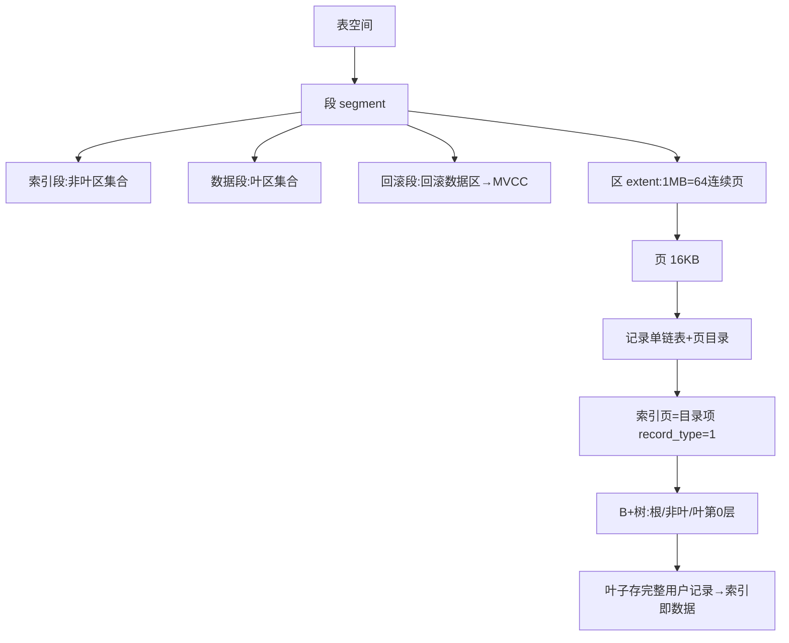

# 1213 InnoDB 底层存储结构 深挖

> 覆盖源 12-13 全文：区/段分配、索引页目录项、B+树分层、回滚段与 MVCC 的物理存储全貌。主卡已拆成区/段、索引目录项、B+树分层三张，本附录做横向串联与取舍。

## 思路与架构

## 方案取舍
- **按区 vs 按页分配**：数据量大时按区（连续 64 页）换随机 IO 为顺序 IO；小表按页更省碎片。MySQL 自动在阈值间切换。
- **目录项复用页结构 vs 独立目录**：复用数据页结构 + record_type 区分，避免为目录单独维护连续空间、免迁移——是 InnoDB 的灵活设计选择。
- **回滚段独立段 vs 混存**：独立回滚段让 MVCC 版本链与用户数据解耦，读不加锁。

## 答题技巧
- 被问「索引底层」时，从「区/段分配 → 页 → 目录项(record_type=1) → B+树分层」自底向上串一遍，比只背 B+树性质更显深度 [经验]。
- 主动连线回滚段↔MVCC，把存储与事务串起来，是 P7 加分项 [经验]。
- 与 1215(记录头)/1216(页目录)/1217(B+树性质)/1211(索引概览) 互为引用而非重述，构成存储全栈 [边界]。
