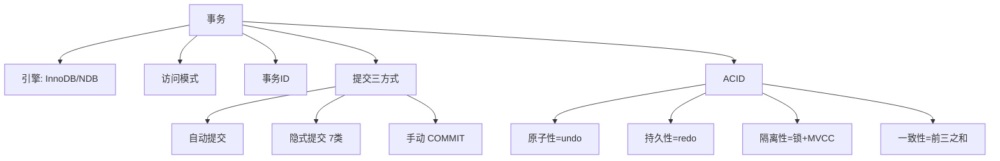

# 1229 事务基础 深挖

> 覆盖源 12-29 全文：事务引擎支持、访问模式、事务 ID 分配、三种提交方式、ACID、InnoDB 保证。
> 主卡已详述访问模式/ID 时机（1229-tx-access-mode-id）、自动提交与隐式提交（1229-autocommit-implicit）、引擎与临时表（1229-tx-engine-temporary）；ACID 详见 124-acid-properties。

## 思路与架构



- 一条主线：事务是"围绕 InnoDB 表的写操作单元"——所以 ID 与写绑定、临时表分两类、提交方式多样。
- ACID 中 A/D/I 各有"负责人"（undo/redo/锁+MVCC），C 是结果态；面试用"一元隔持久"助记（一=一致性、元=原子性、隔=隔离性、持久=持久性）。

## 方案取舍

| 提交方式 | 触发 | 何时用 | 坑 |
|---|---|---|---|
| 自动提交 | autocommit=ON（默认） | 单条 DML 独立成事务 | 多句需原子时忘开事务会各提交 |
| 隐式提交 | DDL/系统表/再开事务/锁表/LOAD DATA/复制 | 特殊语句副作用 | 事务中混 DDL 提前提交前面改动 |
| 手动 COMMIT | 显式 COMMIT/ROLLBACK | 需多句原子 | 忘记提交会持锁 |

- **选型结论**：需要多句原子 → 显式 BEGIN + 手动 COMMIT，且事务内别混 DDL。
- **不适用边界**：纯查询事务无需 COMMIT，也不会分配写事务 ID；只读场景用 READ ONLY 可让优化器走只读路径。

## 细节与核心 API

- `START TRANSACTION READ ONLY|READ WRITE`：显式开事务并指定访问模式 `[源码]`。
- `autocommit`：会话级变量，默认 ON；设为 OFF 后多条语句同一事务 `[源码]`。
- `EXPLAIN ... Extra: Using temporary`：优化器内部临时表，不参与事务、不分配 trx_id `[源码]`。
- 隐式提交 7 类清单：DDL、改 mysql 系统表（ALTER/CREATE/DROP USER、GRANT、REVOKE、SET PASSWORD）、事务控制语句再开、autocommit OFF→ON、`LOCK/UNLOCK TABLES`、`LOAD DATA`、复制语句（START/STOP/RESET SLAVE、CHANGE MASTER）+ 其他（ANALYZE/CHECK/OPTIMIZE/REPAIR/FLUSH/RESET）`[经验]`。
- InnoDB 保证 ACID：持久性=redo log 崩溃重放；原子性=undo log 回滚；隔离性=锁+MVCC（MVCC 本质依赖 undo log 历史版本）；一致性=前三共同维持 `[经验]`。

## 性能量级与实测数据

- 事务 ID 仅在写时分配，纯读事务无 trx_id，因此只读路径不加写锁、不写 undo，开销极低 `[经验]`。
- 隐式提交会让前面未提交改动提前落库并释放锁——长事务中混 DDL 会导致锁提前释放，并发行为难预测 `[经验]`。
- 以上为 MySQL 通用行为，无公开基准数字；落地以 `SHOW ENGINE INNODB STATUS` 的 trx 段观测实际事务为准 `[经验]`。

## 关键代码
```sql
-- 隐式提交演示：事务中再开事务会提交上一个
BEGIN;
UPDATE t SET v=1 WHERE id=1;
START TRANSACTION;   -- 隐式提交上面的 UPDATE
UPDATE t SET v=2 WHERE id=2;
COMMIT;              -- 只提交第二条 UPDATE，第一条已提前落库
```

## 答题技巧

- 30 秒版：背出"仅 InnoDB 支持事务 + 改事务表才分配 ID + 提交三方式（自动/隐式/手动）+ ACID 谁保证谁"。
- 3 分钟版：按"引擎→访问模式→ID 时机→提交方式→ACID"顺序讲，重点展开隐式提交 7 类。
- 白板版：画一张"提交方式 vs 触发"表，标出 DDL 是隐式提交头号坑。
- 话术模板：先说"事务是 InnoDB 写操作的单元"，再补"所以 ID 跟写绑定、提交方式要分三种"。
- 不会怎么接：被问到具体版本差异时，承认通用行为、MySQL 8.0 默认 autocommit=ON，比编版本号强。

## 广度与深度延伸

- 横向：PostgreSQL 默认也是事务型，但临时表语义、autocommit 默认不同；Oracle 隐式提交触发更少。
- 纵向：MVCC 历史版本靠 undo log，长事务会拖慢 purge、撑大回滚段——与"事务 ID 写时才分配"是同一套机制的上下层。
- 经典资料：MySQL 官方手册"Transaction Isolation Levels"与"InnoDB Transaction Model"两章。

## 反问环节

- "贵司对长事务有监控吗？有没有遇到过事务里混 DDL 导致提前提交的事故？"——把单向考核变双向交流。
- "你们 autocommit 是默认开着还是业务层显式 BEGIN？为什么？"——展示你思考过提交语义。
