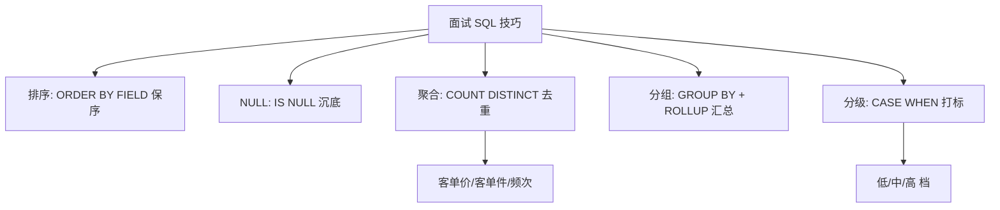

# 1250 面试必备 SQL 技巧 深挖

> 覆盖源 12-50 全文：自定义排序、NULL 处理、去重聚合、分组汇总、条件分级五类高频写法。主卡已拆成自定义排序+NULL、去重聚合、GROUP BY+ROLLUP/CASE 三张，本附录做横向串联与取舍。

## 思路与架构

## 方案取舍
- **FIELD vs 应用层排序**：列表短、保序要求强 → FIELD；列表长 → 拉回应用层按 map 排序（避免内存排序 + 不走索引）。
- **ROLLUP vs UNION 汇总**：要总计 → ROLLUP 一次扫表；多维度交叉 → CUBE/应用层透视。
- **CASE 分级 vs 应用层判断**：分级规则固定在 SQL → CASE；规则多变 → 拉回代码更易维护。

## 答题技巧
- 面试写 SQL 先确认「要不要去重、要不要总计、NULL 怎么排」，这三问能避开 80% 的坑。
- 被要求「一条 SQL 算全」时，用派生聚合 + ROLLUP 组合，显出对聚合模型的掌控 [经验]。
- 提到的函数（FIELD/ROLLUP/GROUPING）务必说明版本与是否走索引，避免被追问时露怯 [经验]。
