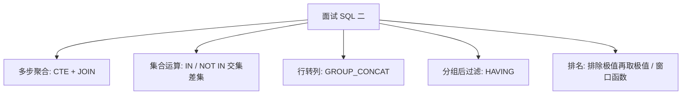

# 1251 面试 SQL（二） 深挖

> 覆盖源 12-51 全文：CTE 两步统计+关联、子查询 IN/NOT IN 取交集差集、GROUP_CONCAT 拼接、HAVING 分组后过滤、排名第二技巧。主卡已拆成 CTE 统计/子查询、GROUP_CONCAT/HAVING、排名三张，本附录做题型串联与取舍。

## 思路与架构

## 方案取舍
- **CTE vs 嵌套子查询**：CTE 可读、可复用；复杂集合运算改写为多 CTE（a/b/c）优于深嵌套。
- **HAVING vs WHERE**：WHERE 过滤行（GROUP BY 前）、HAVING 过滤组（GROUP BY 后）+ 聚合函数，时机不可混。
- **排名取法**：嵌套 MAX 排除法对并列稳健；现代优先窗口函数明确 ROW_NUMBER/RANK/DENSE_RANK 语义。

## 答题技巧
- 被问「复杂统计 SQL」先拆步：聚合（CTE）→ 集合（IN/NOT IN）→ 拼接（GROUP_CONCAT）→ 分组过滤（HAVING）→ 排名（排除极值）[经验]。
- 主动边界到 `1250`(FIELD/ROLLUP/CASE)、`1210`/`1243`(执行流/EXPLAIN)，构成面试 SQL 全栈 [边界]。
