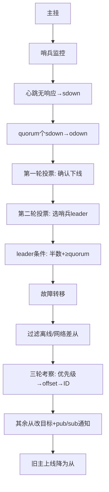

# 1263 Redis 哨兵 深挖

> 覆盖源 12-63 全文：哨兵定位、故障检测（sdown/odown）、两轮投票选主、quorum 配置、故障转移三轮考察。主卡已拆成概述、选主投票、故障转移三张，本附录做流程串联与取舍。

## 思路与架构



## 方案取舍
- **quorum 权衡**：=1 过敏易误转移；过大反应迟钝；推荐 `n/2+1` 抗脑裂。部署至少 3 哨兵（quorum=2）保证挂 1 仍可用。
- **考察顺序**：优先级（运维意图）→ 复制进度（数据新）→ ID 最小（确定性 tie-break），稳健且可重现。
- **客户端配合**：靠 pub/sub 订阅主地址变化，避免硬编码主 IP。

## 答题技巧
- 被问「Redis 高可用」按「主从复制(1262) → 哨兵故障转移」展开，本波讲哨兵不重述主从 [经验]。
- 主动边界到 `1262`(主从)/`1310`(ES HA)/`158`(微服务容错)，构成高可用全栈 [边界]。

## 细节与核心 API

**哨兵关键配置（quorum 抗脑裂，部署至少 3 哨兵）：**

```conf
sentinel monitor mymaster 127.0.0.1 6379 2   # quorum=2（≥ n/2+1 抗脑裂）
sentinel down-after-milliseconds mymaster 30000  # 心跳无响应判 sdown 的时长
sentinel failover-timeout mymaster 180000
```

**故障检测与转移流程（两轮投票 + 三轮考察）：**

```text
心跳无响应 → sdown(主观下线) → quorum 个 sdown → odown(客观下线)
第一轮投票：确认客观下线
第二轮投票：选哨兵 leader（条件：获半数以上且 ≥ quorum 票）
故障转移：过滤离线/网络差从 → 三轮考察(优先级 priority → 复制 offset 最新 → run_id 最小) → 其余从改指向新主 + pub/sub 通知 → 旧主上线降为从
```

**客户端配合（避免硬编码主 IP）：**

```bash
# 订阅主地址变化；Go 用 go-redis 的 Sentinel 模式自动跟进故障转移
redis-cli -p 26379 SUBSCRIBE +switch-master
```
