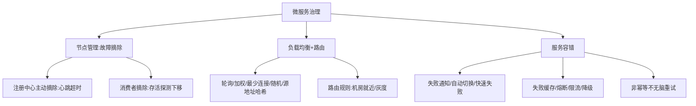

# 157 微服务治理手段 深挖

> 覆盖源 15-7 全文：节点管理、负载均衡/服务路由、服务容错三层面。主卡已拆成节点管理、负载均衡路由、容错总览三张，本附录做横向串联与取舍。

## 思路与架构

## 方案取舍
- **注册中心摘除 vs 消费者摘除**：纯注册中心在「注册中心-提供者」网络隔离时会误删全部，消费者侧存活探测更稳；生产常两者结合。
- **LB 算法选型**：性能均→轮询/随机；性能异→加权；处理时间不均→最少连接；需会话→源地址哈希。
- **容错 vs 路由**：容错解决「调失败怎么办」，路由解决「该调谁」，分层不混。

## 答题技巧
- 被问「微服务治理」按三层面（节点/路由/容错）展开，比零散背策略显体系 [经验]。
- 主动边界到 158（容错实现）：本卡列策略、158 讲实现，构成治理全栈 [边界]。
