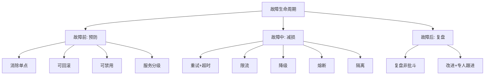

# 158 微服务容错设计 深挖

> 覆盖源 15-8 全文：故障三阶段（前/中/后）+ 容错策略（消除单点/可回滚/可禁用/服务分级/重试/超时/限流/降级/熔断/隔离/容器自愈/追踪/监控）。
> 主卡已详述重试超时（158-retry-timeout）、熔断降级（158-circuit-breaker-degrade）、限流隔离+四基（158-isolation-ratelimit）；本卡做时间轴串联与取舍。

## 思路与架构



- 一条主线：容错 = "故障前预防（四基）+ 故障中减损（重试/超时/限流/降级/熔断/隔离）+ 故障后复盘"。
- 策略分层：四基是架构前提，重试/超时/限流是第一道减损，熔断/降级是下游失守时的兜底，隔离控制爆炸半径。

## 方案取舍

| 策略 | 阶段 | 解决 | 代价 |
|---|---|---|---|
| 消除单点 | 前 | 单点故障 | 冗余成本 |
| 可回滚/可禁用 | 前 | 升级翻车 | 设计预留 |
| 服务分级 | 前 | 核心被拖 | 资源倾斜 |
| 重试+超时 | 中 | 瞬时失败 | 放大流量 |
| 限流 | 中 | 超载 | 丢部分请求 |
| 降级 | 中 | 非核心占资源 | 功能有损 |
| 熔断 | 中 | 下游雪崩 | 更损的降级 |
| 隔离 | 中 | 故障扩散 | 资源分池 |

- **选型结论**：预防四基必做；减损按"瞬时失败→重试超时，超载→限流，下游失守→熔断降级，怕扩散→隔离"逐层加码。
- **不适用边界**：重试对非幂等写要谨慎；熔断打开即走降级；隔离粒度太细反而增复杂度。

## 性能量级与实测数据

- 重试退避示例 1/2/4/8s 累计 15s、总上限 10s 即停，是通用经验值而非固定基准 `[经验]`。
- 限流/熔断是"丢请求换可用"的有损策略，SLA 需事先约定可接受丢弃比例 `[经验]`。
- 以上为架构实践，无公开基准数字；落地以压测 + 混沌工程验证 `[经验]`。

## 关键代码
```go
// 示意，未验证：带熔断的重试调用（组合重试+熔断）
func callProtected(b *Breaker) error {
    if !b.Allow() {
        return errors.New("circuit open: fast fail") // 走降级
    }
    err := callWithRetry(context.Background(), 3)
    b.Record(err == nil) // 成功记成功，失败记失败，驱动三态切换
    return err
}
```

## 答题技巧

## 细节与核心 API

- 重试：限次 + 指数退避（1/2/4/8s）+ 总超时（>10s 停）+ 非幂等谨慎；客户端传重试次、服务端可反向抑制 `[经验]`。
- 超时：每调用设上限，超即终止，防资源被慢调用长期占用 `[经验]`。
- 限流：令牌桶（允许突发）/漏桶（平滑速率）两类；超载快速丢弃保整体 `[源码]`。
- 熔断：统计窗口错误比例超阈值→打开→半开探测→恢复关闭；常用 gobreaker/sentinel `[经验]`。
- 隔离：服务/进程/线程池级（舱壁模式），限制爆炸半径 `[经验]`。
- 容器自愈：平台自动重启/替换故障实例；分布式追踪+监控告警定位根因 `[经验]`。


- 30 秒版：背出"故障三阶段 + 四基预防 + 重试/超时/限流/降级/熔断/隔离减损"。
- 3 分钟版：按"前预防→中减损→后复盘"时间轴讲，重点展开熔断三态与重试防风暴。
- 白板版：画故障生命周期三段图，标出每阶段挂哪些策略。
- 话术模板：先说"容错是分层兜底"，再补"预防四基是前提，减损逐层加码"。
- 不会怎么接：被问到具体组件（Sentinel/Hystrix）时，承认通用原理、以自家用过的为准，比编 API 强。

## 广度与深度延伸

- 横向：与 1261（binlog 删除重试）同属"重试"主题，但 1261 是存储层、本卡是服务层。
- 纵向：熔断→舱壁→ bulkhead 模式；限流→令牌桶算法（Guava RateLimiter 思路）；可追溯到《Release It!》的稳态模式。
- 经典资料：Martin Fowler 博客（Circuit Breaker）、Google SRE 书的"故障处理"章节。

## 反问环节

- "贵司熔断阈值和重试上限是怎么定的？靠压测还是踩过坑？"——把单向考核变双向交流。
- "核心服务调非核心失败，你们是超时兜底还是熔断？"——展示你懂分层容错。
