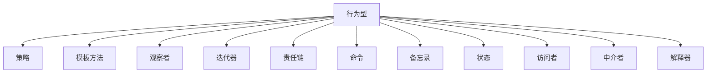

# 163 设计模式（二）深挖：行为型全景

> 覆盖源 16-3 全文：行为型 11（策略/模板方法/观察者/迭代器/责任链/命令/备忘录/状态/访问者/中介者/解释器）。
> 主卡已详述策略/观察者/责任链/模板方法/迭代器，本附录补齐其余 6 种并做横向对比。

## 思路与架构

- 行为型管"对象之间怎么协作/通信/分配责任"，是面试里最考"判断力"的一类。
- 它们常成对混淆：策略↔状态、观察者↔中介者、责任链↔装饰器、命令↔策略——下面给判据。
- 主卡已落地的 5 种不重复，本附录聚焦命令/备忘录/状态/访问者/中介者/解释器。

## 方案取舍

| 模式 | Go 落地要点 | 何时用 | 坑 |
|---|---|---|---|
| 命令 | 把请求封装成 `interface{ Execute() }` | 需撤销/重做、宏命令、排队 | 命令爆炸：每个操作一个类型 |
| 备忘录 | 捕获状态存外部，支持回滚 | 编辑器撤销、游戏存档 | 快照大=内存翻倍，需增量 |
| 状态 | 状态即类型，行为随状态切换 | 多分支状态机、消除 if-else | 状态多=类爆炸，可表驱动替代 |
| 访问者 | 数据结构稳定、操作常变，双分发 | 对固定元素集做多种操作 | Go 无双分发，需类型断言/类型开关 |
| 中介者 | 用一个对象封装对象间交互 | 网状依赖改星型，降耦合 | 中介者变"上帝类" |
| 解释器 | 定义文法并解释句子 | 固定小文法、规则引擎 | 复杂文法性能差，少用 |

- **选型结论**：行为随状态变→状态；算法可互换→策略；一对多通知→观察者；请求沿链→责任链；撤销回滚→命令/备忘录；对象网状依赖→中介者。
- **不适用边界**：状态/访问者等"类型膨胀"模式，若分支很少，直接用 if-else 或 map 表驱动更轻。

## 细节与核心 API

- `interface{ Execute() error }`：命令模式核心，配合 `[]Command` 支持宏与队列 `[源码]`。
- `errors.Join(errs...)`：命令批量执行时聚合多步错误，Go 1.20+ 标准能力 `[源码]`。
- 备忘录常用 `Memento` struct 存字段快照，由 Caretaker 管理历史切片，避免实体自管状态 `[经验]`。
- 状态机表驱动：`map[State]map[Event]State` 比一堆状态类型更省类，小状态机首选 `[经验]`。
- 访问者在 Go 用 `switch v := e.(type) { case *A: ... }` 模拟第二次分发，元素类型固定时安全 `[源码]`。

## 性能量级与实测数据

- 状态/策略用接口方法调用，单次分发开销是一次函数调用（~ns 级），与直接 if-else 差异在现代 CPU 可忽略 `[经验]`。
- 备忘录全量快照在状态大、历史长时内存线性增长；增量快照（只存 diff）可降一个数量级但实现复杂 `[经验]`。
- 访问者类型开关 `switch` 在元素类型少时分支预测友好；类型多变时考虑代码生成或反射（慢） `[经验]`。
- 解释器模式对复杂文法性能明显弱于手写 parser，仅适合轻量规则，无通用基准数字 `[经验]`。

## 答题技巧

- 30 秒版：报出行为型 11 种，指出"策略主动选、状态被动随状态变"等成对区别，是高频考点。
- 3 分钟版：挑一个你真用过的（如观察者用 channel、状态用表驱动），讲清场景+Go 实现+踩坑。
- 白板版：画策略↔状态、观察者↔中介者的对比两列，现场写 `map[State]map[Event]State` 状态机。
- 话术模板："这是行为型，解决的是对象协作中的…；Go 里我倾向用…而不是教科书式继承。"
- 不会怎么接：访问者/解释器使用频率低，直接说"了解定义但未实战，它适合…场景"，并反问是否团队用到，别编实现细节。

## 广度与深度延伸

- 横向：状态模式在 Go 常被"表驱动状态机"或"enum+switch"替代，面试官爱追问"为什么不用状态类"。
- 纵向：命令模式的撤销栈与备忘录常配合；中介者与观察者都解耦，但中介者中心化、观察者去中心化广播。
- Go 特色：Go 用 channel+goroutine 把观察者/中介者天然并发化，这是 Java 时代没有的落地优势 `[经验]`。

## 反问环节

- "你们业务里有复杂状态机吗？是上状态模式还是表驱动？"——展示你知取舍。
- "事件通知你们用自研 channel hub 还是消息队列？"——把模式落回架构选型。
