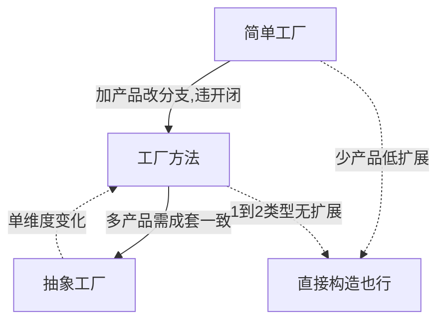

# 166 三工厂模式 深挖

> 覆盖源 16-6 全文：简单工厂 / 工厂方法 / 抽象工厂三种实现，及 Go 里的函数式退化写法。
> 主卡已详述各自定义、抽象工厂家具实现与三者对比选型，本附录做演化脉络与实战坑。

## 思路与架构



- 演化主线：把"创建哪个具体类型"的决策点不断后移——从工厂内的 if-else，到具体工厂子类，再到工厂决定整族。
- Go 的"类继承"被"接口 + 结构体 + 一等函数"替代：工厂方法常写成 `func NewX() Product`，抽象工厂常写成一组 `func() X`，比 Java 的 abstract class 层级更扁平。

## 方案取舍

| 模式 | 决策点 | 扩展代价 | 何时用 | 坑 |
|---|---|---|---|---|
| 简单工厂 | 工厂内 if-else | 加产品改工厂，违开闭 | 产品少、几乎不变 | 分支膨胀、难测 |
| 工厂方法 | 具体工厂子类 | 加产品加工厂，合开闭 | 单产品维度常变 | 类数量翻倍 |
| 抽象工厂 | 工厂决定整族 | 加族加工厂，合开闭 | 多产品需成套一致 | 单维度上它=过度设计 |
| 直接构造 | 调用点 new | 无中间层 | 1~2 类型无扩展 | 创建逻辑散落 |

- **选型结论**：扩展频率低 + 单产品 → 简单工厂或直接构造；单产品常变 → 工厂方法；多产品成套 → 抽象工厂。
- **不适用边界**：只有 1~2 个具体类型且无扩展预期时，任何工厂模式都是过度设计，直接 `&T{}` 或 `NewT()` 最清晰。

## 性能量级与实测数据

- 工厂模式是结构性模式，运行时开销仅为一次接口方法调度/函数调用，无额外分配；与直接 `&T{}` 差异在纳秒级，可忽略 `[经验]`。
- 简单工厂 if-else 与 map 查表在分支数 < ~数十时性能无显著差异；分支极多时 map 查表更稳 `[经验]`。
- 过度引入工厂的主要代价是"类型数量与可读性"，非性能，决策应看扩展预期而非速度 `[经验]`。

## 答题技巧

## 细节与核心 API

- `type Factory func() Product`：Go 把"工厂"建模成函数类型，是一等公民，可作 map value / 参数传递 `[源码]`。
- 注册表 `map[string]Factory`：把简单工厂的 if-else 改成查表，新增产品只注册、不改分支，兼顾简单工厂的集中与开闭 `[经验]`。
- 接口匿名嵌入：`struct{ Chair; Sofa }` 表达"产品族"，是 Go 实现抽象工厂族一致性的手段 `[源码]`。
- `sync.Once`：若工厂需懒加载单例产品，用 Once 保证并发只建一次（见 162 单例）`[源码]`。

```go
// 示意，未验证：用 map 注册表替代 if-else，新增产品只注册不改分支
type Factory func() Product

var registry = map[string]Factory{}

func Register(t string, f Factory) { registry[t] = f }

func Create(t string) Product {
    if f, ok := registry[t]; ok {
        return f()
    }
    return nil
}
```


- 30 秒版：背出三者递进（集中→子类→整族）+ Go 惯用法（func 返回接口）。
- 3 分钟版：按"扩展频率 + 是否产品族"两轴画图决策，现场写 `type Factory func() Product`。
- 白板版：画演化图，标出每步"决策点后移"与"开闭符合度"。
- 话术模板：先说"这是创建型，解决对象怎么生"，再补"Go 里我通常用函数工厂，比继承轻"。
- 不会怎么接：被问到冷门变体（如工厂+原型组合）时，承认未实战，但能说清定义与边界，比硬编强。

## 广度与深度延伸

- 横向：Java 用 abstract class 实现工厂方法/抽象工厂，Go 用接口+函数替代——面试官常考"Go 为什么少谈继承"。
- 纵向：工厂常与单例（Once）、建造者（Options）、原型（Clone）组合；复杂对象多参数 → 建造者。
- 经典书单：GoF《设计模式》仍是母本；Go 适配见《Go 语言设计模式》。

## 反问环节

- "贵团队创建对象时更偏直接构造还是函数工厂？扩展预期一般多大？"——把单向考核变双向交流。
- "你们有没有因为早期用简单工厂、后来产品变多被迫重构的经历？"——展示你思考过演进成本。
