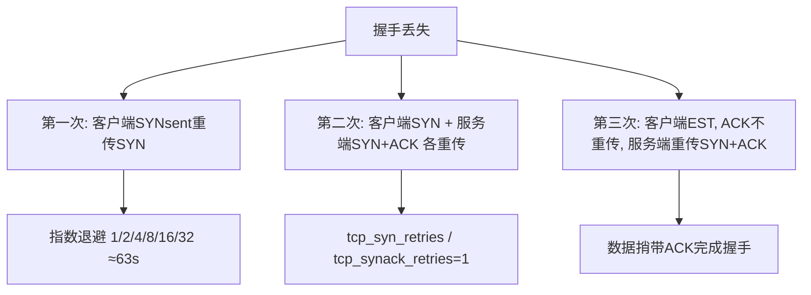

# 1843 TCP 握手丢失与重传 深挖

> 覆盖源 18-43 全文：三次握手过程、第一/二次丢失（指数退避）、第三次丢失（ACK 不重传、服务端补偿）。主卡已拆成握手过程、第一二次丢失、第三次丢失三张，本附录做重传机制串联与取舍。

## 思路与架构



## 方案取舍
- **退避策略**：指数退避避免重传风暴；总耗时约 63 秒后放弃，平衡响应速度与网络抖动容忍。
- **参数分工**：`tcp_syn_retries`（客户端 SYN 上限，默认 5/6）与 `tcp_synack_retries`（服务端 SYN+ACK 上限，默认 1）不对称——服务端重传意愿弱，依赖客户端主导。
- **ACK 不重传**：第三次 ACK 无独立重传，由对端 SYN+ACK 重传补偿，体现「确认由被确认方驱动」的设计。

## 答题技巧
- 被问「握手丢了」按「第几次 + 谁重传 + 什么参数 + 多久放弃」四要素展开 [经验]。
- 主动边界到 `1840`(TCP 头部/状态机)、`158`(微服务重试只引不重述)，构成 TCP 握手全栈 [边界]。

## 细节与核心 API

```bash
# 握手三报文：SYN -> SYN+ACK -> ACK
# SYN 丢失：客户端超时重传 SYN（指数退避，/proc/sys/net/ipv4/tcp_syn_retries 次）
# SYN+ACK 丢失：服务端等不到 ACK，重传 SYN+ACK（tcp_synack_retries）
# ACK 丢失：服务端未收 ACK 不认为连接建立；客户端已认为建立，首数据触发服务端重传 SYN+ACK
# 观察：tcpdump 'tcp[tcpflags] & tcp-syn != 0'
ss -tan | grep -E ':SYN'       # 看 SYN_SENT / SYN_RECV 状态堆积
# 重传超时 RTO：由 RTT 样本估算（RTO = SRTT + 4*RTTVAR），指数退避
# 半连接队列：SYN 洪水攻击占满 -> 启用 syncookie（tcp_syncookies=1）防御
```
