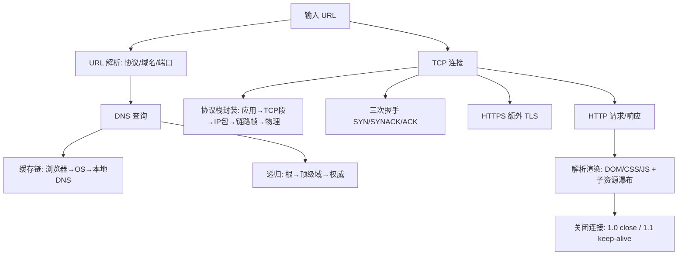

# 1853 从输入 URL 到页面 深挖

> 覆盖源 18-53 全文：URL 解析、DNS 查询、TCP 封装与三次握手、HTTPS/TLS、HTTP 请求响应、渲染、连接关闭。主卡已拆成 DNS、TCP 连接、HTTP 渲染关闭三张，本附录做端到端串联与取舍。

## 思路与架构

## 方案取舍
- **缓存链 vs 递归**：缓存命中即短路省递归 RTT；递归由本地 DNS 代发，客户端不直连根，降低根服务器压力。
- **close vs keep-alive**：短连接每请求一握手（TCP+TLS 成本高）；长连接复用省握手，但占连接数、需防队头阻塞。
- **HTTP/1.1 vs HTTP/2**：1.1 长连接仍串行（队头阻塞）；2 多路复用单连接并发流，进一步降延迟。

## 答题技巧
- 被问「输入 URL 到页面」按「DNS→TCP→TLS→HTTP→渲染→关闭」七步展开，比零散背显体系 [经验]。
- 主动边界到 `1840-tcp-*`（TCP 头部/状态机/四次挥手只引不重述），构成网络全栈 [边界]。
