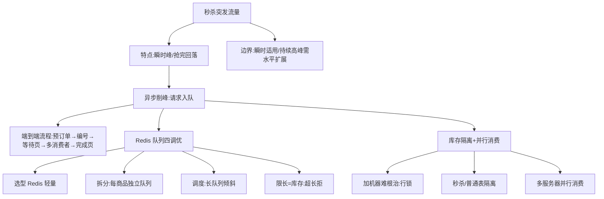

# 194 秒杀突发流量应对 深挖

> 覆盖源 19-4 全文：从「流量特点」到「异步削峰」到「Redis 队列调优」到「库存隔离与并行消费」的完整方案。主卡已拆成端到端流程、Redis 队列调优、库存隔离三张，本附录做横向串联与取舍。

## 思路与架构

## 方案取舍
- **Redis vs MQ**：秒杀排队轻量、要按号定位进度 → Redis 列表；通用解耦异步 → MQ。本源选 Redis，与 195（MQ 削峰）互补不冲突。
- **限长=库存 vs 无限**：限长把无效请求挡在 DB 外，代价是多维护一个长度计数；无限则所有请求都打 DB。秒杀必选限长。
- **隔离 vs 混表**：隔离提速 + 解耦故障域，代价是多套表管理；混表省事但高负载互拖。秒杀必选隔离。

## 答题技巧
- 被问「怎么应对秒杀」先抛总纲：异步削峰 + 队列调优 + 库存隔离，再展开，显出体系化 [经验]。
- 主动声明边界：异步削峰只适合瞬时高峰，持续高峰（外卖）要水平扩展 —— 这一句能避开把方案套错场景的红旗 [经验]。
- 与 193（缓存）/195（MQ+singleflight）/196（HA 降级）串讲，构成秒杀全栈答案 [边界]。
