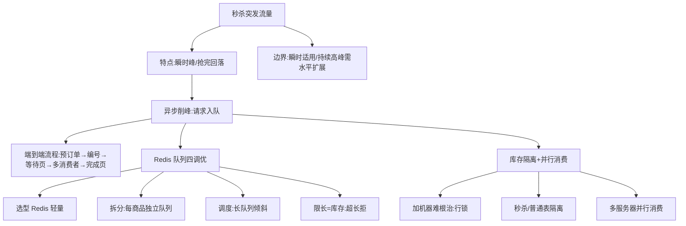

# 194 秒杀突发流量应对 深挖

> 覆盖源 19-4 全文：从「流量特点」到「异步削峰」到「Redis 队列调优」到「库存隔离与并行消费」的完整方案。主卡已拆成端到端流程、Redis 队列调优、库存隔离三张，本附录做横向串联与取舍。

## 思路与架构



## 方案取舍
- **Redis vs MQ**：秒杀排队轻量、要按号定位进度 → Redis 列表；通用解耦异步 → MQ。本源选 Redis，与 195（MQ 削峰）互补不冲突。
- **限长=库存 vs 无限**：限长把无效请求挡在 DB 外，代价是多维护一个长度计数；无限则所有请求都打 DB。秒杀必选限长。
- **隔离 vs 混表**：隔离提速 + 解耦故障域，代价是多套表管理；混表省事但高负载互拖。秒杀必选隔离。

## 答题技巧
- 被问「怎么应对秒杀」先抛总纲：异步削峰 + 队列调优 + 库存隔离，再展开，显出体系化 [经验]。
- 主动声明边界：异步削峰只适合瞬时高峰，持续高峰（外卖）要水平扩展 —— 这一句能避开把方案套错场景的红旗 [经验]。
- 与 193（缓存）/195（MQ+singleflight）/196（HA 降级）串讲，构成秒杀全栈答案 [边界]。

## 细节与核心 API

```lua
-- 令牌桶限流（Redis + Lua，原子取令）
local key = KEYS[1]
local rate = tonumber(ARGV[1])   -- 每秒生成令牌
local burst = tonumber(ARGV[2])  -- 桶容量
local now = tonumber(ARGV[3])
local t = redis.call('HMGET', key, 'last', 'tokens')
local last, tokens = tonumber(t[1] or 0), tonumber(t[2] or burst)
local delta = math.min(burst, tokens + (now - last) * rate / 1000)
if delta < 1 then return 0 end   -- 无令牌，拒绝
redis.call('HMSET', key, 'last', now, 'tokens', delta - 1)
return 1                          -- 放行
```
```go
// 调用：每请求 eval 一次，返回 0 直接 429；配合网关层限流 + 排队（MQ）削峰
// 漏桶 vs 令牌桶：漏桶平滑输出（强制速率），令牌桶允许突发（桶内有存量即放过）
// 选型：保护后端用令牌桶（容许合理突发）；严格平滑用漏桶
// 突发治理三层：接入层限流 -> MQ 排队缓冲 -> 后端按能力消费
```
