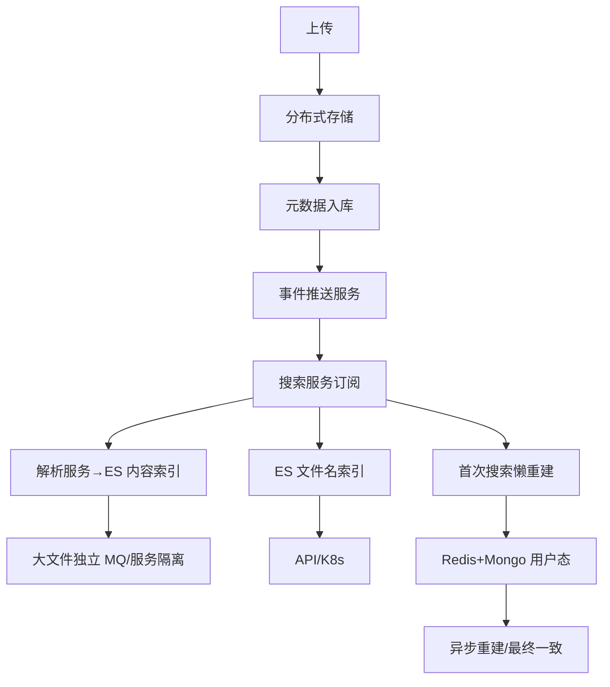

# 197 企业级网盘搜索架构 深挖

> 覆盖源 19-7 全文：端到端链路、文件名/内容索引分离、大文件隔离、首次搜索懒重建、用户态存储。主卡已拆成端到端、分离/大文件、首次重建三张，本附录做全景串联与取舍。

## 思路与架构

## 方案取舍
- **文件名 vs 内容索引**：按访问频率、成本、重建代价分离；内容搜索作会员权益，只对活跃付费用户建。
- **大文件隔离**：独立队列/解析/索引服务做背压，防长尾拖垮小文件 SLA；超大文件截断/放弃。
- **全量 vs 懒建**：搜索服务上线晚、非全员用，按用户首次使用懒重建，省海量计算/存储。

## 答题技巧
- 被问「搜索架构」按「写路径异步建索引 → 读路径走 ES → 成本/性能拆分决策」展开 [经验]。
- 主动边界到 `198`(ES mapping/shard/bool query)、`199`(搜索性能)、`1314`(doc 索引/查询 API)，构成网盘搜索全栈 [边界]。
