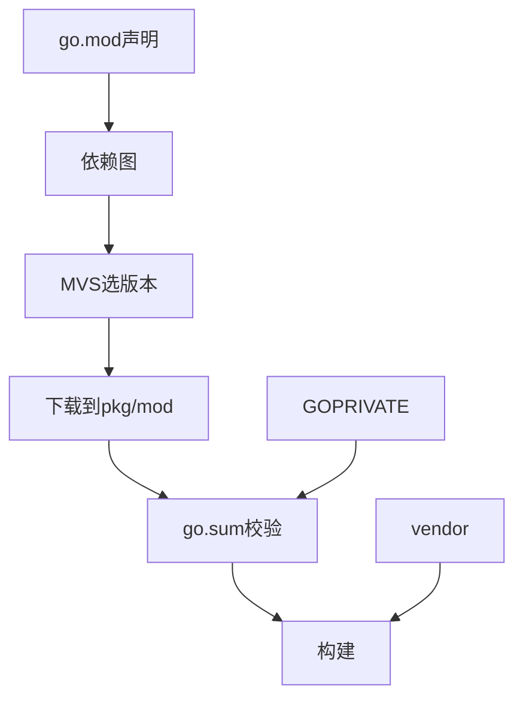

# 405 Go Modules 进阶 深挖附录

> 关联主卡：405-go111-module / 405-gomod-structure / 405-gosum-checksum / 405-vendor-mode / 405-gopath-vs-modules
> 深挖门槛命中：L3（版本选择 MVS + 校验机制 + vendor 权衡）+ 源码层（modload 依赖图解析）

## 思路与架构
Go Modules 的核心问题可拆成三块：声明（go.mod）、锁定（go.sum）、选取（MVS 最小版本选择）。切入顺序：先讲 go.mod 如何描述依赖图，再讲 go.sum 如何用哈希锁死内容，最后讲工具链如何按 MVS 从图中选出每个模块的唯一版本。

文字版：① go.mod 给出直接与间接依赖；② MVS 为每个模块选"所有要求中的最低可行版本"；③ 下载进 pkg/mod 缓存；④ 构建前用 go.sum 哈希比对，私包/vendor 可绕过 sumdb。

## 方案取舍
| 维度 | GOPATH 模式 | Go Modules | vendor 模式 |
|---|---|---|---|
| 版本并存 | 否（单版本） | 是 | 是（固化） |
| 可复现 | 弱 | 强（go.sum） | 最强（离线） |
| 网络依赖 | 需拉取 | 需代理/sumdb | 离线 |
| 维护成本 | 低 | 中（tidy） | 高（同步） |

选型结论：日常开发用 Modules+go.sum；强可复现/隔离环境用 vendor；GOPATH 已基本淘汰。不适用边界：超大 monorepo 用 vendor 会带来巨大 diff 与同步负担。

## 性能量级与实测数据
依赖解析（MVS 选版）在中等项目上是毫秒到秒级，`go mod tidy` 会遍历整张依赖图并触发网络查询，耗时随依赖规模增长 `[经验]`。go.sum 校验是本地哈希比对，开销极低。验证：`time go mod tidy` 对比有无缓存的耗时，go1.22。

## 答题技巧

## 细节与核心 API
- `go mod init <name>`：初始化生成 go.mod，name 建议用仓库路径 `[源码]`。
- `go mod tidy`：补齐缺失依赖、删除未用依赖，重写 go.mod/go.sum。
- `go mod download`：按 go.mod/go.sum 把依赖拉进本地缓存。
- `go mod vendor`：复制依赖到 vendor/，生成 vendor/modules.txt。
- `go mod graph` / `why` / `verify`：查依赖图、解释依赖原因、离线复核。
- `replace` 指令：把某模块重定向到本地路径或另一版本，常用于临时修复/私有 fork `[源码]`。
- `GOPROXY`：模块代理，多个用逗号分隔，`direct` 表示直连 VCS。

- 30 秒版：go.mod 声明、go.sum 锁哈希、MVS 选版本、缺失走 GOPROXY 与 sum.golang.org。
- 3 分钟版：补伪版本三段、go.sum 两类行、GOPRIVATE/GOSUMDB/vendor 三种免校验、replace 用法。
- 白板版：画"go.mod→依赖图→MVS→pkg/mod→go.sum→构建"主线。
- 话术模板："模块模式靠 go.mod 描述、go.sum 锁内容、MVS 选版，私包用 GOPRIVATE，离线用 vendor。"
- 不会怎么接：诚实说"MVS 的精确平局规则我回去查官方文档"，不编版本冲突细节。

## 广度与深度延伸
- 横向：Rust 的 Cargo.lock（类 go.sum）、Node 的 package-lock.json、Java 的 Maven BOM。
- 纵向：src/cmd/go/internal/modload 的图构建与 MVS 实现、semantic import versioning（v2+ 须路径带 /v2）、GONOSUMCHECK 历史（已被 GOSUMDB 取代）。

## 反问环节
可反问："咱们私有模块走 GOPRIVATE 还是自建 proxies？CI 里用 vendor 还是直接拉代理？go.sum 改动有 code review 吗？"——体现供应链与可复现意识。
