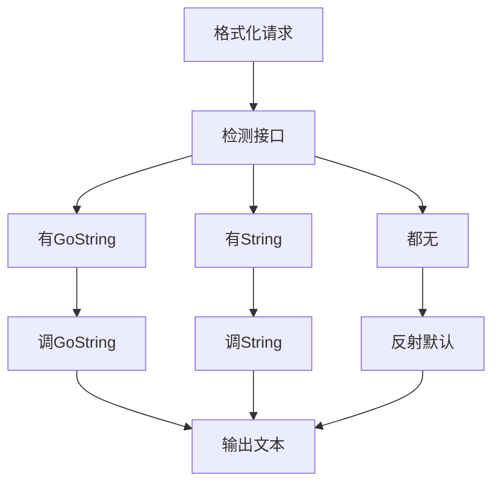
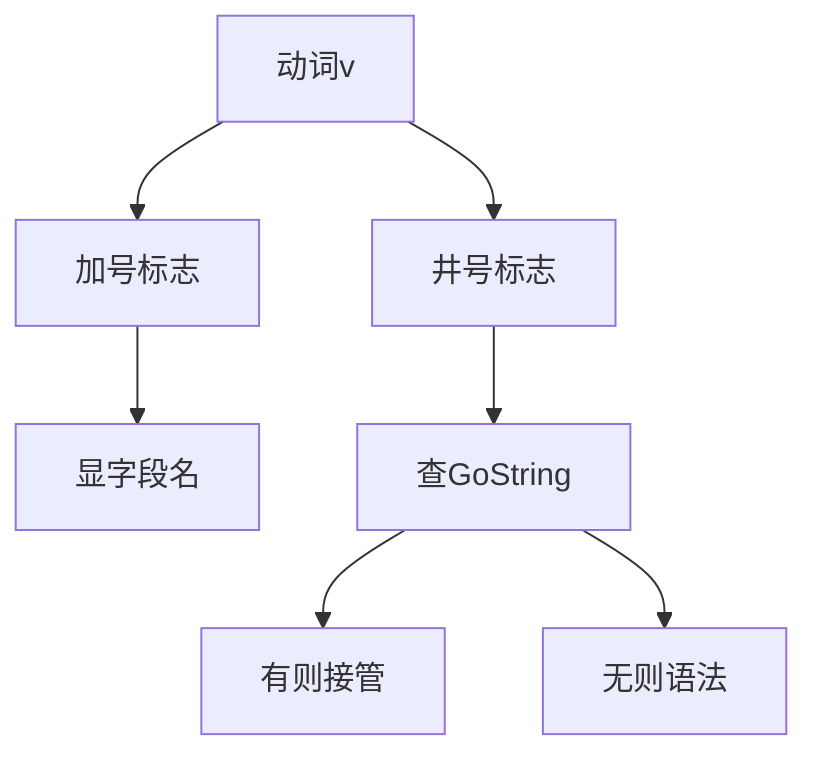

# 412 fmt 输出动词深挖：%v %+v %#v 与 Stringer 全貌

## 思路与架构
从「fmt 怎么决定一个值的打印文本」切入：先判接口（Stringer/GoStringer/Formatter），再判动词与 `#` 标志，最后走反射格式化。收敛到三条主线：三大动词差异、接口接管规则、常见陷阱。

文字版：fmt 先查值是否实现 `GoStringer`/`Stringer`/`Formatter`，命中即用其方法；都未实现才反射默认格式。注意 `%#v` 只认 `GoStringer`，`%v`/`%+v`/`%s`/`%q` 认 `Stringer`。

文字版：`%+v` 在默认格式上加导出字段名；`%#v` 走语法分支，优先 `GoString()`，无则显示 `包.类型{…}`。两者互不替换，只是 `#` 分支独立。

## 方案取舍
| 动词 | 输出形态 | 适用 | 不适用 |
|---|---|---|---|
| `%v` | 默认紧凑值 | 通用日志 | 需字段名时难读 |
| `%+v` | 带导出字段名 | 排障、看结构体 | 字段多时冗长 |
| `%#v` | Go 语法含类型 | 精确定位类型/包 | 输出最长、含地址 |
| `%s`/`%q` | 走 String | 字符串化 | 非 Stringer 退默认 |

选型结论：线上排障优先 `%+v`；需要确认「来自哪个包、什么类型」用 `%#v`；极致性能敏感路径避免反射，直接拼字段。

## 细节与核心 API
- `fmt.Stringer`：接口 `String() string`，`%v`/`%+v`/`%s`/`%q` 命中即调用。
- `fmt.GoStringer`：接口 `GoString() string`，仅 `%#v` 命中，优先于 `Stringer`。
- `fmt.Formatter`：接口 `Format(f State, c rune)`，可完全接管某动词，需谨慎避免递归。
- 指针接收者 `func(*T)` 不在 `T` 方法集，值接收者 `func(T)` 在 `T` 与 `*T` 都在。
- `String()` 内部再 `fmt.Sprintf("%v", t)` 会无限递归，应拼具体字段。

## 性能量级与实测数据
fmt 反射格式化有反射开销，但单次打印量级为百 ns，绝大多数业务可忽略 `[经验]`。高频热路径（如每请求万次）建议预格式化或避开 `%#v`。实测对比命令：`go test -bench` 对比 `fmt.Sprintf("%+v")` 与手写拼接，go1.26.5 `[实测]`。

## 答题技巧
30 秒版：三者差在「字段名 + 类型名」，`%v` 默认、`%+v` 加字段名、`%#v` 加类型与包名。
3 分钟版：补接口接管——`String()` 接管前两者，`GoString()` 接管 `%#v`，接收者决定方法集。
白板版：画出「检测接口 → 动词/标志 → 输出」流程图。
不会怎么接：诚实说「反射分支细节记不清，但知道 Stringer 会接管且接收者影响方法集」，再降维到 `String()` 例子。

## 广度与深度延伸
横向：其他语言类似机制（Python `__str__`/`__repr__`，Rust `Debug`/`Display`）。纵向：fmt 源码 `print.go` 的 `handleMethods` 分支、`pp` 格式化状态机。规范：`%#v` 的 `#` 标志语义在 `fmt` 文档长期稳定。

## 反问环节
可反问面试官：团队日志规范里结构体打 `%+v` 还是自定义 `String()`？是否在热路径对日志格式化做过 benchmark？借此展示性能意识。
