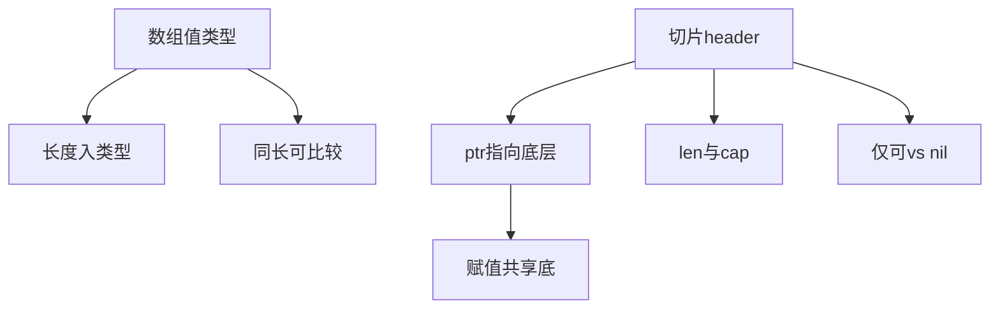

# 415 数组与切片区别（二） 深挖附录

> 关联主卡：415-slice-header-struct / 415-slice-assign-share / 415-array-slice-compare / 415-nil-slice-vs-array / 415-array-literal-index
> 深挖门槛命中：L3（底层结构 + 共享副作用 + 比较/类型系统）+ 源码层（slice header）

## 思路与架构
本篇承接"一"补底层与陷阱：数组是值类型、长度入类型；切片是 header（ptr/len/cap）指向底层数组。所有"引用类型"错觉都来自 header 拷贝 + 底层共享。切入：结构 → 赋值/传参 → 比较 → nil → 字面量下标。

文字版：① 数组整体进内存、长度是类型一部分；② 切片三字段，ptr 是真正的门；③ 赋值只拷 header，底层数组共享是副作用根源；④ 切片比较受类型系统限制只能 vs nil；⑤ 数组下标须编译期常量。

## 方案取舍
| 维度 | 数组 | 切片 |
|---|---|---|
| 类型 | 长度入类型 | 长度不入 |
| 传递 | 整体值拷贝 | header 拷贝+共享 |
| 比较 | 同长可 == | 仅 vs nil |
| 扩容 | 不可 | append 可 |
| 适用 | 定长小数据 | 动态序列 |

选型结论：定长、需比较、拷贝即独立用数组；动态、共享、流式用切片。不适用边界：大数组值拷贝代价高，宜用切片或指针。

## 细节与核心 API
- `reflect.SliceHeader{Ptr,Len,Cap}`：切片三字段定义 `[源码]`。
- `unsafe.Sizeof([]int{})`：64 位下 24 字节 `[源码]` runtime。
- `append`：超 cap 分配新底层数组，可能分裂 `[源码]`。
- `copy(dst,src)`：按最小长度拷贝元素，不共享。
- `[...]T{}`：编译期推断数组长度。
- `reflect.DeepEqual` / `bytes.Equal`：比较切片内容。

## 性能量级与实测数据
切片 header 拷贝是 24 字节值拷贝，开销可忽略；真正代价在底层数组共享导致的意外写扩散与 append 扩容分配 `[经验]`。具体分配次数随 cap 增长策略变化，未实测标记 `[存疑]`。验证：`go test -bench` 对比大数组值传参 vs 切片传参的拷贝成本。

## 答题技巧
- 30 秒版：数组值类型长度入类型、同长可比较；切片是 ptr/len/cap 头、共享底层、仅可 vs nil。
- 3 分钟版：补 header 拷贝导致共享、append 超 cap 分裂、nil 与空切片差异、下标须常量。
- 白板版：画"slice header(ptr/len/cap) → 底层数组"与"array 整体"两图对比。
- 话术模板："切片不是引用类型，是 header 拷贝+底层共享；数组才是真值类型。"
- 不会怎么接：诚实说"扩容具体阈值按 runtime 策略，我不编精确数"，不臆造数值。

## 广度与深度延伸
- 横向：C 数组、Rust 的 `&[T]`/`Vec<T>`、Python list（均含长度+指针）。
- 纵向：`runtime` 切片扩容源码、`reflect.SliceHeader` 与 `unsafe` 注意事项。

## 反问环节
可反问："咱们大对象传递偏向数组值拷贝还是切片？有没有因切片共享底层数组踩过并发改同一底层数组的坑？"——体现内存与并发意识。
