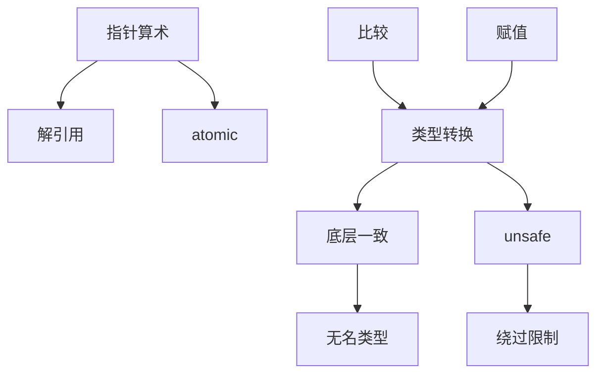

# 503 Go 指针限制深挖

> 分类：语法 | 难度：L3 | 题型：原理题 | 频率：中 | 关键词：**指针限制** / **unsafe.Pointer** / **可寻址性**
> 原文锚点：第 44~122 段「不可寻址的值 / 四大限制 / unsafe 打破限制」

## 思路与架构
Go 的指针限制是一个"约束收敛"体系：先用语言规范卡住四类高危操作，再把一个逃生舱（`unsafe.Pointer`）留给底层必要场景。四条限制（算术、转换、比较、赋值）本质同源——都由"类型系统的可赋值性/可比性"推导出来。

- 节点说明：算术被禁后，合法改值路径只剩"解引用"或"atomic"两条；转换受"底层一致+无名类型"约束，绕不过才用 unsafe。
- 比较与赋值的判定条件和转换同源，记住一个规则即记住全部。
- unsafe 是统一出口，但它脱离类型系统，属于最后手段。
- 收敛的目的在于内存安全，代价是失去 C 式底层灵活性。

## 方案取舍
| 方案 | 安全性 | 灵活性 | 适用场景 |
|---|---|---|---|
| 受限指针（规范内） | 高，编译期保证 | 低，禁止算术/随意转换 | 日常业务代码，默认选择 |
| C 式指针（指针算术） | 低，易越界野指针 | 高，可底层遍历 | 系统编程、CGO 边界 |
| unsafe.Pointer | 无，脱离类型系统 | 最高 | 与 C/系统调用交互、性能 hack |

选型结论：业务代码一律走规范内受限指针；只有确需与 C、内核、内存布局交互时才动 unsafe，且转换必须紧邻、不留 `uintptr` 中间态。不适用边界：任何"图省事"而用 unsafe 绕过类型检查的场景都属于误用。

## 性能量级与实测数据
指针解引用本身是单条内存访问，与 C 同级，运行时开销可忽略 `[经验]`。Go 与 C 的指针差异不在运行期速度，而在**编译期约束**：Go 用规范禁止算术与随意转换，换取内存安全；这部分是"免费"的，不引入运行期成本。无需专门 benchmark，除非涉及 unsafe 批量改内存布局才需实测。

## 答题技巧

## 细节与核心 API
- `new(T)`：返回 `*T`，指向 T 的零值，是获取指针的标准途径 `[源码]`。
- `&x`：取地址运算符，仅对**可寻址**的值合法，否则编译报错 `[源码]`。
- `reflect.Value.CanAddr()`：运行时判断值是否可寻址，调试与反射常用 `[源码]`。
- `unsafe.Pointer` 四规则：任意 `*T`↔`unsafe.Pointer`；`unsafe.Pointer`↔任意类型指针；`uintptr`↔`unsafe.Pointer`；同一对象二者同址 `[源码]`。
- `sync/atomic.AddInt64(&x, 1)`：对指针所指值的并发安全自增，是"不能算术"下的合规替代 `[源码]`。
- 不可寻址的值：map 元素、字符串字节、常量、函数、方法值；可寻址的：变量、可寻址结构体字段、可寻址切片元素、数组、指针解引用 `[源码]`。

- 30 秒版：Go 指针不能做算术，不能随意转换/比较/赋值，要跨类型只能用 unsafe，但官方不推荐。
- 3 分钟版：讲清四条限制 + 转换/比较/赋值同源于可赋值性规则 + unsafe 四规则与 uintptr 悬垂陷阱。
- 白板版：画"算术→解引用/atomic"、"转换→底层一致+无名→unsafe"的收敛链。
- 话术模板："限制的本质是类型安全，不是性能；unsafe 是逃生舱不是常规工具。"
- 不会怎么接：承认"跨底层类型的精确转换细节我记不准，但规范原则是类型安全，极端场景用 unsafe 并参考 go spec"，不编造具体 API。

## 广度与深度延伸
- 横向：C 指针可自由算术与 cast，灵活但易越界；Rust 用借用检查在编译期保证类似安全，比 Go 更严格。
- 纵向：可寻址性（Addressability）是 Go 规范独立一节，决定 `&x` 是否合法，与"取地址"和"方法集"都相关；源码见 `go/types` 与 spec "Address operators"。
- 延伸：多维指针（**T）可读性差，仅在"函数内改指针本身"时必要，是 Go 里少数需二维指针的场景。

## 反问环节
可反问面试官：团队里有没有因 unsafe 误用（如 uintptr 悬垂）导致的线上事故？借此展示你对 unsafe 陷阱的真实认知，也把话题引向你熟悉的实战面。
