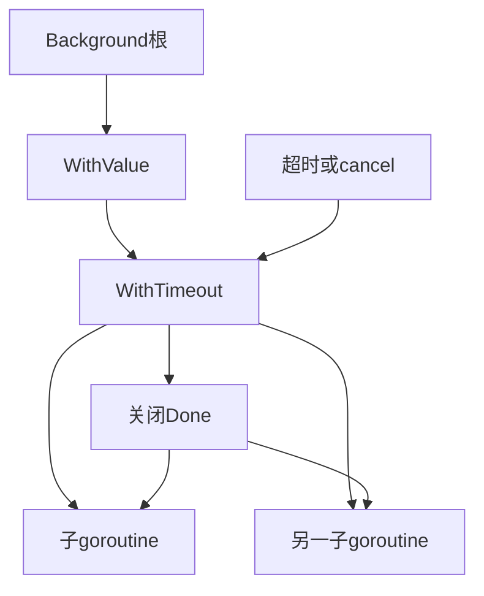

# 602 Context 最佳实践 深挖附录

> 关联主卡：602-context-interface / 602-context-cancel-propagation / 602-withvalue-timeout / 602-context-best-practices / 602-context-data-abuse
> 深挖门槛命中：L3（派生链机制 + 取消协作性 + 版本演进）+ 源码层（context 树与 cancel 传播）

## 思路与架构
Context 本质是一棵不可变的派生树：每个 WithXxx 都产生一个子节点，子节点持有父节点的引用；取消时父节点调用 cancel 关闭自身 Done 并通知子节点，形成"父取消→子收尾"的协作链。切入顺序：接口契约 → 派生函数 → 取消传播 → 使用纪律。

文字版：① Background/WithCancel 是根；② WithValue/WithTimeout 在树上叠加能力；③ 同一父的两个子都能收到取消；④ 取消只关 Done，需子自己 return。

## 方案取舍
| 维度 | context 取消 | 直接 channel 取消 | 全局退出标志 |
|---|---|---|---|
| 透传性 | 强，随调用链 | 需手动传 | 弱，需共享变量 |
| 超时 | 内建 WithTimeout | 自写 timer | 无 |
| 数据 | WithValue 携带 | 另传 | 另传 |
| 可读性 | 高（约定俗成） | 中 | 低 |

选型结论：请求链路一律用 context；纯内部后台任务可用 channel 自管。不适用边界：长生命周期后台协程不应绑定请求 context，否则请求结束即被取消。

## 细节与核心 API
- `context.Background()`：空根 ctx，main/入口用。
- `context.WithCancel(parent)`：返回子 ctx 与 cancel，调用 cancel 关 Done `[源码]`。
- `context.WithTimeout/WithDeadline`：带截止，到点自动 cancel。
- `context.WithValue(parent, key, val)`：挂键值，仅请求元数据。
- `ctx.Done()`：只读 channel，关闭即信号；`ctx.Err()` 取原因。
- `context.WithoutCancel(parent)`：go1.21 新增，派生不随父取消的 ctx `[源码]`。
- `context.AfterFunc`：go1.21 新增，ctx 取消时触发回调 `[源码]`。

## 性能量级与实测数据
context 派生根本身轻量：WithXxx 仅构造小结构体并复制父引用，无锁复制 `[源码]`。取消的代价在于需要每个阻塞点主动 select Done，若 goroutine 数量巨大且都监听同一 ctx，cancel 时需唤醒全部监听者，呈 O(n) `[经验]`。验证：用 `go test -bench` 对比派生 1k/10k 层 ctx 的 cancel 延迟，go1.22。

## 答题技巧
- 30 秒版：context 是派生树，父 cancel 关 Done，子 select 收尾；作为参数第一个传、别存 struct、别存敏感数据。
- 3 分钟版：补四方法语义、WithTimeout=WithDeadline 封装、cancel 必须调用、Value 用自定义 key。
- 白板版：画"Background→WithXxx→子 goroutine"的树，标 cancel 信号沿边下行。
- 话术模板："入口 WithCancel/WithTimeout，透传第一参数，阻塞处 select Done，错误即 cancel。"
- 不会怎么接：诚实说"WithoutCancel 是 1.21 才加的，老版本没有"，不编 API。

## 广度与深度延伸
- 横向：Java 的 ThreadLocal（数据而非取消）、Python 的 contextvars（异步上下文）。
- 纵向：src/context/context.go 的 cancelCtx 定时器与 children map、propagateCancel 的父子挂接、timerCtx 的 stop。

## 反问环节
可反问："咱们请求链路里 context 是在哪一层创建的，子 goroutine 的取消有没有遗漏监听？超时是统一 middleware 设还是各 handler 自设？"——体现生命周期治理意识。
