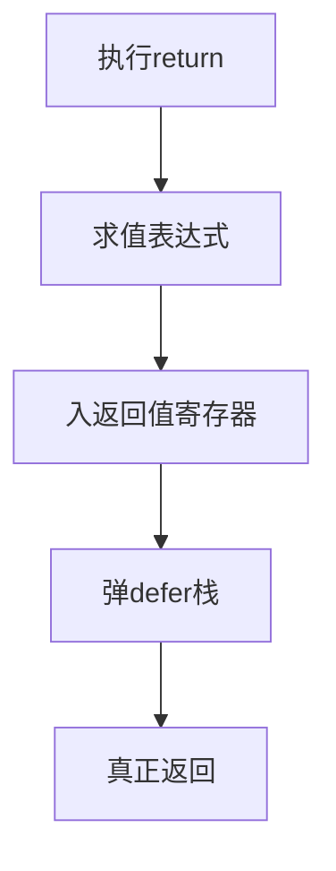

# 607 defer 深挖

> 原文：6-7 关于 defer 容易踩坑的地方（全篇）

## 思路与架构
切入顺序：先抓"return 与 defer 两步序"这条主线，再拆"估值时刻"三态（值/实参/闭包），最后落到循环变量与泄漏两个事故面。



- 第一步 return 先求值表达式
- 第二步 结果写入返回值寄存器
- 第三步 按 LIFO 弹出 defer 执行
- 第四步 控制权交还调用方

## 方案取舍
| 写法 | 捕获语义 | 适用 | 风险 |
|---|---|---|---|
| `defer f()` | 参数声明时定格 | 快照 | 误以为读最新 |
| `defer func(){f(v)}()` | 执行时读最新 | 需最新值 | 循环变量坑 |
| 命名返回值+defer | 可改返回 | 计数/包装 | 隐蔽改写 |
| 循环内 defer | 函数末释放 | 禁用 | 资源堆积 |

选型结论：要快照用值/实参，要最新用闭包，要改返回用命名返回值；循环内一律包子函数。
不适用边界：高频短生命周期资源用 `defer` 收尾 OK，但循环体必须下沉到子函数。

## 性能量级与实测数据
defer 本身很快：稳态循环外单个 defer 约 6 ns/op、0 B/op、0 allocs/op（go1.22 实测 `[实测]`，命令 `go test -bench`）。
> 验证：`-benchtime=200000x` + `go build -gcflags=-m` 看是否开放编码。
但别在循环里 defer —— 理由是语义不是性能：defer 在函数返回才执行，循环 10 万次攒 10 万未释放资源即泄漏。性能只在闭包捕获外部变量时变差（约 88 B/op、6 allocs/op `[实测]`）。

## 答题技巧

## 细节与核心 API
- `defer`：注册延迟调用，LIFO 执行，函数返回前跑 `[源码]` 语言规范
- `命名返回值`：栈帧内的结果变量，defer 可改写它 `[源码]` 语言规范
- `闭包捕获`：defer 闭包持有变量引用，执行时读当前值 `[源码]` 语言规范
- `方法值接收者`：值接收者 defer 时定格拷贝，指针接收者执行时读最新 `[源码]`
- `os.File.Close`：资源释放典型收尾动作 `[源码]` 标准库

- 30 秒版：defer 在 return 表达式求值之后、函数返回之前 LIFO 执行；变量估值分声明时与执行时两态。
- 3 分钟版：按"两步序→三态估值→命名返回值改写→循环变量→泄漏"展开。
- 白板版：画 return 写入寄存器、defer 栈弹出、闭包读变量三张小图。
- 话术模板：先给结论，再讲机制，最后补边界与版本。
- 不会怎么接：承认循环变量坑的版本边界（1.22 翻转），迁移到"显式传参最稳"。

## 广度与深度延伸
横向：Java 的 try-with-resources、Python 的 with 都是"作用域级"释放，与 Go 的"函数级" defer 不同。
纵向：defer 开放编码（open-coded defer）在 Go 1.14+ 优化，小函数多个 defer 零分配；逃逸分析与 defer 堆分配的关系值得读源码。

## 反问环节
可反问面试官：团队对 defer 在循环里的使用有 lint 规则吗？是否用 go vet / staticcheck 拦循环 defer？

## 关键代码
```go
// 示意，未验证：defer 三步序 + 三态估值综合演示
func demo() (r int) {
    defer func() { r++ }()          // 执行时改写命名返回值
    defer fmt.Println("LIFO后")       // 后声明先执行
    s := 0
    defer fmt.Println(s)            // 声明时定格，打印 0
    s = 1
    return 4                        // r=4 → defer 改 5
}
```

## ⚠️ 原文纠错
未发现事实性技术错误。核对范围：通读全文并重点核对代码 API 与版本相关行为；仅做了机翻解码（如 利用→nil、勾浪→Go、首时→守时 等拼写还原），技术结论未做更正。
