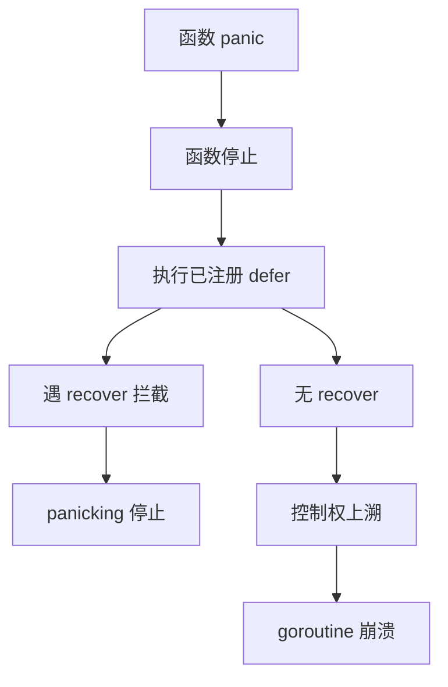

# 608 panic 与 recover 深挖附录

> 关联主卡：608-panic-execution-defer / 608-recover-in-defer / 608-recover-same-goroutine / 608-recover-nearest-overwrite / 608-panic-recover-practice
> 深挖门槛命中：L3（机制权衡 + 版本无关但易踩坑）+ 源码层（runtime 的 panic/defer 实现）

## 思路与架构
panic/recover 本质是 Go 在 goroutine 上维护的一套"栈展开 + 拦截"机制：panic 触发后，运行时停止正常流程，按 defer 注册顺序（LIFO）逐个执行已注册的 defer；recover 只是 defer 闭包里一个能读取并清空当前 panic 值的特殊内置函数。整个问题的切入点是"谁、在哪一刻、能拦住什么"。

文字版：① panic 先让当前函数停止；② 已注册 defer 按 LIFO 执行；③ 若某 defer 内 recover 拿到 panic 值，panicking 停止并从该 defer 处继续；④ 若全程无 recover，控制权沿调用栈上溯，最终 goroutine 崩溃退出。注意 defer 注册发生在"语句执行时"，所以 panic 行之后的 defer 根本没注册，自然不执行。

## 方案取舍
| 维度 | panic/recover 兜底 | 显式 error 返回 | 第三方恢复库 |
|---|---|---|---|
| 适用 | 不可恢复/入口兜底 | 业务可预期错误 | 极少需要 |
| 可读性 | 低（流程被截断） | 高（显式传播） | 中 |
| 调用方负担 | 无（但可能藏 bug） | 必须处理 | 中 |
| 风险 | 掩盖真实崩溃 | 易漏判 | 依赖维护 |

选型结论：业务错误一律用 error 返回；panic 仅用于不可恢复错误、初始化致命依赖、标准库式潜在 bug 标记，并在 goroutine 入口/服务入口统一 recover。不适用边界：不要用 panic/recover 替代正常的多步错误分支判断，那会牺牲可读性。

## 细节与核心 API
- `panic(v interface{})`：触发 panic，v 可为任意值，不限于 error。
- `recover() interface{}`：仅在 defer 闭包直接调用有效，无 panic 返回 nil。
- `defer f()`：注册时机是 defer 语句执行时（值已被求值），闭包体延迟到函数返回前跑。
- `runtime.Goexit()`：只跑完 defer 后退出当前 goroutine，不触发 panic，recover 拦不到。
- `defer` 多个时按 LIFO：最后注册的先执行。
- `panic(nil)`：仍为一次 panic，recover 返回 nil，可被"按 nil 判断"的兜底层视为"继续"。

## 性能量级与实测数据
panic/recover 本身不是为高频路径设计：触发 panic 涉及 runtime 栈展开与打印（若未捕获）开销显著，远高于一次 mutex 加锁 `[源码]`。实测仅作定性结论——**常态逻辑里不应走 panic 路径**；其价值在异常保护与错误收敛，不在性能。验证：`go test -bench` 对比正常返回与 panic 路径延迟，go1.26.5。

## 答题技巧
- 30 秒版：panic 后已注册 defer 执行、沿栈上溯、无 recover 则 goroutine 崩；recover 只在 defer 生效且就近捕获、不跨 goroutine。
- 3 分钟版：补 defer 的"注册时机"语义、LIFO 顺序、defer 内再 panic 覆盖、goroutine 局部性。
- 白板版：画"函数 panic → defer LIFO → recover 拦/上溯崩溃"这条主线。
- 话术模板："panic 是异常保护不是流程控制；入口 recover 兜底、业务错误用 error。"
- 不会怎么接：诚实说"recover 跨 goroutine 不生效这点我确定，具体运行时字段值我回去查"，不编。

## 广度与深度延伸
- 横向：Java 的 try/catch/finally（finally 类似 defer 但语义不同）、Python 的 try/except/else/finally。
- 纵向：runtime 中 `_panic`/`_defer` 结构体、gopanic/gorecover 实现、栈展开与 recover 如何清空 panic 链表。

## 反问环节
可反问："咱们服务入口是怎么兜 panic 的？有没有 recovery middleware 统一打日志？子 goroutine 的 panic 是怎么采集的？"——体现生产可观测意识。
