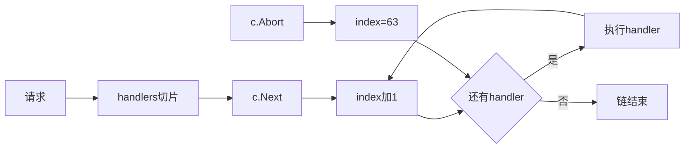

# 706 Gin 中间件处理链实现深挖：切片合并、Next 与 Abort

> 分类：网络与 IO | 难度：L3 | 题型：原理题 | 频率：中 | 关键词：**combineHandlers** / **index 自增** / **abortIndex 哨兵** / **作用域**
> 原文锚点：第 126~157 段「rootgroup.Use append…combineHandlers 合并…Next for 循环…Abort 置 index」

## 思路与架构
从"一条 HTTP 请求如何流过多个函数"切入：注册阶段把组级与路由级函数合并成一个 handlers 切片；执行阶段靠 c.index 在切片上递进，Next 前进、Abort 跳到末尾，从而支持拦截/短路。

- Use/Group/Handle 都走 combineHandlers 拼成一条链。
- Next 前进、Abort 置哨兵，二者都作用在 index 上。

## 方案取舍
| 方式 | 收益 | 代价 | 适用 |
|---|---|---|---|
| 切片顺序执行 | 无反射/无递归，O(n) 线性 | 中途改链麻烦 | 通用 |
| Next 显式调用 | 中间件可前后插逻辑 | 忘记 Next 就断链 | 日志/耗时 |
| Abort 置 index | 短路零异常开销 | 需手动 return | 鉴权/限流 |
| 组级合并 | 作用域清晰 | 易误挂全局 | 分组 API |

选型结论：线性切片 + index 指针最轻量，Next/Abort 用同一 index 实现"继续/中断"两极。不适用边界：需要动态重排或并行执行时该模型不合适 `[经验]`。

## 细节与核心 API
- `RouterGroup.Use(ms ...HandlerFunc)`：把中间件 append 到 `group.Handlers` `[源码]`。
- `combineHandlers`：拼接 `group.Handlers` + 当前 handlers，总数超上限（~63）会 panic `[源码]`。
- `c.handlers`：最终合并后的 HandlerFunc 切片，按序执行 `[源码]`。
- `c.Next()`：`index++` 后 for 循环调用剩余 handler `[源码]`。
- `c.Abort()`：`c.index = abortIndex`（gin 固定 63 哨兵）`[源码]`。
- `c.AbortWithStatus(code)`：Abort 同时写响应状态码 `[源码]`。

## 性能量级与实测数据
- 中间件链是线性切片遍历，无反射、无递归，单跳 O(1)，整链 O(n)（n=链长）`[经验]`。
- 合并阶段在注册时完成，运行期零合并开销 `[源码]`。
- 原文未给基准数字，以上为结构推断，非本批实测 `[存疑]`。

## 答题技巧
- 30 秒版：handlers 切片 + Next 推进 index + Abort 置哨兵终止循环。
- 3 分钟版：展开注册合并（combineHandlers）+ 执行循环 + Abort 非异常短路。
- 白板版：画切片下标 0..n，标 Next 前进箭头、Abort 跳到末尾。
- 话术模板："Gin 把中间件和 handler 拼成一条切片，Next 用 index 往后走，Abort 把 index 跳到末尾。"
- 不会怎么接：承认细节有限，但从"切片 + 下标"讲清继续/中断两种控制。

## 广度与深度延伸
- 横向：对比 Express/Koa 的洋葱模型（也是切片+next，但靠回调串联）。
- 纵向：读 gin `context.go` 的 `Next`/`Abort` 与 `routergroup.go` 的 `combineHandlers`。

## 反问环节
- 可反问："贵司中间件顺序是怎么约定的？Recovery/Logger/鉴权一般挂在全局还是分组？"
