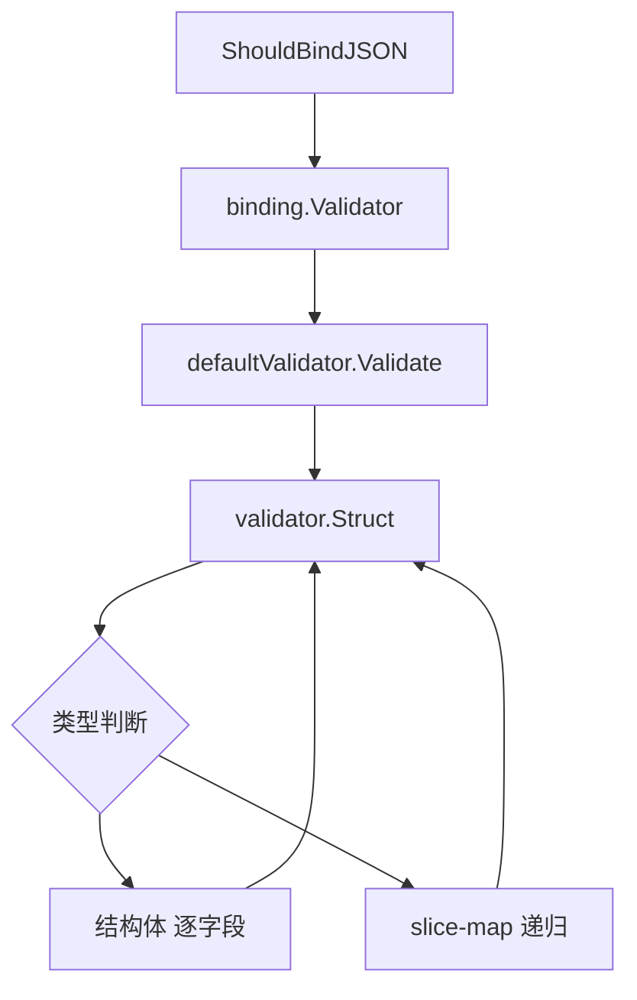

# 707 Gin 参数校验实现原理（深挖）

> 分类：Web框架 | 难度：L3 | 题型：原理题 | 频率：中 | 关键词：**反射递归** / **validateStruct** / **lazyInit-tagName**
> 原文锚点：第 133~154 段「shouldbandwith…vledatestruck递归调用…lazyNIT设置tagname=binding」

## 思路与架构
Gin 的 `ShouldBindJSON` → `binding` 包 → 默认 `defaultValidator` → 第三方 validator/v10 的 `Struct` 方法。核心是一条「反射驱动、递归下降」的校验链：先 nil 判断，再按类型（结构体/指针/slice/数组/map）分派，结构体逐字段读取 `binding` 标签并递归校验子结构。

- 入口 `ShouldBindWith` 落到 `binding` 包，`b.Bind` 调用 `ValidateStruct`。
- `ValidateStruct` 对入参做 nil 与类型判断，非指针/结构体/slice/array/map 直接退出递归。
- 结构体字段递归调用自身 `Struct`，退出条件为「值为 nil」或「类型不属于上述几类」。
- 每个字段的错误收集进 `ValidationErrors`（原文「RETET」即 result）。

## 方案取舍
| 方案 | 优点 | 缺点 | 适用 |
|---|---|---|---|
| 反射（validator 现状） | 零代码生成、标签即规则 | 运行时反射有开销、错误信息需翻译 | 绝大多数 Web 项目 |
| 代码生成（如 protoc/ozzo 预编译） | 编译期检查、更快 | 增加构建链路、灵活性低 | 超高性能/强类型场景 |
| 手写 if 校验 | 完全可控、易调试 | 样板代码多、易漏字段 | 极简单结构 |

选型结论：`binding`+反射在「开发效率 vs 性能」上取了开发效率，秒杀级 QPS 下反射开销通常远小于网络/DB，不必过早优化。**不适用边界**：字段级极致性能要求或需要编译期保证规则不被误删时，反射方案吃亏。

## 细节与核心 API
- `validator.New()`：构造校验器，lazyInit 时把 `tagName` 设为 `"binding"`。
- `Validate.Struct(ptr)`：反射入口，必须传可取地址的值。
- `RegisterValidation(name, fn)`：注册自定义规则，fn 签名为 `func(FieldLevel) bool`。
- `SetTagName("json")`：改默认标签名，让校验跟随 json 标签。
- `ValidationErrors`：错误集合，每条 `Field()`/`Tag()`/`Param()` 可定位失败点。
- `Engine()`：Gin 暴露底层 `*validator.Validate` 实例的接口。

## 性能量级与实测数据
反射校验单次开销在结构体字段数量级上通常是百 ns~数 µs `[存疑]`：未在本机实跑，字段数与规则复杂度线性放大。结论：**不要为校验反射做过早优化**，瓶颈在 IO。若要量化，用 `go test -bench` 对真实结构体压测 [存疑]。

## 答题技巧
- 30 秒版：Gin 校验 = 封装 validator/v10，binding 标签 + 反射递归 Struct，错误进 ValidationErrors。
- 3 分钟版：讲清「反射驱动 → 类型分派 → 结构体逐字段递归 → 错误收集」，并点出 tagName 默认 binding、可 SetTagName。
- 白板版：画上面那张 flowchart。
- 话术模板：「它没自研，是 wrapper；核心在第三方库的 Struct 方法用反射读标签比对值。」
- 不会怎么接：坦诚「具体递归实现我没读过源码，但知道它反射 + 标签驱动、错误可断言类型」。

## 广度与深度延伸
- 横向：Java 的 javax.validation（JSR-380）、Python pydantic 同为声明式 + 反射/描述符。
- 纵向：读 `gin/binding/default_validator.go` 与 `go-playground/validator` 的 `struct.go` 看 `validateStruct` 与 `lazyInit`。

## 反问环节
可反问：「团队是否对校验错误做了统一翻译与告警？高并发下是否测过校验带来的额外延迟？」
